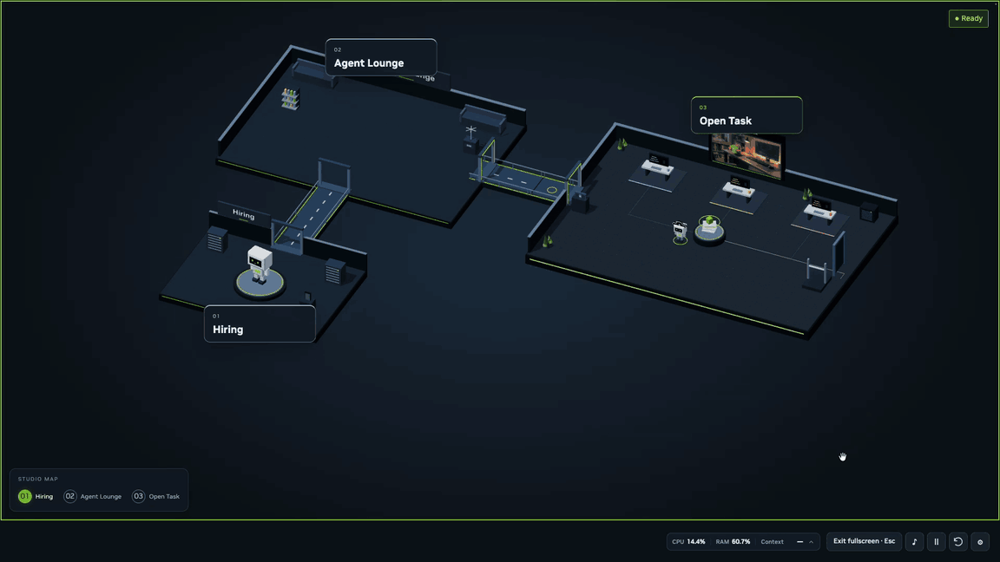
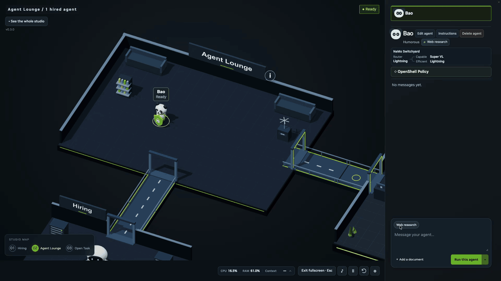
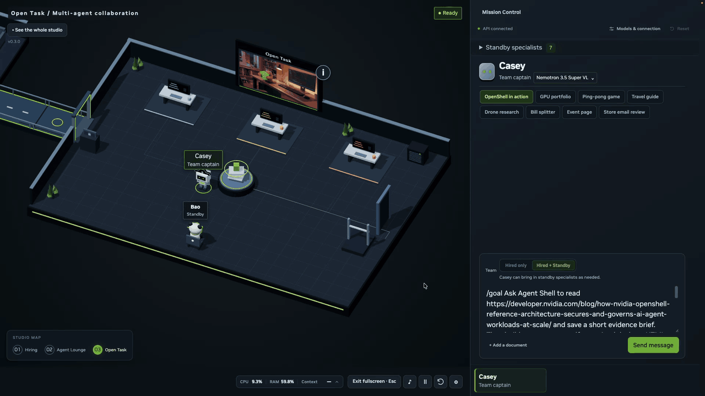

# Demo workflow

[Watch the full walkthrough (MP4, no-audio, 3 min 47 sec)](docs/media/studio-walkthrough.mp4)

## Demo journey

### 01 Hiring

**Target and intent:** Define who an agent is, what work its equipped skills authorize, which model it uses and whether OpenShell protects its runtime. This stage shows that role, tone, skills, model choice and runtime policy are separate controls.

**Workflow:** Choose an identity, role, tone, skills, model and optional OpenShell protection. Hire the agent and inspect its generated instructions.

**Advanced UI example:**

1. Select **Hiring** on the Studio map, then choose the **Web researcher** preset. Adjust **Tone** and **Role** to demonstrate personality without changing permissions.
2. Expand the skills and model controls. Keep **Web research**, then choose what runs behind the agent: a **Local** model, a fixed model from an **External Endpoint**, or **Model routing (NeMo Switchyard)** on an eligible NVIDIA endpoint. Local and fixed external model choices run without automatic routing; **Switchyard** uses the configured Router, Efficient and Capable roles to select a model for eligible requests. Enable **OpenShell protection** when you also want the sandbox and policy boundary. These choices determine the agent's tools, model route and execution boundary.
3. Select **Hire**. Click the new agent's portrait or name, then open **Instructions** or **Agent Files** to inspect `AGENTS.md`, `IDENTITY.md`, `SOUL.md` and the equipped skill. This connects the visible form to the runtime instructions OpenClaw receives.

### 02 Agent Lounge

**Target and intent:** Work with one agent directly and observe how identity, skills, tools and OpenShell policy affect a real request.

**Workflow:** Ask the agent to use one of its skills. With OpenShell protection enabled, demonstrate a blocked website request, approve that specific destination, and retry.

**Advanced UI example:**

1. Select **Agent Lounge**, then select the protected Web researcher you hired.
2. In the chat composer, ask it to read a specific public webpage and summarize three supported findings. Select **Send** to start an actual model-and-tool turn.
3. If access is blocked, open **OpenShell Policy** and inspect the requested destination and recorded decision. Approve only that website, close the panel and resend the same request. This demonstrates enforced policy rather than a model claiming that access was denied.
4. Inspect the reply, source links, generated files and status indicators. Use those records—not animation alone—as evidence of completed work.

### 03 Open Task

**Target and intent:** Demonstrate multi-agent orchestration. Casey turns one goal into skill-matched assignments, coordinates handoffs and returns a traceable result without assuming that every task requires the same team.

**Workflow:** Give Casey a goal that needs multiple skills. Follow specialist assignments in Mission Control, then inspect the final response, generated files, model usage and timing.

**Advanced UI example:**

1. Select **Open Task**, then choose the team:
   - **Hired only** restricts Casey to agents you created in Hiring.
   - **Hired + Standby** also lets Casey use the existing research, programming, analysis, design and review specialists. Casey prefers a suitable hire unless you explicitly request a standby specialist.
2. Choose how to provide the goal:
   - Enter an editable `/goal ...` request in Casey's chat.
   - Or select one of the [predefined Open Task scenarios](README_POSSIBLESCENARIOS.md) below Casey, review the populated request and sample attachment, then edit it before sending.
3. For an advanced walkthrough, set a location in Settings, hire agents with **Web research** and **Coding**, choose **Hired only**, select **Travel guide**, review the draft and select **Send**. Switch to **Hired + Standby** instead when you want the built-in specialists to fill missing expertise.
4. Open **Mission Control** to inspect why each participant was selected, its assignment, handoffs and any OpenShell approval pause. Open **Results** for the final response and saved files, then **Usage & time** for recorded models, tokens and timing.

The interface visualizes observed application and runtime events. Movement, badges and animations do not by themselves prove that a tool ran or that a security boundary was enforced; use the recorded activity, files and verification evidence described below.

## Presenting live

Before the session, check **Settings → Model** and **Location**, then [verify the demo](README.md#verification) on the presentation host. Use `./bac start --keep-data` when you want to keep a rehearsal.

If Casey pauses for [website access](docs/openshell-open-task.md), review the requested sites in **OpenShell Policy**, then select **Continue**. For a partial result, check the files already saved under **Results** before retrying. You can [copy diagnostics](docs/diagnostics.md#share-a-report) before [resetting the task](docs/runtime-settings.md#location-and-reset).
