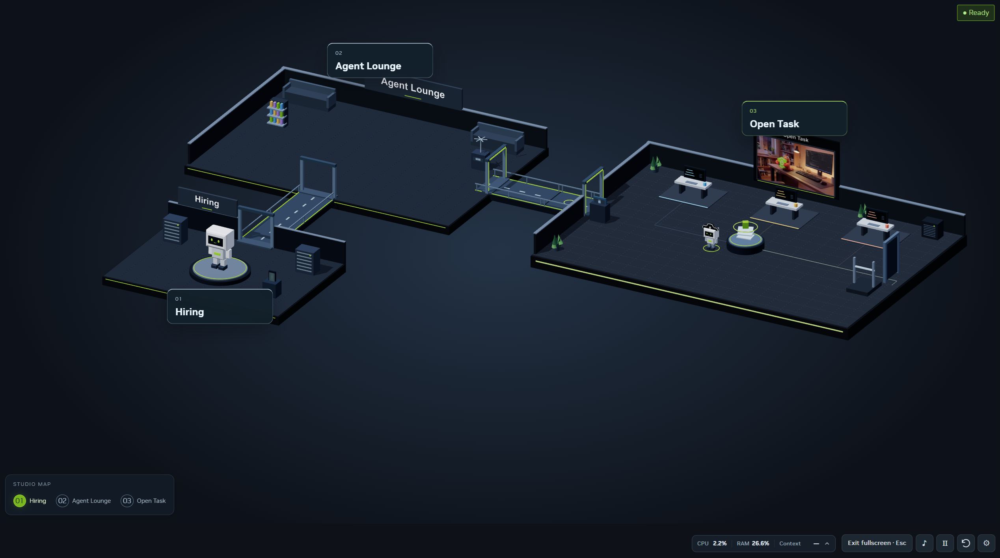

# Multi-Agent Studio

| Catalog field | Value |
| --- | --- |
| Description | Hire AI agents, chat with them in the Lounge, and give their team a task. Follow their work and open the result in the studio. |
| Industry | 🎓 Academia/Education |
| Requirements | Ubuntu 24.04 (AMD64 or ARM64), rootful Docker Engine 28+, Docker Compose 2.24+, internet for setup, and a model with tool calling. On Windows, run Docker Engine and Compose inside Ubuntu on WSL 2. |
| NemoClaw | N/A |
| Harness | OpenClaw 2026.11.3 |
| OpenShell | 0.1.4 |
| Collection | Build-a-Claw |



[See the demo in action](DEMO_WORKFLOW.md)

## Prerequisites

- Ubuntu 24.04 on AMD64 or ARM64. Windows users run Docker Engine and Compose inside Ubuntu on WSL 2.
- Rootful Docker Engine 28+ and Docker Compose 2.24+.
- Internet access during setup for container images and runtime packages.
- A local or hosted model that supports tool calling.
- A provider API key when using an external endpoint that requires one.

Hosted inference does not require a local GPU. Local inference needs hardware appropriate for the selected model and server.

## Quick start

1. Prepare a model that supports tool calling. For **Local**, start a compatible server such as vLLM, llama.cpp or Ollama. For an **External Endpoint**, get a key from [NVIDIA NIM API](https://build.nvidia.com/settings/api-keys), [OpenAI](https://platform.openai.com/api-keys) or [Anthropic](https://platform.claude.com/settings/keys). You can enter the key in Settings or [configure it before startup](docs/docker-setup.md#provider-keys).

2. From the project directory on Ubuntu or inside WSL, start a fresh demo:

   ```bash
   ./bac start
   ```

   This clears previous agents, chats and results. To keep an existing session, use `./bac start --keep-data`.

3. Open **http://localhost:8080**. If prompted, select **Connect a model to start**. Under **Settings → Model**, configure either connection:

   - **Local** - Enter the server URL, choose a model and click **Connect & enable**.
   - **External Endpoint** - Choose a provider, confirm the endpoint and enter your key if needed. Click **Connect**, choose a model, then click **Use model**.

   When the connection shows **Ready**, open **Hiring**.

For a remote DGX Spark, use the documented [SSH connection from your laptop](docs/docker-setup.md#connect-to-a-remote-dgx-spark).

## Demo intent

Hire an agent with a role and skills, then try it in the Agent Lounge. In Open Task, give Casey a goal and watch how those choices affect who gets the work, which tools they can use and when the team needs your permission.

## At a glance

| Field | Details |
| --- | --- |
| Category | Field Demo |
| Contributor or provenance | NVIDIA Build-a-Claw team |
| Use this when | Teaching how agents use skills, delegate work, and request website access. |
| You will get | A browser-based studio where you can follow the team’s work and download its results. |
| Runs on | Ubuntu 24.04 (AMD64 or ARM64), or Windows with Ubuntu 24.04 in WSL 2. |
| Requires | Rootful Docker Engine 28+, Docker Compose 2.24+, and a model that supports tool calling. Hosted inference works without a local GPU. |
| Verified on | NVIDIA DGX Spark and NVIDIA RTX Spark PCs running Windows with WSL 2. Deployment was also verified on GB10-based partner systems. |
| Evidence level | live end-to-end |
| Support and maturity | Best-effort community support. See the [support policy](https://github.com/NVIDIA/nemoclaw-community/blob/main/SUPPORT.md). |
| External access, data, and actions | Setup downloads images. Hosted inference sends prompts and task inputs to your provider and may incur charges. Web-enabled agents can contact permitted sites. |
| Start here | [Quick start](#quick-start) |
| Confirm success | Complete the [verification journey](#verification): receive a Lounge reply, observe an OpenShell policy decision and produce an Open Task result. |

## Architecture

```text
Browser
  │
  ▼
Studio UI + Python API + application orchestration
  │
  ▼
OpenClaw 2026.11.3 agent sessions
  ├─ standard host tools
  ├─ OpenShell 0.1.4 sandbox and policy for protected agents
  ├─ fixed local or external model endpoint
  └─ Switchyard 0.3.0 routing for eligible NVIDIA endpoints
```

- **[OpenClaw](https://openclaw.ai/)** runs each agent’s conversations, skills and tool calls in a separate context.
- **[OpenShell](https://build.nvidia.com/openshell)** enforces permissions for protected agents. Their workspace and website approvals follow them from the Lounge into Open Task.
- **[NeMo Switchyard](https://github.com/NVIDIA-NeMo/Switchyard)** routes eligible NVIDIA requests to the Efficient or Capable model. Casey uses Capable directly when following this default. Mission Control shows the recorded model choices.

See the detailed [architecture](docs/architecture.md), [model-routing behavior](docs/plan-team-models.md) and [OpenShell walkthrough](docs/openshell-open-task.md).

## Verification

**Evidence level:** live end-to-end

Project documentation records deployment on NVIDIA DGX Spark, NVIDIA RTX Spark PCs running Windows with WSL 2, and GB10-based partner systems. Rehearse the selected model and scenario on the presentation host because provider availability, model behavior and performance vary.

Confirm a new installation with this journey:

1. Run `./bac status` and confirm that Studio and OpenShell are running and healthy.
2. Hire an agent and receive a real model reply in the Agent Lounge.
3. For an OpenShell-protected agent, request an unapproved website, observe the native policy denial, approve only that destination and retry successfully.
4. Submit an Open Task that needs at least one equipped specialist. Confirm Mission Control records the assignment and that Results contains the response or a verified generated file.

For implementation-specific checks and evidence limits, see [OpenShell in Open Task](docs/openshell-open-task.md) and [runtime telemetry](docs/telemetry.md).

These checks establish that the selected deployment, model connection and demonstrated workflow operated together. They do not guarantee model quality, provider availability, production security, billing accuracy or performance on other hardware.

## Update, operate and remove

Finish active work before updating. A normal start resets demo data; use the preserving option only when you intend to retain the current session.

```bash
git pull --ff-only
./bac start
```

| Action | Command |
| --- | --- |
| Check service status | `./bac status` |
| View recent logs | `./bac logs` |
| Stop and reset app data and OpenShell policies | `./bac stop` |
| Stop while preserving agents, conversations, volumes and OpenShell policies | `./bac stop --keep-data` |
| Uninstall Studio and delete its managed data | `./bac remove` |

See [Docker setup and removal](docs/docker-setup.md) for the exact data, image, backup and teardown behavior.

## Security boundaries and limitations

- Use a trusted host and network. Studio binds to loopback by default; use the documented SSH tunnel for remote access.
- The OpenShell gateway uses the host Docker socket. Keep OpenShell and model gateways bound to loopback.
- OpenShell policies apply only to protected agents. Standard agents use app-scoped tools and separate workspaces but do not receive operating-system isolation from the host.
- Hosted inference sends prompts, selected inputs and tool results to the configured provider and may incur charges.
- Web-enabled agents can contact permitted destinations. An approval proves a policy decision, not that the remote service succeeded or returned trustworthy content.
- Files in `shared/` are available inside Studio at `/host-files`.
- The standalone Switchyard server is used here for demo and evaluation routing; this project does not claim it as a production gateway.

## Provenance and support

The NVIDIA Build-a-Claw team contributes this field demo. Support is best effort under the [NemoClaw Community support policy](https://github.com/NVIDIA/nemoclaw-community/blob/main/SUPPORT.md).

[Docker setup](docs/docker-setup.md) · [Architecture](docs/architecture.md)

The studio source is licensed under [Apache 2.0](LICENSE). [Third-party components and their licenses](src/vendor/README.md).

## Credits

- [Jinho Lee](https://github.com/leejinho610)
- [Benjamin Bayart](https://github.com/BenjaminBNVFR)
- [Paul Roeseler](https://github.com/PaulRoeseler)
- [James Wormwell](https://github.com/jwormwell-nvidia)
