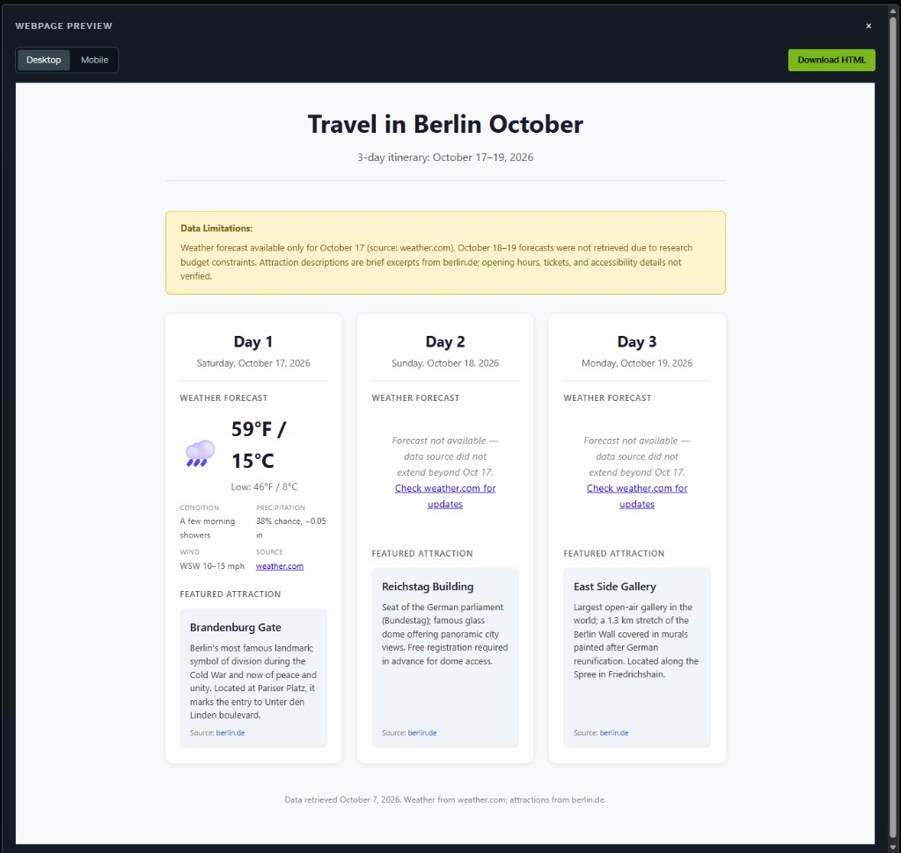
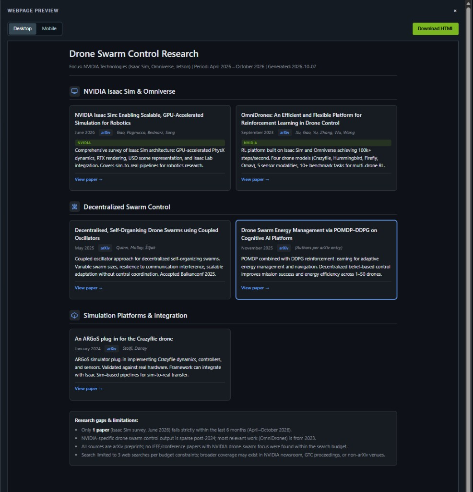
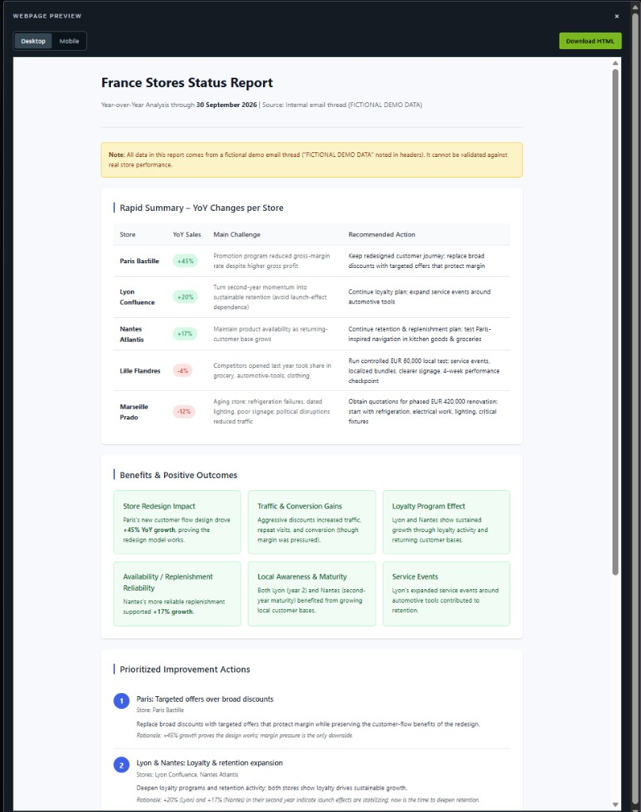

# Open Task scenarios

Select an example below Casey to see its editable `/goal`. The table follows the buttons in the studio. Use the skills column to plan a **Hired only** team. One agent can cover several skills. Choose **Hired + Standby** if you want Casey to fill gaps with standby specialists.

| Scenario | Suggested skills | What to prepare | What to look for |
| --- | --- | --- | --- |
| OpenShell in action | Shell (protected Web research), Coding | The example selects Hired + Standby and supplies the article URL. | Shell saves a brief for the webpage. If the article is blocked, [review access in Mission Control](docs/openshell-open-task.md). |
| GPU portfolio | Data interpretation, Coding | The example attaches the [demo GPU portfolio CSV](scenario/datacenter_gpu_portfolio.csv). | A dashboard, top-five CSV and brief. Check the numeric TDP order and source order for ties. The [dataset notes](scenario/datacenter_gpu_portfolio.md) explain the units and limits. |
| Ping-pong game | Coding | No attachment. Use a keyboard for two players. | Play the game in the preview with A/Q and P/M. Check the score and restart. |
| Travel guide | Web research, Coding. Live weather can cover the forecast separately. | Set the city in **Settings → Location**. The forecast and tourism research need internet access. | A three-day webpage with dates, official tourism links and clearly marked forecast gaps. |
| Drone research | Web research, Coding | Internet access to recent papers or preprints. | A dashboard of up to three qualifying papers, with dates and links. Any NVIDIA connection needs a source. |
| Bill splitter | Coding | No attachment. Pick a bill amount, tip and party size to try. | A calculator showing the tip, total and amount per person. |
| Event page | Coding, Slack announcements | Set the city in **Settings → Location**. The goal supplies a fictional agenda. | An event webpage and a short announcement you can copy. Nothing is published. |
| Store email review | Data interpretation, Coding | The example attaches the [fictional five-store email thread](scenario/demo-france-store-status-email-thread.txt). | A dashboard comparing all five stores with three proposed actions. Figures come from the thread. |

Review the goal and any staged attachment before sending. Follow assignments in **Mission Control** and open saved files in **Results**. For an offline demo, connect a local model and choose GPU portfolio, Ping-pong game, Bill splitter, Event page or Store email review.

## Example outputs

These screenshots are from earlier runs. Your team and model may produce different layouts.

### Travel guide

[Studio result](docs/images/travel-berlin-scenario-output.png) · [Alternative travel layout](docs/images/alternative-travel-webpage-preview.png)

### Drone research

### Store email review

