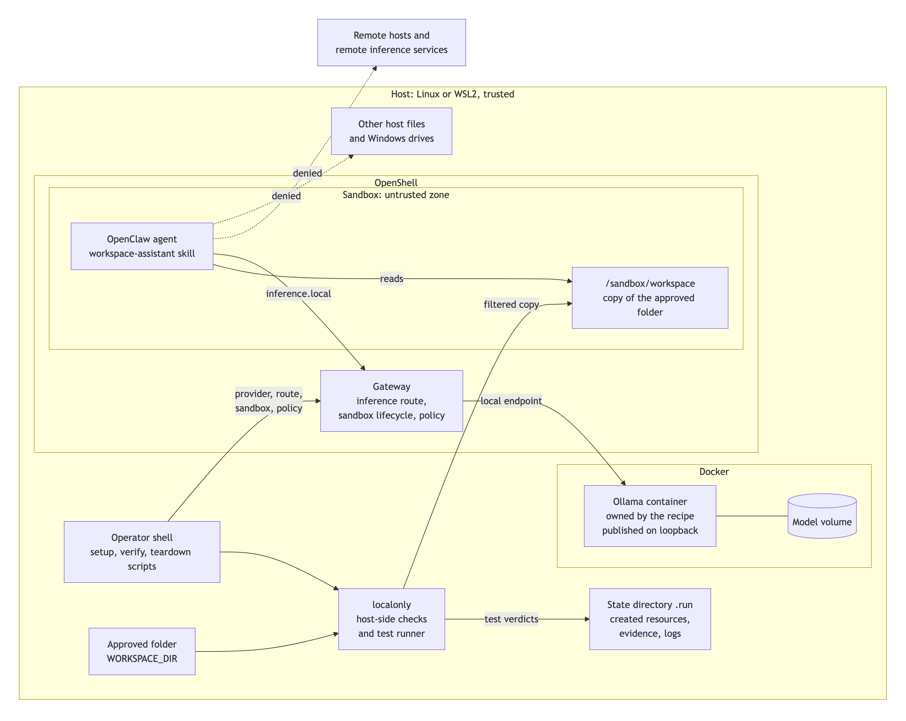
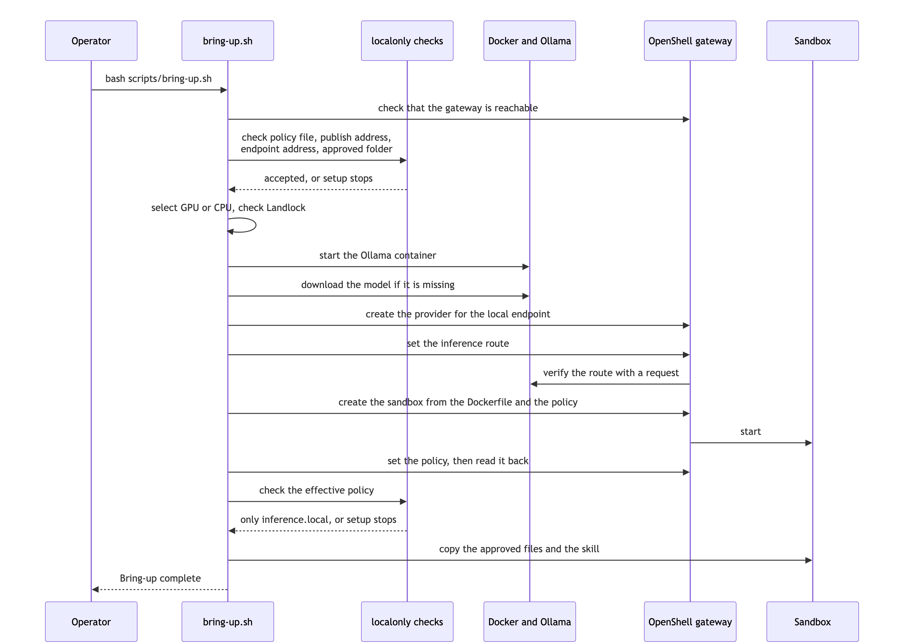
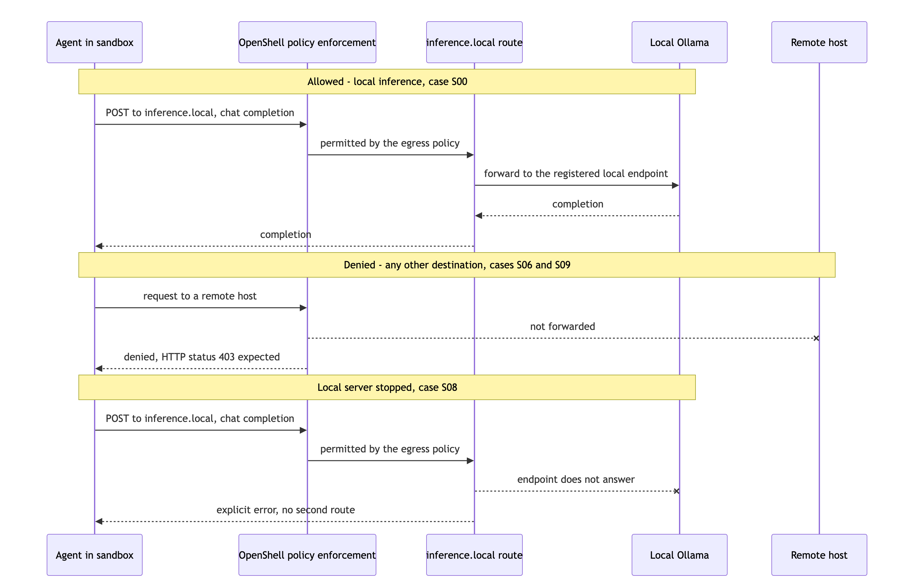
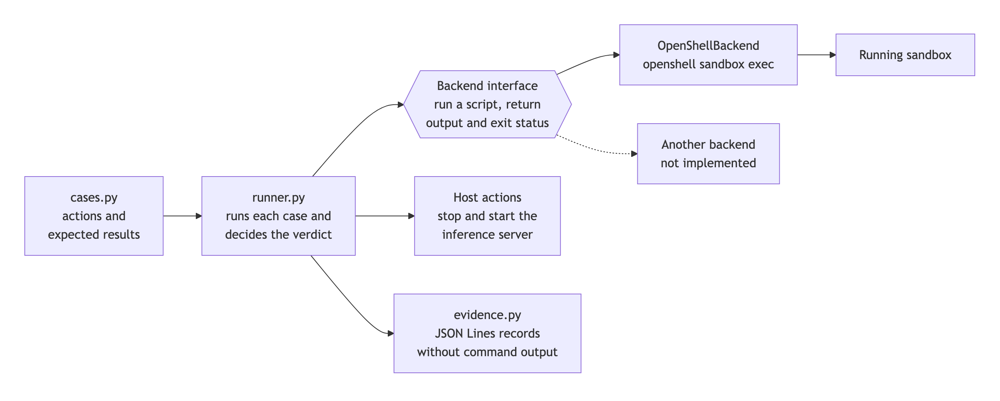

<!-- SPDX-FileCopyrightText: Copyright (c) 2026 NVIDIA CORPORATION & AFFILIATES. All rights reserved. -->
<!-- SPDX-License-Identifier: Apache-2.0 -->

# How It Works

This page describes the design. No live run has confirmed the behavior of the
sandbox or the OpenShell gateway yet. [Status And Planned Work](status.md)
lists what has run.

## The Big Picture

Everything runs on one host. The host is trusted: the operator, the scripts,
Docker, and the OpenShell gateway. The sandbox is the untrusted zone, because
it runs the agent and any code that the agent starts.

Follow the solid arrows to see what is allowed:

1. The operator runs the scripts. The scripts check the inputs and ask the
   OpenShell gateway to create the sandbox with the policy.
2. Setup passes the approved folder through the copy filter and copies the
   accepted files into `/sandbox/workspace`.
3. The agent reads the copy.
4. The agent sends prompts to `inference.local`. The gateway forwards them to
   the Ollama container on the same host.

The dotted arrows are what the policy is designed to deny: any other network
destination, and any host file outside the short list in the policy.

## Three Controls

Three controls keep file contents and prompts on the machine. None of them
runs inside the model or the agent process, so the agent cannot switch them
off.

| Control | What it does | Where it runs |
| --- | --- | --- |
| Sandbox policy | Permits one egress endpoint, `inference.local`, and a short list of file paths | OpenShell enforces it |
| Local inference endpoint | Setup rejects an inference address that does not point at this machine, before it registers the address with the gateway | Setup script, on the host |
| Copy, not mount | The sandbox receives a copy of the approved folder. No host folder is mounted. A filter rejects links, special files, and oversized files before the copy | Setup script, on the host |

The second control exists because the gateway, not the sandbox, sends prompts
to the model server. The sandbox policy does not apply to the gateway. If the
gateway held a remote address, prompts would leave the machine even with a
correct sandbox policy.

## Who Does What

The recipe configures and tests. It does not enforce.

| Party | Responsibility |
| --- | --- |
| OpenShell and the host kernel | Enforce the filesystem allowlist and the egress policy. Route `inference.local` to the registered endpoint |
| Docker | Run the Ollama container and publish its port on one host address |
| Ollama | Serve the model through an OpenAI-compatible API |
| The recipe scripts | Check inputs, create and remove resources in order, and record what they created |
| The `localonly` package | Check the policy file, the addresses, and the approved folder. Run the test cases and write evidence |
| The operator | Choose the approved folder, read the test results, and decide whether to trust them |

## Setup, Stage By Stage

`scripts/bring-up.sh` runs seven stages. It stops at the first stage that
fails. Stages 1 and 2 change nothing outside the `.run` directory.

| Stage | What setup does | What it changes |
| --- | --- | --- |
| 1. Check inputs | Confirms that Docker, Compose, and OpenShell exist and that the gateway answers. Checks the policy file, the publish address, the endpoint address, and the approved folder | Writes the list of files to copy to `.run` |
| 2. Select the device and check the kernel | Chooses the NVIDIA GPU or the CPU. On Linux, checks that the kernel lists the Landlock security module | Records the device in `.run/created` |
| 3. Start the inference server | Starts the recipe-owned Ollama container and waits until it is healthy | Creates one container and one volume. The first run downloads the image |
| 4. Make the model available | Downloads the model if the volume does not hold it | The first run downloads the model |
| 5. Point the inference route at the local server | Saves the current route, creates a provider for the local endpoint, and sets the route | Changes the gateway. Every sandbox on that gateway uses the new route |
| 6. Create the sandbox | Creates the sandbox from the `Dockerfile` with the policy, waits until it is ready, applies the policy again, reads the effective policy back, and checks it | Creates one sandbox |
| 7. Copy the folder and the skill | Copies each accepted file to `/sandbox/workspace` and the skill to the agent's skill directory | Writes files inside the sandbox |

Setup refuses to reuse a sandbox or a provider that it did not create. That
rule keeps setup from replacing the policy of a sandbox that belongs to
something else.

Stage 6 reads the policy back because a policy that the gateway did not apply
is worth nothing. Setup accepts the sandbox only when the effective policy
lists `inference.local` and no other host.

## What Happens To A Request

**Allowed.** The agent sends a chat request to `inference.local`. The egress
policy permits that endpoint. OpenShell forwards the request to the local
endpoint that setup registered. Ollama answers, and the answer returns to the
agent. Test case S00 exercises this flow.

**Denied.** The agent, or a program that it starts, sends a request to any
other host. The policy lists no such endpoint, so OpenShell does not forward
the request. The expected reply is HTTP status 403. Cases S06, S06b, and S06c
try this with two programs, because egress rules name programs. Case S09
tries a remote inference service directly.

**Local server stopped.** The agent sends a chat request while the Ollama
container is stopped. The gateway has one provider and no second route, so the
expected result is an explicit error. A completion in this state would mean
that another inference service answered. Case S08 stops the container, sends
the request, and starts the container again.

## How The Recipe Tests Itself

A claim that an action is denied needs evidence. The test suite runs each
action inside the running sandbox and records the result.

The design has one rule that matters most: a denied case passes only when the
failure carries text that the boundary produces. A missing file, a stopped
network, or a missing sandbox also makes an action fail. Those failures are
reported as `INCONCLUSIVE`, not as a pass.

Two cases read a canary file. The recipe image places the file in `/srv`, and
file permissions let every user read it. The policy does not list `/srv`. Only
the sandbox policy can deny the read, so a denial is evidence that the policy
is enforced.

[Test Suite](test-suite.md) describes the cases, the verdict rules, and the
evidence records.

## Teardown

`scripts/teardown.sh` reads `.run/created` and removes what setup recorded:

1. It deletes the sandbox, if setup created it.
2. It deletes the provider, if setup created it.
3. It stops the Ollama container, if setup started it. It keeps the model
   volume unless you pass `--purge-models`.

Teardown prints the inference route that the gateway used before setup. It
does not restore that route. It does not change an Ollama installation that
exists outside this recipe.

## OpenShell Versions

Stages 5 to 7 use the commands of OpenShell 0.0.85 and 0.0.106, the versions
that other examples in this repository use. OpenShell 0.1.8 replaces several
of those commands. With that version, setup stops at stage 5. The design on
this page does not change, but the commands that carry it out will.
[Status And Planned Work](status.md) lists the differences.
