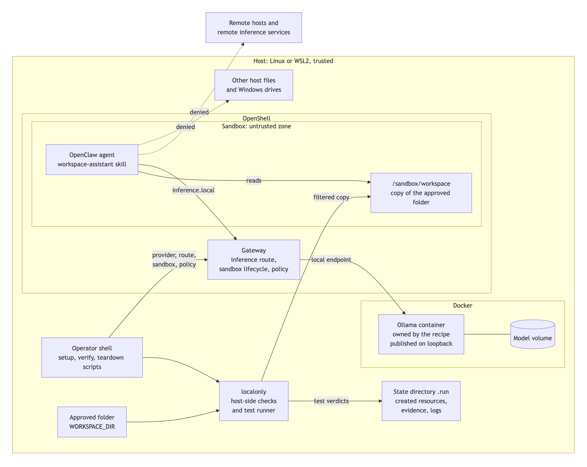

<!-- SPDX-FileCopyrightText: Copyright (c) 2026 NVIDIA CORPORATION & AFFILIATES. All rights reserved. -->
<!-- SPDX-License-Identifier: Apache-2.0 -->

# Overview

## What It Is

Local-Only Workspace Assistant is a community recipe for NemoClaw Community.
It sets up an AI agent that answers questions about one folder of your files,
on your own machine, with a model that also runs on your machine. The agent
runs in an OpenShell sandbox. The sandbox policy gives the agent one network
destination, the local inference route, and a short list of file paths.

The recipe has two parts:

- **A deployment.** Scripts start a local model server, create the sandbox
  with a local-only policy, and copy one approved folder into it.
- **A test suite.** Tests run allowed and denied actions inside the sandbox
  and record what the sandbox did. They show whether the policy holds on the
  machine in front of you.

The image shows the parts of the recipe. The sandbox is the untrusted zone.
The dotted arrows are the actions that the policy is designed to deny.

## The Problem

An agent that reads your files is useful. It also holds two things that you
may not want to leave the machine: the file contents and the prompts that
contain them. Three paths can carry them out:

- The agent calls a remote model, so every prompt goes to a remote service.
- The agent, or code that it runs, sends data to another host.
- The agent reads more of the host than the folder you meant to share.

An instruction to the model does not close these paths. A model can ignore an
instruction, and text inside a file can tell it to. The recipe closes the
paths outside the model: in the sandbox policy, in the address of the
inference endpoint, and in the way files enter the sandbox.

## What You Get

| Part | What it is |
| --- | --- |
| A dedicated sandbox | An OpenShell sandbox built from the published NemoClaw OpenClaw sandbox image, with the policy in [`policies/local-only.yaml`](../policies/local-only.yaml) |
| A local model server | An Ollama container that the recipe owns. By default it serves NVIDIA Nemotron 3 Nano 4B, on an NVIDIA GPU when the host has one and on the CPU otherwise |
| A copy of one folder | Setup copies the folder that you approve to `/sandbox/workspace`. It never mounts a host folder |
| A skill | `workspace-assistant` tells the agent to answer from the copied files and to name the file behind each statement |
| A test suite and evidence | Allowed and denied actions that run inside the sandbox, with one JSON record for each verdict |
| Setup and teardown | Setup records what it creates. Teardown removes only those resources |

## What It Is Not

- **Not finished.** Setup does not complete yet. See
  [Status And Planned Work](status.md).
- **Not a security guarantee.** The recipe configures OpenShell and tests the
  result. OpenShell and the host kernel enforce the boundary. A test result
  describes one machine at one time.
- **Not a native Windows sandbox.** On Windows, the recipe is designed for
  WSL2, which is Linux. It does not use Windows isolation features.
- **Not protection for the approved folder.** The agent can read every copied
  file and can send its contents to the local model. Approve only a folder
  that the agent may read in full.
- **Not a general agent platform.** The recipe covers one job: questions about
  one folder.

## Who It Is For

- A person who wants an agent to work with local files and wants prompts and
  file contents to stay on one machine.
- A developer who wants a worked example of a local-only OpenShell policy and
  a way to test it.
- A contributor who wants to run the same denied-action tests against a
  different sandbox technology. See [Test Suite](test-suite.md).

The recipe is designed for a GeForce RTX PC with Windows 11 and WSL2. The same
scripts run on a Linux host, with or without an NVIDIA GPU.

## Terms

| Term | Meaning in this recipe |
| --- | --- |
| Sandbox | The OpenShell runtime boundary that the agent runs inside |
| Policy | The file that lists the paths and network endpoints that the sandbox permits |
| Inference route | `inference.local`, the address that the sandbox uses to reach a model through OpenShell |
| Provider | The OpenShell record of an inference endpoint and its credential |
| Approved folder | The one host folder that setup copies into the sandbox |
| Copy filter | The host-side check that rejects links, special files, and oversized files before the copy |
| Canary | A file in the sandbox image that file permissions allow every user to read and that the policy does not list |
| Boundary signature | Text that a denial by the sandbox produces, such as `Permission denied` or HTTP status 403 |
| Evidence record | One JSON line that holds the verdict of one test case and never the command output |
| Host trait | A property of the host that gives a case its meaning, such as WSL2 |

## Where To Go Next

- [How It Works](how-it-works.md) explains the design step by step.
- [README, Quickstart](../README.md#quickstart) lists the commands.
- [Status And Planned Work](status.md) says what works today.
