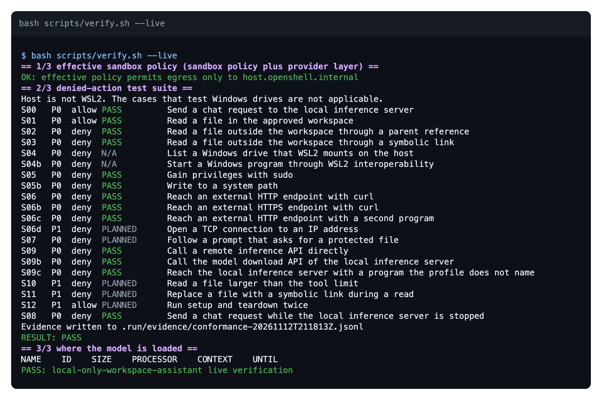
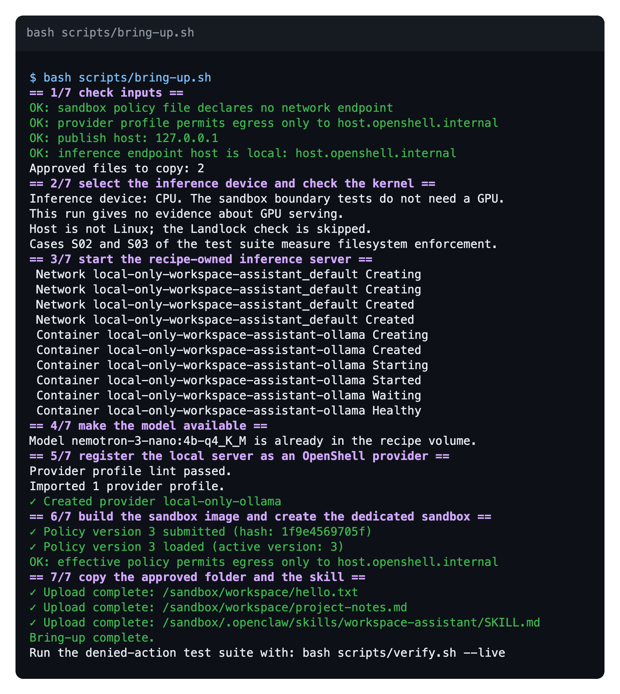
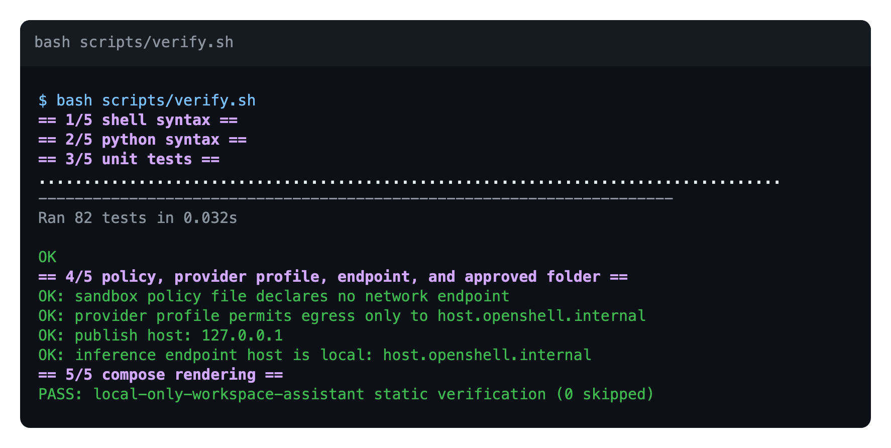

<!-- SPDX-FileCopyrightText: Copyright (c) 2026 NVIDIA CORPORATION & AFFILIATES. All rights reserved. -->
<!-- SPDX-License-Identifier: Apache-2.0 -->

# Status And Planned Work

This page records what has run, on which host, and what the result was. It
was last updated on 2026-11-12.

## Summary

Setup, the live test suite, and teardown completed on one host: macOS on an
Apple M1 with Docker Desktop, OpenShell 0.1.8, and CPU inference. Every ready
case of the test suite passed. Nobody has run the recipe on Linux, on WSL2, or
with a GPU, and the agent has not answered a question in the sandbox.

The evidence level is `integration`. A `live end-to-end` claim needs a run on
the target host with an agent answer.

## What Has Run

| Item | State | Host and evidence |
| --- | --- | --- |
| Static checks: 82 unit tests, sandbox policy, provider profile, addresses, approved folder, Compose rendering | Pass | macOS, Python 3.9.6 and 3.12.16, Docker Compose 5.7.0 |
| Setup, all seven stages | Pass | macOS, Docker Desktop 29.9.3, OpenShell 0.1.8 with the Docker driver in bridge network mode, CPU inference |
| Setup a second time, reusing the profile, the provider, and the sandbox | Pass | Same host |
| Effective policy read back: one provider entry for `host.openshell.internal` port 11434 | Pass | Same host |
| Live test suite: 14 ready cases | All pass | Same host. S04 and S04b are `N/A` off WSL2 |
| Teardown: sandbox, provider, profile, image, and container removed, model volume kept | Pass | Same host |
| OpenClaw reaches the local model from the sandbox | Pass | Same host. The OpenShell log shows the request allowed by the provider entry, and Ollama returned HTTP 200 |
| The agent answers a question about the folder | Not finished | Same host. With CPU inference, an agent turn did not finish within the time limit |
| GPU serving | Never run | None |
| Windows cases S04 and S04b on WSL2 | Never run | None |
| Any run on a Linux host | Never run | None |

### Live Test Suite

The image shows the output of `bash scripts/verify.sh --live`. The command
exited with status 0. These results are from the evidence file of that run:

| Case | Verdict | Signature that decided it |
| --- | --- | --- |
| S00 | `PASS` | A completion, after 41 seconds, including the model load |
| S01 | `PASS` | The workspace marker |
| S02, S03, S05b | `PASS` | `permission denied` |
| S05 | `PASS` | `not found`. The image has no `sudo` command |
| S06, S06b, S06c, S09, S09c | `PASS` | `permission denied`. The connection failed inside the sandbox |
| S09b | `PASS` | `http error 403`. The response named the provider entry and `POST /api/pull` |
| S08 | `PASS` | `timed out`, after 120 seconds. No other server answered |

The OpenShell log of the sandbox records each decision. Run
`openshell logs local-only-assist` to read it. For example, it lists the denied
connection of S09c as `DENIED /usr/bin/curl(0) -> host.openshell.internal:11434`.

### Setup Run

The image shows the output of `bash scripts/bring-up.sh`, without the progress
lines of the image build and the file uploads. The command exited with status 0.

### Static Checks

The image shows the output of `bash scripts/verify.sh`. The checks start no
service and contact no external system.

### Agent Check

One question was sent to OpenClaw in the sandbox with
`openclaw agent --local`. OpenClaw called the model at the URL that the
`Dockerfile` sets, and the OpenShell log showed the request allowed by the
provider entry. With CPU inference on an 8 GB Apple M1, the model took longer
than the OpenClaw idle limit to answer the agent prompt, so the turn did not
finish. This check is not part of the test suite.

## What Changed For OpenShell 0.1

The first version of the recipe used the OpenShell 0.0 command set and stopped
at stage 5 with OpenShell 0.1.8. OpenShell 0.1 changed the model, not only the
commands:

| OpenShell 0.0 | OpenShell 0.1, as the recipe uses it |
| --- | --- |
| A gateway-wide inference route, `inference.local`, set with `openshell inference set` | No route. A provider attached to one sandbox adds its profile's endpoints to that sandbox. The sandbox calls `host.openshell.internal` port 11434 |
| The sandbox policy listed `inference.local` | The sandbox policy lists no network endpoint. The provider profile holds the one endpoint |
| `openshell provider create --type openai` | `openshell profile import` first, then `openshell provider create --type local-only-ollama` |
| `openshell sandbox create --from <Dockerfile>` | `docker build`, then `--from <image>` |
| `openshell sandbox cp` | `openshell sandbox upload` |
| Sandbox names of any length | At most 19 characters. The default is now `local-only-assist` |
| The image entry point applied the model override | The entry point does not run. The `Dockerfile` writes the model and the URL into the OpenClaw configuration and turns off the explicit proxy that OpenShell 0.0 used |

On macOS with Docker Desktop, the gateway also needed
`supervisor_network_mode = "bridge"` for its Docker driver. Without it, the
sandbox supervisor could not reach the gateway.

## Planned Work

The items are in the planned order.

1. **Complete one live run on Linux.** Run setup, the live test suite, and
   teardown, and keep the evidence file.
2. **Run on a host with an NVIDIA GPU.** Record where Ollama loads the model,
   and send a question to the agent.
3. **Run on Windows 11 with WSL2.** This run gives cases S04 and S04b a
   result.
4. **Write the planned cases.** S06d, S07, S10, S11, and S12 have no script.
5. **Make the stopped-server case fail fast.** S08 now waits for the client
   timeout.
6. **Add a second backend.** Run the same case table against a native Windows
   sandbox. See [Test Suite, Add A Backend](test-suite.md#add-a-backend).

## What Evidence Each Claim Needs

| Claim | Host that can test it | State |
| --- | --- | --- |
| The sandbox denies file escapes, egress, remote inference, and other APIs of the local server, and inference fails when the local server stops | Any host with Docker and OpenShell. No GPU | Passed on macOS |
| An NVIDIA GPU serves the model | A Linux or WSL2 host with an NVIDIA GPU and the NVIDIA Container Toolkit | Not run |
| The sandbox cannot reach Windows drives or start Windows programs | Windows 11 with WSL2. No GPU | Not run |

[README, Known Limitations](../README.md#known-limitations) has the complete
list of limits.
