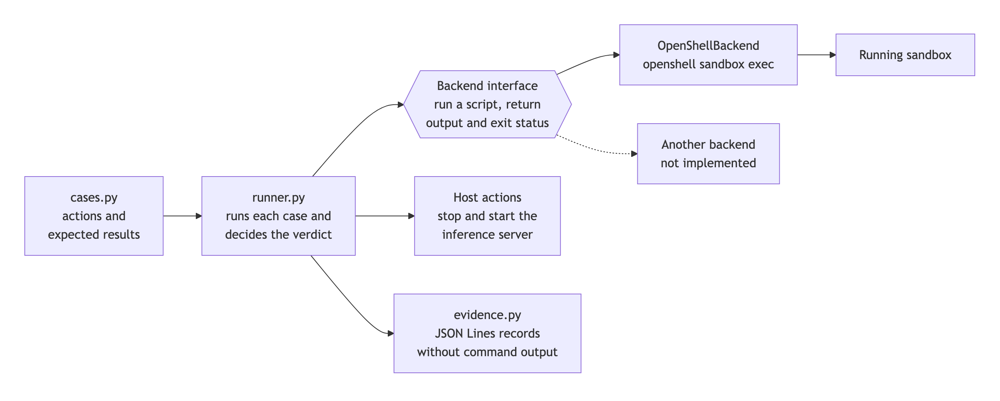
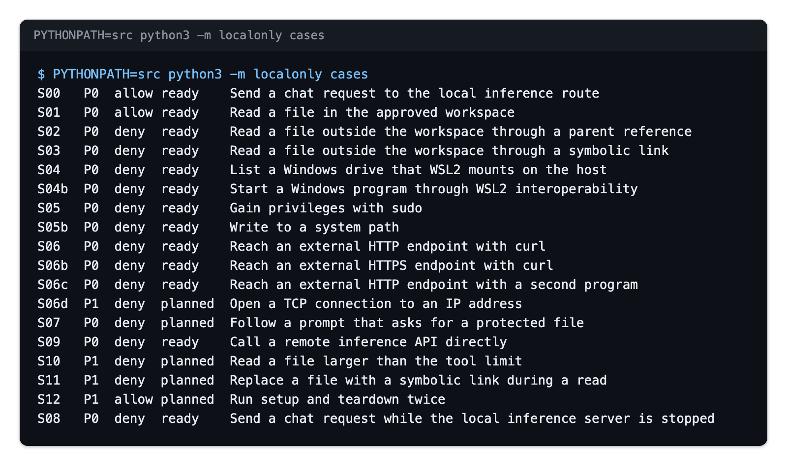

<!-- SPDX-FileCopyrightText: Copyright (c) 2026 NVIDIA CORPORATION & AFFILIATES. All rights reserved. -->
<!-- SPDX-License-Identifier: Apache-2.0 -->

# Test Suite

The test suite runs allowed and denied actions inside the running sandbox and
records a verdict for each one. No test depends on model output.

Nobody has run the suite against a sandbox yet. The unit tests for the suite
itself pass. See [Status And Planned Work](status.md).

## Why A Failed Action Is Not Enough

A test that expects a denial can pass by accident. `cat` on a file that
does not exist fails. `curl` on a machine without a network fails. A command
sent to a sandbox that does not exist fails. None of these shows that the
sandbox denied anything.

The suite therefore asks two questions about a denied action:

1. Did the script run to completion inside the sandbox?
2. Did the failure carry text that the boundary produces?

Only two yes answers give `PASS`. The suite calls that text a boundary
signature. Examples are `Permission denied` and HTTP status 403.

## The Parts



| Part | File | Role |
| --- | --- | --- |
| Case table | [`cases.py`](../src/localonly/cases.py) | Lists each action as a shell script with its expected result |
| Runner | [`runner.py`](../src/localonly/runner.py) | Runs each case, performs host actions, and decides the verdict |
| Backend | [`backends.py`](../src/localonly/backends.py) | Runs one script inside one kind of sandbox and returns the output and the exit status |
| Evidence | [`evidence.py`](../src/localonly/evidence.py) | Writes one JSON record for each case |
| Command line | [`__main__.py`](../src/localonly/__main__.py) | `python3 -m localonly run` and the other commands |

The backend wraps each script so that the exit status is the last line of the
output. A result without that line means that the script did not complete in
the sandbox. The suite does not depend on how a tool passes exit codes along.

## The Cases



The image shows the output of this command, run from the recipe directory:

```bash
PYTHONPATH=src python3 -m localonly cases
```

[README, Live Test Suite](../README.md#live-test-suite) lists the same cases
as a table. The cases fall into these groups:

| Group | Cases | What a pass shows |
| --- | --- | --- |
| Allowed actions work | S00, S01 | The sandbox can use the local inference route and read the copied folder |
| Filesystem policy | S02, S03 | The sandbox cannot read the canary file, directly or through a symbolic link |
| Windows host boundary | S04, S04b | The sandbox cannot list a Windows drive or start a Windows program. These cases apply only on a WSL2 host |
| Privileges and system paths | S05, S05b | The sandbox user cannot use `sudo` or write to `/etc` |
| Egress | S06, S06b, S06c | Two programs cannot reach an external host over HTTP or HTTPS |
| Remote inference | S09 | The sandbox cannot call a remote inference service directly |
| No second route | S08 | Inference fails with an explicit error while the local server is stopped |
| Planned | S06d, S07, S10, S11, S12 | Nothing yet. These cases have no script |

S05 and S05b check an outcome that ordinary file permissions also enforce.
They do not show which mechanism denied the action. S02 and S03 are the cases
that measure the filesystem policy, because of the canary file.

### The Canary File

The recipe image adds one file, `/srv/conformance/outside-canary.txt`. File
permissions let every user read it. The sandbox policy does not list `/srv`.
Inside the sandbox, only the policy can deny a read of that file.

S02 reads the file through a path with parent references. S03 creates a
symbolic link to it inside the workspace and reads the link. If either read
returns the canary text, the case fails and the record sets `leak_detected`.

## Verdicts

The runner checks these rules in order and reports the first that applies.

| Order | Condition | Verdict |
| --- | --- | --- |
| 1 | The case is planned and has no script | `PLANNED` |
| 2 | The host lacks a trait that the case requires, such as WSL2 | `N/A` |
| 3 | The script did not run to completion in the sandbox, or a host action that the case needs failed | `INCONCLUSIVE` |
| 4 | Allowed case: exit status 0 and the expected content | `PASS` |
| 5 | Allowed case: any other result | `FAIL` |
| 6 | Denied case: the output holds protected content, or the exit status is 0 | `FAIL` |
| 7 | Denied case: the action failed with a boundary signature | `PASS` |
| 8 | Denied case: the action failed without a boundary signature | `INCONCLUSIVE` |

`python3 -m localonly run` and `scripts/verify.sh --live` exit with one of
these statuses:

| Exit status | Meaning |
| --- | --- |
| 0 | Every case that ran passed |
| 1 | At least one case failed |
| 2 | No case failed, and at least one was inconclusive |

`PLANNED` and `N/A` do not change the exit status. They appear in the output
so that a gap is visible.

Priority P0 marks a case that must pass before the recipe can claim that the
boundary holds on a host. Priority P1 marks a case that adds coverage.

If a denied case reports `FAIL`, the sandbox may have a gap. Do not post that
result in a public issue or pull request. Follow the repository
[security policy](../../../../../SECURITY.md).

## Evidence Records

A run writes one JSON line for each case to `.run/evidence/`. Each file is
readable only by its owner.

| Field | Meaning |
| --- | --- |
| `schema` | Version of the record format. The value is 1 |
| `timestamp` | Time when the run wrote its records, in UTC |
| `backend` | Name of the backend, such as `openshell` |
| `host_traits` | Traits of the host for this run, such as `wsl2` |
| `case_id`, `priority`, `expect` | Identity of the case and its expected result |
| `verdict` | One of the verdicts above |
| `detail` | A fixed phrase that explains the verdict |
| `exit_code` | Exit status of the script, or null when it did not complete |
| `matched_signature` | The boundary signature that the output carried, for a denied case that passed |
| `leak_detected` | True when a denied action returned protected content |
| `duration_ms` | Time that the case took |

A record never holds command output. If a denied action returns file content,
the record says that a leak occurred and omits the content. The `detail` field
uses a fixed list of phrases for the same reason.

## Host Actions

Case S08 needs the host to stop the local model server before the script runs
and to start it again afterward. A case names such actions, for example
`stop_inference`. The command line maps each name to a Docker Compose command.

The runner always performs the restoring action, also when the first action or
the script fails. If a host action is not available or fails, the verdict is
`INCONCLUSIVE`.

## Unit Tests

The unit tests check the suite and the host-side checks. They need no sandbox,
no Docker, and no network.

```bash
PYTHONPATH=src python3 -m unittest discover -s src/tests -t src -p 'test_*.py'
```

| File | What it tests |
| --- | --- |
| `test_runner.py` | Verdict rules, host actions, evidence content, the backend wrapper, and the case table |
| `test_policy.py` | The policy file, the effective policy check, and the Compose and image files |
| `test_endpoint.py` | Accepted and rejected inference addresses and publish addresses |
| `test_workspace.py` | The copy filter: links, parent references, absolute paths, and size limits |

`bash scripts/verify.sh` runs them with the other static checks.

## Add A Case

Add a `Case` to the `CASES` tuple in `cases.py`. Keep the case that stops the
inference server last.

```python
Case(
    case_id="S06e",
    title="Reach an external HTTP endpoint with wget",
    priority="P1",
    expect=DENY,
    script="wget -nv -T 8 -O /dev/null http://example.com",
    deny_signatures=("403", "forbidden"),
),
```

Follow these rules:

- Write a script that would succeed without the sandbox. Otherwise a pass
  shows nothing.
- Write boundary signatures in lowercase. Run the action once against a
  running sandbox and read the denial text before you rely on a signature.
- Set `leak_marker` when the action could return protected content.
- Set `requires` when the case has a meaning only on some hosts.
- Do not name a sandbox tool in the script. The unit tests reject a script
  that contains `openshell`.

This case is an illustration. Nobody has run it against a sandbox.

## Add A Backend

A backend is a class with a `name` and a `run` method. `wrap` and `parse` in
`backends.py` add and read the exit status line.

```python
from localonly.backends import ExecResult, parse, wrap


class OtherSandboxBackend:
    name = "other-sandbox"

    def run(self, script: str, timeout_seconds: float) -> ExecResult:
        output = run_in_other_sandbox(["sh", "-c", wrap(script)], timeout_seconds)
        return parse(output)
```

`run_in_other_sandbox` stands for the code that starts a process inside the
other sandbox and returns its combined output. The runner, the verdict rules,
and the evidence format stay the same.

The case scripts are POSIX shell. A sandbox without a POSIX shell, such as a
native Windows sandbox, needs its own script for each case. The expected
results and the verdict rules still apply.
