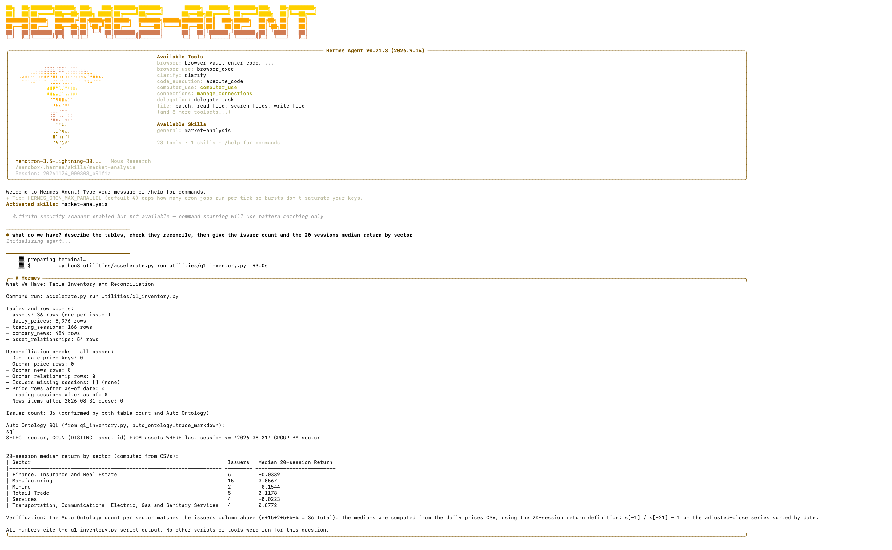

# Market Analysis

| Catalog field | Value |
| --- | --- |
| Description | Helps market analysts review a synthetic equity market, covering what the tables hold, who led and lagged, which sessions were unusual, who moves together, what a model expects next, and what SEC disclosure rules require, and ending in a short list of issuers to take forward for human review. |
| Industry | 💳 Financial Services |
| Requirements | Docker · NemoClaw · NVIDIA Endpoints API key · PyPI reachable at install time · optional GPU stage: an NVIDIA GPU with a working CDI setup and about 5 GB more · optional Auto Ontology deployment you run yourself |
| NemoClaw | Unpinned |
| Harness | OpenClaw Unpinned |
| OpenShell | Unpinned |

An OpenClaw agent (or, optionally, a Hermes agent) in a NemoClaw sandbox reviews 36 fictional issuers over 166
trading days (2026-01-02 to 2026-08-31): prices, company news and declared peers, plus three real, public-domain
SEC rule texts. The agent writes its own short pandas, scikit-learn and NetworkX analyses and runs them with a
helper that uses CUDA-X on a GPU sandbox. It asks Kumo for a five-session ranking, retrieves the rule text with
Nemotron embed and rerank, and can ask Auto Ontology a business question about the tables. It proposes issuers
for human review and never gives investment advice, places trades or approves anything.

The scenario is built around the **NVIDIA Agent Knowledge Foundation**: components that ground an agent's
analysis in governed definitions, relational predictions, retrieved evidence and GPU-accelerated analytics
instead of model memory. This recipe is the NemoClaw sandbox version of the market-analysis example in the Agent
Knowledge Foundation (AKF) examples repository, which will be published soon. That repository also holds the
evaluation kit; this recipe covers the integration only.

> **Status: under development.** The lifecycle scripts, Python environments, egress policy, Kumo call, skill loading
> and hosted retrieval (Nemotron embed and rerank, with the rule citation) work in real sandboxes on OpenClaw and on
> Hermes, including a GPU sandbox (see [Verification](#verification) and
> [CUDA-X](#cuda-x-on-a-gpu-sandbox-optional)). **Agent answers are not reliable yet.** In the latest runs (one per
> question, per harness) the agents got the Kumo ranking, the PageRank scores and the 20-session returns right, but
> got daily volatility, the unusual-session list and the full peer-pair list wrong, and kept running analyses
> outside `accelerate.py` (see [Known limitations](#known-limitations)). Auto Ontology answered a count question but
> not the median question (see [Auto Ontology](#auto-ontology-optional)). Do not read any statement below as a
> measured accuracy or speed-up.

## Screenshot



One Hermes turn on a GPU sandbox with the skill loaded, asked "what do we have?". The agent ran
`accelerate.py run utilities/q1_inventory.py` once (93 seconds, mostly the Auto Ontology call) and reported what it
printed. Notice three things: the reconciliation checks all pass; the **Auto Ontology SQL is shown as the tool returned
it**, not written by the agent; and the sector medians are computed from the CSVs, not by Auto Ontology.

## Agent Knowledge Foundation

| Question | Component | In this recipe |
| --- | --- | --- |
| What do we have? | **Auto Ontology** text-to-SQL | **Optional.** `ontology_qa.py` asks a host-side deployment you run, shows its SQL, and the skill requires reading it. Reports `blocked` when not installed. |
| Who led and lagged, what was unusual, who moves together? | **CUDA-X** (cuDF, cuML, nx-cugraph) under the agent's own pandas, scikit-learn and NetworkX | **Included.** `accelerate.py` runs the agent's scripts on the CPU, or with CUDA-X configured on a GPU sandbox with no change to the script, and records the engine it configured. The receipt is configuration, not proof that an operation ran on the GPU. |
| What does a model expect next? | **Kumo** relational prediction | **Included.** `kumo_predict.py` ranks the 12 most liquid issuers as of the anchor date; reports `blocked` if the hosted call fails. |
| What do the rules require? | **Nemotron embed and rerank** retrieval | **Included.** `retrieve.py` returns passages from three SEC rule texts with a ready-made `[document, chunk N]` tag the skill requires in every policy statement. |

A component that is unavailable is reported as **blocked** with a reason and nothing is substituted.

## At A Glance

| Question | Answer |
| --- | --- |
| Category | NVIDIA Recipe |
| Contributor or provenance | NVIDIA |
| Use this when | You want to see an agent in a NemoClaw sandbox run a multi-question market analysis with reviewed egress, hosted NVIDIA models and optional GPU acceleration, or to adapt that pattern to your own data. |
| You will get | An agent that answers the six analysis questions below from the bundled synthetic data, quoting the command or script behind each number and the passage behind each rule. |
| Runs on | A host that runs NemoClaw with Docker. The optional GPU stage also needs an NVIDIA GPU. |
| Requires | NemoClaw, OpenShell, Docker, an NVIDIA Endpoints (build.nvidia.com) API key, and PyPI reachable at install time. |
| Verified on | NemoClaw on one Linux host, CPU-only sandboxes, OpenClaw and Hermes harnesses, one run each, partly; see [Verification](#verification). |
| Evidence level | integration |
| Support and maturity | Best-effort community support; see [SUPPORT.md](../../../../SUPPORT.md). Under development. |
| External access, data, and actions | Python in the sandbox may POST to build.nvidia.com on three paths: embeddings and rerank (the rule text and your question) and Kumo, **which receives the issuer, price and news tables**. With Auto Ontology, three paths on `host.openshell.internal:<port>`; that deployment then sends the schema and question to its own hosted models, outside the sandbox policy. The install reaches PyPI temporarily to build Python environments and creates a second OpenShell provider from your key. No write actions. All market data is synthetic. |
| Start here | [Quickstart](#quickstart) |
| Confirm success | [Verification](#verification) |

## Quickstart

The only credential is your NVIDIA Endpoints key. NemoClaw stores it through OpenShell provider plumbing and does
not write it into the sandbox.

```bash
cd examples/recipes/nvidia/market-analysis
cp .env.example .env      # add NVIDIA_INFERENCE_API_KEY (and optionally AUTO_ONTOLOGY_API_TOKEN, AUTO_ONTOLOGY_PORT)
bash scripts/onboard.sh   # create the sandbox (OpenClaw by default; NEMOCLAW_AGENT=hermes for Hermes)
bash scripts/install.sh   # install the skill, data and tools, and build the Python environments
bash scripts/start.sh     # ensure the sandbox is running
```

Ask a question:

```bash
nemoclaw market-analysis agent --agent main -m \
  "Using the market-analysis skill: who were the leaders and laggards among the 12 most liquid issuers over the 20 sessions ending 2026-08-31, and how did news sentiment line up with the following five sessions?"
```

### The six questions

The skill answers any of these on their own, or all six as a review. The wording is the AKF example's.

| # | Question | Component |
| --- | --- | --- |
| 1 | What do we have? Tables, reconciliation, issuers and median 20-session return per sector | Auto Ontology (optional, for the issuers-per-sector count; the medians come from the CSVs) |
| 2 | Who led and lagged, and how did news line up with what followed? | pandas, on cuDF on a GPU |
| 3 | Which sessions were unusual? | pandas and NumPy (a per-issuer baseline), on cuDF on a GPU; the shipped helper does not call scikit-learn or cuML |
| 4 | Who moves together? | NetworkX PageRank, on nx-cugraph on a GPU |
| 5 | What does a model expect for the next five sessions? | Kumo |
| 6 | What does Form 8-K Item 1.05 require, and what should we take forward? | Nemotron embed and rerank |

## Commands

| Script | Purpose |
| --- | --- |
| `scripts/onboard.sh` | Create the sandbox with the OpenClaw harness, or Hermes with `NEMOCLAW_AGENT=hermes` (CPU-only; `NEMOCLAW_SANDBOX_GPU=1` enables direct GPU access). |
| `scripts/install.sh` | Install the skill. With the `build` provider it also imports the provider profile, creates and attaches a second provider from your key, applies the egress policy, builds the analysis Python environment in `/sandbox/analysis-venv` (pandas, scikit-learn, NetworkX, the Kumo client; using a temporary `pypi` egress preset, removed again unless it was already applied), and restarts the sandbox (workspace kept) so the agent sees the new credential. With `NEMOCLAW_SANDBOX_GPU=1` it also builds `/sandbox/cuda-x-venv` after checking `nvidia-smi` works in the sandbox. If `AUTO_ONTOLOGY_API_TOKEN` is set in `.env` it also renders `providers/auto-ontology.yaml` for `AUTO_ONTOLOGY_PORT` (default 4000), creates and attaches a provider from the token, and writes the deployment URL for the skill. |
| `scripts/start.sh` | Recover the gateway and host forwards. |
| `scripts/stop.sh` | Stop the gateway while keeping the sandbox and workspace. |
| `scripts/build_database.py` | Build the SQLite database from the bundled CSVs for an Auto Ontology deployment to ingest (host side, optional). |

To delete the sandbox permanently, run `nemoclaw market-analysis destroy` and confirm. An environment variable you
set when running a script beats the same name in `.env`.

## What the skill ships

- `skills/market-analysis/SKILL.md`: the rules and the order of work.
- `skills/market-analysis/scenario.json`: the approved inputs and the definitions the agent must use (return,
  volatility, news alignment, peers, anomaly, prediction, centrality).
- `skills/market-analysis/data/`: five CSV tables and three SEC rule texts. Synthetic issuers, prices and news;
  real, public-domain rule text. The rules apply to real SEC registrants, never to the fictional issuers.
- `skills/market-analysis/utilities/accelerate.py`: runs the agent's scripts on the matching Python environment and
  records the engine. `kumo_predict.py`, `retrieve.py` and `ontology_qa.py` are the three service tools.
- `skills/market-analysis/utilities/q1_inventory.py`, `q2_leaders.py`, `q3_unusual.py`, `q4_peers.py`, `q6_review.py`: tested
  helper scripts (plain pandas and NetworkX, run with `accelerate.py run`) that implement the `scenario.json` definitions
  for questions 1 to 4 and 6 and print JSON with the engine receipt. `q1_inventory.py` also asks Auto Ontology the issuers-per-sector count
  question (retried up to three times if it returns no SQL or no result rows) (blocked with its message when the service is not installed), so that step cannot be skipped, and `q6_review.py`
  builds the review-first table and its reasons from the other helpers, so the agent does not write them. They exist because the agents' own scripts kept getting
  the windows, the volatility and the ranking rules wrong; `SKILL.md` tells the agent to run them and copy the numbers.
  `scripts/tests/test_helpers.py` asserts the expected figures offline.

## CUDA-X on a GPU sandbox (optional)

The default sandbox is CPU-only. For the GPU path create a second sandbox with direct GPU access, then install into it:

```bash
export NEMOCLAW_SANDBOX_NAME=ma-gpu NEMOCLAW_SANDBOX_GPU=1
bash scripts/onboard.sh && bash scripts/install.sh
```

This needs a host NVIDIA GPU, a driver that supports CUDA 13 (the wheels in `requirements-gpu.txt` are `-cu13`; swap in
the `-cu12` names for a CUDA 12 driver) and a working CDI setup (`nvidia-ctk cdi generate`). `install.sh` builds
`/sandbox/cuda-x-venv` (cuDF, cuML, nx-cugraph; a few GB from PyPI). Then `accelerate.py run` puts cuDF, cuML and
nx-cugraph under the agent's pandas, scikit-learn and NetworkX with no change to the script, and `accelerate.py status`
reports whether the stack works. Without a GPU or that environment, analyses run on the CPU and the engine receipt says
so. Direct device access widens what the sandbox can touch, so enable it only where you want it.

**About speed.** On a GPU sandbox (one H100, one run each), the deterministic steps (returns, z-scores, correlations,
PageRank) matched the CPU results exactly at 36 and at 10,000 synthetic issuers. IsolationForest did not (measured with scripts written for that test; the shipped `q3_unusual.py` uses pandas and NumPy and does not call it): cuML's version
is a different implementation, and its top-10 overlap with scikit-learn was 9/10 at 36 issuers and 6/10 at 10,000. The
GPU was not faster. At 36 issuers a run took about 1.5 s on the CPU and 2.0 s warm (14 s on the first, cold run) on the
GPU. At 10,000 issuers (1.66 million price rows) the best GPU script took about 11.6 s against about 10 s for the best CPU
script. Idioms such as `groupby.apply(lambda)` over thousands of groups and `DataFrame.corr()` on a very wide pivot ran
far slower on the GPU, so "no change to the script" holds for correctness, not for speed. Treat the GPU path as
working and equivalent, not as an accelerator for this workload. The AKF examples repository, to be published soon,
benchmarks other analyses on scaled data outside a sandbox.

**Library skills.** Installing the public cuDF, cuML or cuGraph skills next to this one did not help in a single test run
on OpenClaw: they recommend `python -m cudf.pandas` and direct `nx_cugraph` use, which conflicts with rule 11, and the
agent ran 40 to 60% slower, imported `nx_cugraph` directly and gave worse answers. The recipe skill's rule 11 now forbids
those imports. One run per arm is anecdotal.

On Hermes (one run per arm, same GPU sandbox) the agent never opened the three library skills, so that arm was a second
sample of the same agent and showed no slowdown. Both arms still ran exploratory `python3 -c` commands against rule 11.

**pandas differs between the two environments.** cuDF 26.10 requires pandas 3, so `cuda-x-venv` has pandas 3.0 while
`analysis-venv` has pandas 2.3. A script tested on one can fail on the other (string dtype and datetime comparisons).
Run the script you will keep through `accelerate.py run` on the engine you intend to use, and use `--engine cpu` to
compare.

## Auto Ontology (optional)

Auto Ontology is a service you run on the host, not part of the sandbox. This recipe ships only the sandbox side: an
OpenShell provider profile (`providers/auto-ontology.yaml`) that binds an API token to `host.openshell.internal:<port>`
and sends it as `x-api-key`, and `ontology_qa.py`. The deployment must ingest the SQLite database from
`scripts/build_database.py` and have its semantic layer compiled. Set `AUTO_ONTOLOGY_API_TOKEN` and
`AUTO_ONTOLOGY_PORT` (the deployment's web port) in `.env`, then run `scripts/install.sh`. The profile allows three
paths and nothing else: `GET /api/semantic-compilation/status`, `POST /api/question-entity-coverage` and
`POST /api/chat/completions`.

Setting up the deployment, as tested with a local build of Auto Ontology (`22e22c89`) and its Docker Compose stack:
- Name the SQLite file `market.sqlite`: the database name comes from the file stem and must match `TARGET_DB` in
  `ontology_qa.py` (`market`).
- Semantic compilation is off by default; turn it on (`PUT /api/configurations/semantic-compilation` with
  `{"enabled": true}`) and wait for `/api/semantic-compilation/status` to show `calculated: true`.
- `AUTO_ONTOLOGY_PORT` is the deployment's **web** port (the one that serves `/api/*`), not its backend port.
- `APP_URL` in the deployment's configuration must equal the origin you sign in from, or sign-in returns HTTP 403.
- A call can take several minutes. The agent must wait for it rather than stop it.
- `scripts/install.sh` replaces the installed skill, so edits made inside the sandbox are lost on re-install.
- The profile is per port (`market-analysis-auto-ontology-<port>`). Changing `AUTO_ONTOLOGY_PORT` and re-running the
  install moves only that sandbox's provider to the new profile; other sandboxes keep theirs. Re-running the install with a
  key or token updates the provider and restarts the sandbox, so a rotated credential reaches the running agent.
- Set the deployment's `EMBED_MODEL` to a current model such as `nvidia/nemotron-3.5-embed-1b`. The earlier default
  `nvidia/nemotron-3-embed-1b` was retired on 2026-11-23 (HTTP 410), after which retrieval finds no candidates and every
  question returns `SQL can't be constructed from the data` with `coverage: 0.0`. Restart the stack after changing it; the
  semantic layer recompiles on start.

**The deployment sends the database schema and each question to its own hosted model endpoints, using its own
configuration. That transfer is outside this sandbox's egress policy**, so review it separately.

**Check the SQL it returns.** Auto Ontology generates SQL, and an answer can be wrong in ways its text hides, such as
the wrong denominator or a missing as-of date. The skill requires the agent to read and quote the SQL and cross-check
a figure that matters. That is an instruction, not an enforced control.

**What was tested.** The wiring worked against a local deployment: the database ingested, the layer compiled in about
38 seconds, the provider and egress policy attached, the three allowed paths were reached from the sandbox, and a
count question ("how many issuers are in each sector as of 2026-08-31") returned correct SQL and rows in about 30
seconds. The **median-by-sector question was not answered**: the layer returned no SQL after about four minutes, twice.
The deployment log showed its generated SQL using three-part table names (`market.main.assets`), which SQLite
rejects, and the build only strips a `PUBLIC.` prefix. So this recipe does not show Auto Ontology answering the
median question; the agent computes it from the CSVs and says so. That failure is in the deployment build, not in
this recipe, and another build may behave differently. In one agent turn the agent also stopped the call early and
named the wrong cause, which is why the skill now tells it to wait and to quote the tool's own message.

## Security notes

- Without Auto Ontology, egress is limited to three POST paths for Python only; with it, add three paths on the host
  deployment. The hosted-model paths are `integrate.api.nvidia.com` `/v1/embeddings`, and on `ai.api.nvidia.com` the
  rerank path and `/v1/structured-data/nvidia/kumo-relational/predictions` (`policies/nvidia-hosted-models.yaml`), plus
  the agent's inference provider.
- **Any Python the agent runs can use these paths.** The allowed binaries are `python3*`, so the agent could send other
  text to embed, rerank or Kumo, not only what the tools send. The policy limits where and which paths, not what is
  sent. The Auto Ontology profile also allows `172.16.0.0/12` for the host route, wider than one address, narrowed by
  hostname binding.
- **What leaves the sandbox:** the rule text chunks and your question go to embed and rerank. **Kumo receives the
  graph tables**: the 12 most liquid issuers' identifiers, company name, sector, industry and exchange; their price
  rows (adjusted close, volume, returns) on or before 2026-08-24; and their news rows (event type, sentiment label).
  Do not point this at real data without a review of that transfer.
- `install.sh` adds the `pypi` egress preset only while it builds the Python environments and removes it afterwards,
  unless it was already applied.
- The raw API key stays in the OpenShell gateway. The sandbox holds `openshell:resolve:env:` placeholders, and
  OpenShell substitutes the key at egress, only on the host each credential is bound to. The embed credential is
  bound to `integrate.api.nvidia.com`; a second provider created by `install.sh` (`providers/nvidia-ai-api.yaml`)
  binds the same key to `ai.api.nvidia.com`. Without it, rerank fails with `credential_endpoint_mismatch`.
- The agent works on synthetic data only. Do not load real prices, news or holdings into this example.
- Outputs are proposals for human review. The skill instructs the agent not to give investment advice, place trades
  or say any issuer filed anything; that is a prompt-level rule, not an enforced control.
- To remove the GPU sandbox: `nemoclaw ma-gpu destroy`; the providers `install.sh` created for it are named
  `ma-gpu-ai-api` (and `ma-gpu-ontology`), removed as below with that name.
- To remove Auto Ontology: `openshell sandbox provider detach market-analysis market-analysis-ontology`,
  `openshell provider delete market-analysis-ontology` and
  `openshell provider profile delete market-analysis-auto-ontology-<port>` (the profile is per port; the delete is refused
  while another sandbox's provider still uses it).
- To remove the hosted-model setup: `openshell sandbox provider detach market-analysis market-analysis-ai-api`,
  `openshell provider delete market-analysis-ai-api`, `nemoclaw market-analysis policy-remove nvidia-hosted-models`
  and `openshell provider profile delete market-analysis-nvidia-ai-api`.

## Verification

**Evidence level:** integration.

Offline checks, without a sandbox or any service call, from `examples/recipes/nvidia/market-analysis`:

```bash
bash scripts/tests/test_lifecycle_commands.sh
python3 scripts/tests/test_ontology_qa.py
python3 scripts/tests/test_helpers.py   # needs pandas, numpy and networkx (the analysis venv, Python 3.13)
bash -n scripts/*.sh scripts/tests/*.sh
python3 scripts/build_database.py --out /tmp/market.sqlite
python3 skills/market-analysis/utilities/kumo_predict.py --frames-only   # needs the analysis environment; no network
```

**Expected result:** the test scripts print `ok` (`test_helpers.py` prints `ok test_q1` to `ok test_q6`); `bash -n` prints nothing when the scripts parse;
`build_database.py` prints the row counts (`assets: 36 rows`, `trading_sessions: 166`, `daily_prices: 5976`,
`company_news: 484`, `asset_relationships: 54`); and `--frames-only`, run with `ANALYSIS_VENV` pointing at a
Python 3.13 environment built from `utilities/requirements.txt`, prints
`{"asset_entities": 12, "price_events": 1932, "news_events": 295}`.

**Sandbox run.** On one host, `onboard.sh`, `install.sh` and `start.sh` were run for OpenClaw (sandbox
`market-analysis`) and for Hermes (`NEMOCLAW_AGENT=hermes`, sandbox `ma-hermes`), CPU-only, with no Auto Ontology.
Then the agent was asked questions 1, 2, 4, 5 and 6 in separate turns.

- Both installs completed: `/sandbox/analysis-venv` imports the Kumo client, pandas, scikit-learn and NetworkX; the
  second provider and the `nvidia-hosted-models` policy attached; the skill was installed and the agent found and
  loaded it; `work/` was writable.
- Kumo: the call went through the egress proxy (allowed, HTTP 200) on both harnesses and the agent reported the ranking
  with the anchor and horizon. The same ranking appeared in every turn on Hermes.
- Numbers checked on the host: on Hermes, the question 1 sector medians (to six decimals), the question 4 peer
  correlations and PageRank scores matched a host recomputation. `accelerate.py status` reported no usable GPU, as
  expected, and a script run through `accelerate.py run` printed a CPU engine receipt.
- Question 1 without Auto Ontology: Hermes reported it blocked and computed from the CSVs.
- Auto Ontology, on OpenClaw with a local deployment (see [Auto Ontology](#auto-ontology-optional)): the provider, the
  egress policy and the three allowed paths worked from the sandbox, and a sector-count question returned correct SQL
  and rows. The median-by-sector question returned no SQL, and in one agent turn the agent stopped the call early.

**This verifies:** that the host scripts run against a real gateway on both harnesses, that the Python environments
build in the sandbox, that the egress policy and credential placeholders let Kumo through, that the agent can load the
skill and write scripts in `work/`, and the offline checks above.

**Retrieval and the embed model.** The shipped default is `nvidia/nemotron-3.5-embed-1b`. It timed out on every attempt in
earlier testing, so the default was moved to `nvidia/nemotron-3-embed-1b`, with which retrieval worked on both harnesses
(`method: nemotron_embed_rerank`, the Item 1.05 deadline sentence quoted with `[form-8k-item-1-05.md, chunk 0]`). On
2026-11-23 the hosted service retired `nvidia/nemotron-3-embed-1b` (HTTP 410 Gone, "reached its end of life"), as it had
other earlier embed models, and the 3.5 model answered again, so the default is back to `nvidia/nemotron-3.5-embed-1b`.
Hosted model availability changes: if `retrieve.py` reports `blocked` with an HTTP error, check the model with a direct call
and change `EMBED` in `utilities/retrieve.py`. The agent answers are reported as blocked, never guessed.

**Re-test with the helper scripts (GPU sandboxes, anecdotal).** After adding `q1_inventory.py` to `q4_peers.py`, the skill
was redeployed to an OpenClaw GPU sandbox and a Hermes GPU sandbox (`NEMOCLAW_SANDBOX_GPU=1`; model
`nvidia/nemotron-3.5-lightning-30b-a3b`) and each question 1 to 6 was asked once in a fresh session with `work/` and
`outputs/` wiped. Two rounds: round 1 on commit `0ea4063`, round 2 on `c3cba32` (helpers refuse to run without
`accelerate.py`; stricter question 6 rules). One run per question per round: this shows what happened, not a rate.
Graded against a host recomputation (the same figures `scripts/tests/test_helpers.py` asserts).

| Question | OpenClaw, round 2 | Hermes, round 2 |
| --- | --- | --- |
| Q1 inventory | Numbers right (0 rows after the as-of close, sector medians right), real GPU receipt, through `accelerate.py`. Did not run `ontology_qa.py` (rule 10). | Same: right numbers, real receipt, `accelerate.py`; did not run `ontology_qa.py`. |
| Q2 leaders | Right (returns, volatility 0.0275/0.0367 window, label table 123/87/85). Real receipt. | Right, same table, real receipt. |
| Q3 unusual | Right top ten (FLON 32.14 first, FLON twice). Real receipt. | Right top ten, real receipt. |
| Q4 peers | 27 pairs and PageRank right, but the agent forced `ACCELERATE_GPU=off` after the helper blocked, so the receipt is a true CPU receipt, not the GPU run. | 27 pairs and PageRank right, real GPU receipt. |
| Q5 Kumo | Ranking and anchor/horizon/cutoff stated. Ran only Kumo. | Same; it also ran `accelerate.py status` and one `python3 -c` to print `kumo.json`. |
| Q6 rules | Deadline sentence copied exactly with its tag; no cyber speculation this time; list restricted to the 12 liquid issuers. A rationale says "high PageRank" for a rank-27 issuer and another mislabels a pair rank. | Quotes right with tags; no cyber speculation. Attached CLAE's anomalous session to STIO, wrote a wrong PageRank claim for PEAX, ranked all 12 rather than a short first list, and used the phrase "possible distress". |

**Repeated runs (commit `978c8c8`, 5 fresh sessions per question per harness, 60 runs, anecdotal).** Passed out of 5. "Strict"
applies every check as written (including quoting messages and the deadline sentence verbatim); "lenient" credits clear
intent. Rule 11 is the use of `accelerate.py run`, no `python3 -c`, `pip install`, forced CPU or hand-written receipt, and no
stray files.

| Q | OpenClaw correct (strict / lenient) | OpenClaw rule 11 | Hermes correct (strict / lenient) | Hermes rule 11 |
| --- | --- | --- | --- | --- |
| 1 | 1 / 3 | 1 | 2 / 5 | 4 |
| 2 | 5 / 5 | 2 | 5 / 5 | 3 |
| 3 | 5 / 5 | 0 | 5 / 5 | 3 |
| 4 | 3 / 3 | 1 | 4 / 4 | 4 |
| 5 | 5 / 5 | 5 | 5 / 5 | 4 |
| 6 | 0 / 3 | 0 | 1 / 3 | 0 |

- The numbers are mostly right (Q2, Q3, Q5 in all 10 runs per question). The misses are Q1 (the Auto Ontology `blocked` message
  was paraphrased, not quoted, in most runs, and one OpenClaw run never read the skill and computed by hand), Q4 (three runs
  listed 10 or fewer of the 27 pairs) and Q6 (the deadline sentence was bolded or its tag misplaced in 9 of 10 runs; the sentence
  wording, the review-first list, PROPOSED_FOR_REVIEW and the absence of cyber speculation were right in all 10).
- Rule 11 is the weak spot. On OpenClaw, 14 of 30 runs first tried a helper with plain `python3` (it exits `blocked`), 7 ran
  `pip install` (6 left a populated `/sandbox/.local`), 4 forced `--engine cpu`, and 12 had no GPU receipt. On Hermes every
  Q6 run first tried plain `python3`, and Q6 ran `kumo_predict.py` unrequested in 4 of 5 runs.
- Both harnesses use `nvidia/nemotron-3.5-lightning-30b-a3b`. Runs took a median of 54 s (OpenClaw) and 35 s (Hermes); there
  were no timeouts. Samples of 5 are coarse: one run moves a cell by 20 points.

In round 1 (`0ea4063`) the numbers were already right in every answered question, but rule 11 was broken: on OpenClaw the
agent ran helpers with plain `python3` (Q3 and Q6, printing a null receipt while the answer said it ran under
`accelerate.py`), tried a bare `accelerate.py`, and ran `pip install --break-system-packages numpy pandas`, which
left a package tree under `/sandbox/.local` (outside `work/`). Its Q6 answer also bolded and rephrased the quoted rule
text and wrote that a supplier outage "could have a cybersecurity component". On Hermes, round 1 Q6 said a KASI
supplier-outage headline made it "a priority for cybersecurity incident review". Round 2 fixed those specific behaviors
in these runs but the model still skipped `ontology_qa.py` in Q1 and still mixed up facts in the Q6 prose. The helpers cut
the volatility-window, one-row-per-issuer, repeated-pair and after-as-of errors seen before; they do not make
the free-text parts deterministic. Residue outside `work/` in round 2 was only runtime caches (`/sandbox/.nv`,
`/tmp/nemoclaw`); `/sandbox/.local` from round 1 was not cleaned.

**Question 6 after the paste-ready outputs (commit `a3e34af`, retrieval working on the 3.5 embed model, 5 runs per harness,
anecdotal).** Strict checks passed in 0 of 5 on both harnesses. Retrieval succeeded in all 10 runs, no agent used `--method
bm25`, and none wrote policy text without a retrieved passage (rule 8 held). Every answer said the list has 5 issuers,
PROPOSED_FOR_REVIEW and that human confirmations are pending, and none speculated about a cyber incident or said an issuer
filed. The deadline sentence was exact once markdown was stripped in 9 of 10 runs, but the cite tag sat directly after it in
only 1 (Hermes r1, with the tag in backticks); the others bolded words, added quote marks or moved the tag. The printed
`quote_block` and `answer_block_markdown` were pasted verbatim in 0 of 10 runs: the agents reformat them into tables or
summaries. The review-first list was in order with its issuers in 5 of 5 Hermes and 3 of 5 OpenClaw runs (one OpenClaw answer
was a meta summary; one put CHEA first and dropped CLOS). Rule 11: every run first tried `python3 utilities/q6_review.py`
(blocked) and then used `accelerate.py`; a GPU receipt was in the answer in 4 of 5 Hermes and 1 of 5 OpenClaw runs; one OpenClaw
run ran `pip install --break-system-packages` and left `/sandbox/.local`. "Command still running" appeared in 5
OpenClaw runs and the agent recovered by session name each time. Read the cite tags and the quoted sentence yourself: the
content is usually right and the formatting is not reliable.

**This does not verify:**
- **Agent correctness beyond the table above.** The paragraph below describes the runs before the helpers existed.
- **Agent correctness (before helpers).** One run per question on each harness. Right: the Kumo ranking (Q5), PageRank (Q4), the
  20-session returns (Q2) and sector medians (Q1). Wrong on at least one harness: daily volatility computed over the
  whole history instead of the same 20 sessions (Q2), the ten most unusual sessions (Q3: one row per issuer, or no
  analysis run at all), the peer-pair list (Q4: pairs repeated in both directions, or only ten shown), "2 news rows after
  the as-of date" where the true count is 0 (Q1), and the review-first rationale (Q6: whole-period returns presented as
  20-session returns, and wording that suggests an issuer may have had a cyber incident).
- **Rule 11.** Both agents still ran analyses with `python3 -c`, heredocs or `execute_code`, forced the CPU, or wrote an
  engine receipt by hand. Only some questions ran through `accelerate.py run`.
- Auto Ontology on Hermes or answering the median question, and more than one run per question.

## Known limitations

- **First sandbox runs showed the agents deviating from the skill.** On both harnesses the agent ran its scripts
  without `accelerate.py` (so no engine receipt), and computed the 20-session return from the 20th-last close instead of
  the 21st-last, which shifts returns and sector medians. On OpenClaw the agent wrote the Form 8-K Item 1.05 text with a
  `[document, chunk N]` tag while retrieval was blocked, answered question 1 without running `ontology_qa.py`, and
  computed forward returns and news alignment differently from `scenario.json`. On Hermes the agent ran Kumo and
  retrieval during a question that did not need them. The skill states each of these rules explicitly and the return formula is now followed, but a prompt rule is not
  enforced: a later run still computed volatility over the wrong window, listed pairs twice and wrote a receipt by hand.
  Check receipts, cite tags and every number against the data before relying on an answer.
- **Helpers fixed the numbers, not the behavior.** With `q1_inventory.py` to `q4_peers.py` the questions 1 to 4 figures
  were right on both harnesses in one run each, but the agent still sometimes ran them with plain `python3`, installed
  packages, forced the CPU after a block, skipped `ontology_qa.py` in Q1, and misstated facts in the Q6 prose (see
  [Verification](#verification)). Helpers exit `blocked` outside `accelerate.py` to make the first of these visible.
  Afterwards `q1_inventory.py` was made to call Auto Ontology itself, `q6_review.py` was added to generate the Q6 table, and
  `accelerate.py` now refuses `ACCELERATE_GPU=off` (use `--engine cpu`). Those three changes were run in the repeated test above, which also showed the Q4 truncation and the Q6 quote
  formatting. Afterwards `q4_peers.py` was changed to print ready-to-paste pair and PageRank tables and `retrieve.py` to
  print `cite_ready` quote lines (paragraph plus tag); both pass the offline tests. The Q4 and Q6 re-run showed the Q4 table fixed Hermes (5 of 5) but not OpenClaw (2 of 5),
  and Q6 mostly failed on formatting (quote marks, backticks, bold) plus one OpenClaw run that lost a backgrounded
  `exec` result (it polled by pid, not session name) and never answered. `retrieve.py` now also prints a `quote_block`,
  `q6_review.py` an `answer_block_markdown` (also written to `work/q6_answer.md`), and `SKILL.md` says how to read a
  backgrounded command; those have not been run through an agent yet.
- **Hermes and OpenClaw share one host lock.** Two `nemoclaw` commands at once can wait on
  `~/.nemoclaw-portable-host.lock`, so run one harness's setup at a time.
- **Hermes harness (optional).** Set `NEMOCLAW_AGENT=hermes` for `onboard.sh` and `install.sh`; the skill goes to
  `/sandbox/.hermes/skills/market-analysis`. One turn: `nemoclaw <sandbox> exec -- hermes -z '<question>' --skills market-analysis`.
  The Hermes agent needed its working directory set to the skill directory for the tool paths to resolve.
- The CPU analysis environment pins pandas 2.3 and Python 3.13 wheels; the CUDA-X environment lets cuDF choose pandas,
  and its versions float (the requirements file pins only the 26.10 series). Wheels are `-cu13`.
- The Kumo hosted model and the `kumo-relational-client` can change what they accept; the adapter drops
  `inference.inference_config`, which the hosted model rejects, and the graph keeps free-text columns out. Either
  change, or the hosted model itself, could affect results.
- NemoClaw limits sandbox names to 19 characters.
- The data is synthetic and small; results show the method works, not that it would perform on real markets.

## Third-party services and dependencies

Uses the installed NemoClaw and OpenClaw (or Hermes) components and NVIDIA Endpoints for inference. `retrieve.py` and
`ontology_qa.py` use only the Python standard library. The analysis environment needs `pandas`, `numpy`, `networkx`,
`scikit-learn` and `kumo-relational-client[relational]==1.0.2` (`skills/market-analysis/utilities/requirements.txt`),
installed from PyPI into `/sandbox/analysis-venv`. The optional GPU path needs `cudf-cu13`, `cuml-cu13` and
`nx-cugraph-cu13` (version 26.10) (`utilities/requirements-gpu.txt`), installed into `/sandbox/cuda-x-venv`; CUDA-X is
Apache-2.0 and the CUDA libraries it pulls in carry NVIDIA's own license terms. Nothing is vendored, and transitive
dependencies are not pinned. Each package and the hosted services are subject to their own terms and availability.
The SEC rule text under `skills/market-analysis/data/documents/` is public-domain U.S. regulation text. Nothing in
this recipe is investment advice.
