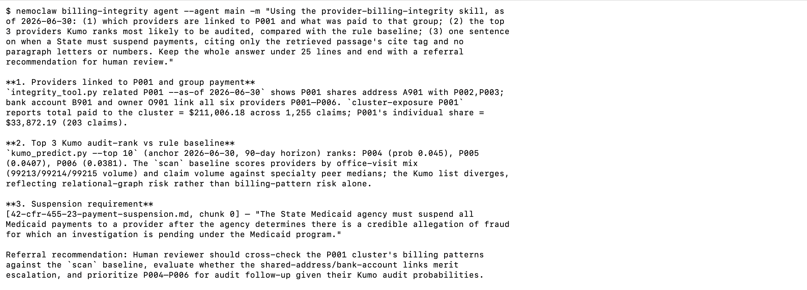

# Provider Billing Integrity

| Catalog field | Value |
| --- | --- |
| Description | Helps program-integrity reviewers find anomalous provider billing, expand each lead to providers linked by shared addresses, bank accounts or owners, and total the paid exposure of each group, ending in a referral recommendation for a human. |
| Industry | 🏛️ Public Sector |
| Requirements | Docker · NemoClaw · NVIDIA Endpoints API key · about 370 MB free in the sandbox · PyPI reachable at install time · optional GPU stage: an NVIDIA GPU with a working CDI setup and about 5 GB more |
| NemoClaw | Unpinned |
| Harness | OpenClaw Unpinned |
| OpenShell | Unpinned |

An OpenClaw agent (or, optionally, a Hermes agent) in a NemoClaw sandbox
reviews 80 synthetic healthcare
providers and about 5,800 synthetic claims. It ranks providers with a
transparent billing-rule baseline, follows shared-entity links to build related
groups, and reports paid exposure. It recommends review and never determines
fraud or suspends payment.

The scenario is built around the **NVIDIA Agent Knowledge Foundation**: the
components that ground an agent's analysis in governed definitions, relational
predictions, retrieved evidence and GPU-accelerated analytics instead of model
memory. See [Agent Knowledge Foundation](#agent-knowledge-foundation) for what
each component does here and which ones this version includes.

> **Status: under development.** The CPU baseline, **Nemotron embed and
> rerank** policy retrieval and **Kumo** risk ranking are included and
> verified. Optional **Auto Ontology** text-to-SQL is included as an integration
> example: it needs a host-side deployment you run yourself, with a local patch
> this repo does not ship (see [Auto Ontology](#auto-ontology-optional)). The
> optional **CUDA-X (RAPIDS)** path runs on a GPU sandbox and was verified on one
> host (see [CUDA-X on a GPU sandbox](#cuda-x-on-a-gpu-sandbox-optional)).
> The skill also installs on the **Hermes** harness (see
> [Hermes harness](#hermes-harness-optional)); that path was run twice, on the
> CPU, retrieval and Kumo stages only.
> See [Verification](#verification) for exactly what was run.

## Agent Knowledge Foundation

Each question a reviewer asks here has a component of the NVIDIA Agent
Knowledge Foundation that answers it best. The table shows the intended design
and what this version actually ships.

| Reviewer question | Foundation component | In this version |
| --- | --- | --- |
| What do the tables mean, and what is the right denominator? | **Auto Ontology**: a semantic layer over the provider-billing database with terms, relationships and measures, queried through grounded text-to-SQL (the generated SQL does not enforce an as-of date; see [Known limitations](#known-limitations)) | **Included, optional.** `ontology_qa.py` checks the semantic layer, asks for question coverage, streams the grounded text-to-SQL answer and prints the generated SQL, the rows and the answer. It needs a host-side Auto Ontology deployment and its token. The skill requires the agent to read and quote the SQL, to cross-check figures that matter, and to report `blocked` when the call fails. Without a token the skill reads the CSV files directly. |
| Who is likely to be audited in the next 90 days? | **Kumo** (`nvidia/kumo-relational`, hosted on build.nvidia.com): relational prediction over providers, addresses, claims and audit findings | **Included.** `kumo_predict.py` builds the graph as of 2026-06-30, asks Kumo the PQL question `PREDICT COUNT(audit_findings.*, 0, 90, days) > 0`, and prints a ranking with the package version, graph sizes and a fingerprint. The skill requires the agent to compare it with the `scan` rule baseline and to say what each uses. If Kumo fails it reports `blocked`; `scan` is never presented as a substitute. |
| What does policy say? | **Nemotron embed and rerank**: retrieval over four public 42 CFR sections with citable passages | **Included.** `retrieve.py` embeds the chunks and query, reranks the closest, and returns each passage with a ready-made `[document, chunk N]` tag the skill requires in every policy statement. If the hosted call fails it reports `blocked` and substitutes nothing. |
| Who is connected, and does it scale? | **RAPIDS** (cuDF, cuGraph through nx-cugraph): the same baseline and related-entity expansion on GPU | **Included, optional, on a GPU sandbox.** `integrity_gpu.py` computes the baseline on cuDF and the clusters on cuGraph, lists the hub entities by betweenness, and `parity` checks that it matches the CPU tool. Without a GPU sandbox it reports `blocked`; the CPU tools (`related`, `cluster-exposure`, standard library) are the default. The sample data is far too small for the GPU to help: it is slower here (see [CUDA-X on a GPU sandbox](#cuda-x-on-a-gpu-sandbox-optional)). |

What the foundation adds is grounding. An answer that names a provider, a
dollar figure or a regulation can be traced to a query, a model run with its
inputs, or a retrieved passage, and a step that cannot run is reported as
blocked rather than filled in from memory. The skill's rules already enforce
the last part: every number comes from a command that was run, and an
unavailable step is reported as blocked.

This recipe places the components inside a NemoClaw sandbox with reviewed
network policy, one at a time. Kumo and Auto Ontology were each exercised on a
small number of runs here (see [Verification](#verification)); the GPU stage ran
once on one H100. Nothing here is a measured accuracy or speed-up.

## Screenshot



One run of the prompt shown, on the CPU, retrieval and Kumo stages (the
Auto Ontology and GPU stages were not called). The agent called
`integrity_tool.py` (related, cluster-exposure), `kumo_predict.py` and
`retrieve.py`, and cited the retrieved passage by its `cite` tag. The wording
differs between runs; the figures come from the tools. In this run the agent
named the Kumo top three but described the `scan` list only in words, so the
side-by-side comparison is in [Expected results](#verification), not in the
capture. Synthetic data throughout.

## At A Glance

| Question | Answer |
| --- | --- |
| Category | NVIDIA Recipe |
| Contributor or provenance | NVIDIA |
| Use this when | A reviewer needs a worked example of agent-assisted related-entity analysis with a human making the final decision. |
| You will get | Ranked leads, related-provider groups with the reason for each link, per-group paid totals, and a referral recommendation. |
| Runs on | A host that runs NemoClaw with Docker. The optional GPU stage also needs an NVIDIA GPU. |
| Requires | NemoClaw, an NVIDIA Endpoints API key for the agent's model. |
| Verified on | NemoClaw v0.0.142, OpenShell v0.0.116, OpenClaw harness (the Hermes path: Hermes Agent v0.21.3, two runs), Ubuntu 22.04, `nvidia/nemotron-3.5-lightning-30b-a3b` on NVIDIA Endpoints, one run per workflow, not repeated at scale. The GPU stage: one NVIDIA H100 NVL, driver 595.91.07 (CUDA 13.2), RAPIDS 26.10. |
| Evidence level | live end-to-end for the CPU, retrieval and Kumo workflows; integration for the optional Auto Ontology stage, which needs a host deployment this repo does not ship |
| Support and maturity | Best-effort community support; see the repository support policy. |
| External access, data, and actions | Inference calls to the configured provider. Three POST paths from sandbox Python to build.nvidia.com: embeddings and rerank (the 42 CFR text and the question) and Kumo, **which receives the provider, address, claim and finding tables**. If you enable Auto Ontology, three paths on `host.openshell.internal:<port>` (the question text, to a deployment you run), which then sends the database schema and the question to its own hosted models, outside the sandbox policy. The install also reaches PyPI, temporarily, to build a roughly 370 MB Python environment, and creates a second OpenShell provider from your key. No write actions. All data is synthetic. |
| Start here | [Quickstart](#quickstart) |
| Confirm success | [Verification](#verification) |

## Quickstart

The only credential is your NVIDIA Endpoints key. NemoClaw stores it through
OpenShell provider plumbing and does not write it into the sandbox.

```bash
cd examples/recipes/nvidia/provider-billing-integrity
cp .env.example .env      # add NVIDIA_INFERENCE_API_KEY (and optionally AUTO_ONTOLOGY_API_TOKEN, AUTO_ONTOLOGY_PORT)
bash scripts/onboard.sh   # create the sandbox (OpenClaw by default; see Hermes harness below)
bash scripts/install.sh   # install the skill, data and tools
bash scripts/start.sh     # ensure the sandbox is running
```

Ask a question:

```bash
nemoclaw billing-integrity agent --agent main -m \
  "Which providers are connected to P001 through shared entities as of 2026-06-30, and what was paid to that group?"
```

Or connect and use the TUI: `nemoclaw billing-integrity connect`, then
`openclaw tui`.

### Hermes harness (optional)

OpenClaw is the default and the most tested path. To run the same skill on the
Hermes harness instead, set `NEMOCLAW_AGENT=hermes` for both scripts, ideally
with its own sandbox name:

```bash
export NEMOCLAW_AGENT=hermes NEMOCLAW_SANDBOX_NAME=bi-hermes   # or set them in .env
bash scripts/onboard.sh && bash scripts/install.sh && bash scripts/start.sh

nemoclaw bi-hermes exec -- hermes -z \
  "Using the provider-billing-integrity skill, as of 2026-06-30: which providers are linked to P001 and what was paid to that group?" \
  --skills provider-billing-integrity
```

What differs from OpenClaw:

- **Where the skill lives.** Hermes keeps skills in `/sandbox/.hermes/skills/`,
  OpenClaw in `/sandbox/.openclaw/workspace/skills/`. `install.sh` picks the
  path from `NEMOCLAW_AGENT` and stops with an error if the skill is not there,
  which is what happens when the value does not match the harness the sandbox
  was onboarded with.
- **Asking a question.** `nemoclaw <name> agent` does not support Hermes. Use
  `hermes -z "<prompt>" --skills provider-billing-integrity` inside the sandbox
  as above, or `hermes chat` after `nemoclaw <name> connect`. Each `-z` call is
  a one-shot prompt that starts a new session, so the session-reset advice
  below does not apply to it (Hermes memory, if you use it, is still loaded).
- **Re-running `install.sh`.** Hermes refuses to replace an installed skill, so
  the script removes the earlier copy first.

The tools, data, egress policy and providers are the same on both harnesses. The
Auto Ontology and GPU stages were not run on Hermes.

## Commands

| Script | Purpose |
| --- | --- |
| `scripts/onboard.sh` | Create the sandbox with the OpenClaw harness, or Hermes with `NEMOCLAW_AGENT=hermes` (CPU-only; `NEMOCLAW_SANDBOX_GPU=1` enables direct GPU access). |
| `scripts/install.sh` | Install the skill. With the `build` provider it also imports the provider profile, creates and attaches a second provider from your key, applies the egress policy, builds the Kumo Python environment in `/sandbox/kumo-venv` (using a temporary `pypi` egress preset, removed again unless it was already applied), and restarts the sandbox (workspace kept) so the agent sees the new credential. With `NEMOCLAW_SANDBOX_GPU=1` it also builds `/sandbox/rapids-venv` after checking `nvidia-smi` works in the sandbox. If `AUTO_ONTOLOGY_API_TOKEN` is set in `.env` it also renders `providers/auto-ontology.yaml` for `AUTO_ONTOLOGY_PORT` (default 4000), creates and attaches a provider from the token, and writes the deployment URL for the skill. |
| `scripts/start.sh` | Recover the gateway and host forwards. |
| `scripts/stop.sh` | Stop the gateway while keeping the sandbox and workspace. |
| `scripts/generate_data.py` | Regenerate the synthetic data (deterministic). |

To delete the sandbox permanently, run `nemoclaw billing-integrity destroy`
and confirm.

An environment variable you set when running a script beats the same name in
`.env`, so `NEMOCLAW_SANDBOX_NAME=bi-gpu bash scripts/onboard.sh` creates a
second sandbox without editing `.env`.

## CUDA-X on a GPU sandbox (optional)

The default sandbox is CPU-only. For the GPU path create a second sandbox with
direct GPU access, then install into it:

```bash
export NEMOCLAW_SANDBOX_NAME=bi-gpu NEMOCLAW_SANDBOX_GPU=1
export NEMOCLAW_SANDBOX_GPU_DEVICE=nvidia.com/gpu=0   # optional: index, UUID or CDI name
bash scripts/onboard.sh && bash scripts/install.sh
```

Needs a host NVIDIA GPU, a driver that supports CUDA 13 (the wheels in
`requirements-gpu.txt` are `-cu13`; swap in the `-cu12` names for a CUDA 12 driver),
and a working CDI spec (`nvidia-ctk cdi generate`; a stale `/etc/cdi/nvidia.yaml` makes
the sandbox fail to start). `install.sh` checks that `nvidia-smi` works in the
sandbox, then builds `/sandbox/rapids-venv` from PyPI (cuDF, nx-cugraph and their CUDA
libraries, about **4.7 GB**, several minutes) while the temporary `pypi` egress preset is
applied. RAPIDS lives in its own environment, apart from Kumo's.

`utilities/integrity_gpu.py` then offers `scan` (the baseline on cuDF), `related`
(connected components on cuGraph and the shared entities with the highest betweenness)
and `parity` (runs both paths and the CPU tool and compares them). It never falls back:
without a GPU or the environment it exits 1 with `blocked`. The GPU holds no secrets and
needs no extra egress. Direct device access does widen what the sandbox can touch, so
enable it only where you want it.

**About speed.** This is a sample dataset (80 providers, about 5,800 claims), so the GPU
path is slower than the CPU one: the work is tiny and the fixed costs of starting the
device, launching kernels and moving data dominate. A GPU speed-up needs a much larger
dataset, in the order of millions of claims and far bigger graphs, where the computation
outweighs those costs. This recipe did not measure where that break-even is, so treat
the large-data benefit as the reason the path exists, not as a result shown here.

## What the skill ships

`skills/provider-billing-integrity/` is installed into the sandbox with its data:

- `data/`: synthetic providers, claims, addresses, bank accounts, beneficiaries
  and audit findings, plus four public-domain 42 CFR sections in `data/documents/`.
- `utilities/integrity_tool.py`: `scan` (rule baseline), `related` (transitive
  related-entity expansion) and `cluster-exposure` (paid totals per group).
- `utilities/retrieve.py`, `utilities/kumo_predict.py`: hosted policy retrieval
  and Kumo ranking.
- `utilities/integrity_gpu.py`: the optional CUDA-X path (cuDF and cuGraph), used only on a
  GPU sandbox.
- `utilities/ontology_qa.py`: Auto Ontology text-to-SQL, used only when the
  deployment's token was set at install time.

The skill sets an as-of date of 2026-06-30 and states that a shared entity is a
lead rather than guilt.

## Auto Ontology (optional)

Auto Ontology is a service you run on the host, not part of the sandbox. This
recipe ships only the sandbox side: an OpenShell provider profile
(`providers/auto-ontology.yaml`) that binds an API token to
`host.openshell.internal:<port>` and sends it as `x-api-key`, and
`ontology_qa.py`. Set `AUTO_ONTOLOGY_API_TOKEN` and `AUTO_ONTOLOGY_PORT` (the
deployment's web port) in `.env`, then run `scripts/install.sh`. The profile
allows three paths and nothing else: `GET /api/semantic-compilation/status`,
`POST /api/question-entity-coverage` and `POST /api/chat/completions`.

The deployment must have a semantic layer compiled over the provider-billing
database. See `ontology/README.md` for what the verified deployment looked like
and the timeout problem to avoid.

**The deployment sends the database schema and each question to its own hosted
model endpoints, using its own configuration. That transfer is outside this
sandbox's egress policy**, so review it separately; the sandbox only controls
the call to the deployment.

## Security notes

- Without Auto Ontology, egress is limited to three POST paths for Python only; with it, add three paths on the host deployment (see [Auto Ontology](#auto-ontology-optional)). The hosted-model paths are: `integrate.api.nvidia.com`
  `/v1/embeddings`, and on `ai.api.nvidia.com` the rerank path and
  `/v1/structured-data/nvidia/kumo-relational/predictions`
  (`policies/nvidia-hosted-models.yaml`), plus the agent's inference provider.
- **Any Python the agent runs can use these paths.** The allowed binaries are `python3*`, so the agent could send other text to embed, rerank or Kumo, not only what the tools send. The policy limits where and which paths, not what is sent. The Auto Ontology profile also allows `172.16.0.0/12` for the host route, wider than one address, narrowed by hostname binding.
- **What leaves the sandbox:** the policy text chunks and the reviewer's
  question go to embed and rerank. **Kumo receives the graph tables**: provider
  specialty, state and address ID, address state, every claim row (provider,
  beneficiary ID, date, procedure code, paid amount) on or before 2026-06-30,
  and the finding rows. Do not point this at real data without a review of
  that transfer.
- `install.sh` adds the `pypi` egress preset only while it builds the Kumo
  environment and removes it afterwards, unless it was already applied.
- The raw API key stays in the OpenShell gateway. The sandbox holds
  `openshell:resolve:env:` placeholders, and OpenShell substitutes the key at
  egress, only on the host each credential is bound to. The embed credential is
  bound to `integrate.api.nvidia.com`; a second provider created by
  `install.sh` (`providers/nvidia-ai-api.yaml`) binds the same key to
  `ai.api.nvidia.com`. Without it, rerank fails with `credential_endpoint_mismatch`.
- The agent works on synthetic data only. Do not load real claims, beneficiary
  or provider data into this example.
- Outputs are recommendations for human review. The skill instructs the agent
  not to assert fraud or order a payment suspension; that is a prompt-level
  rule, not an enforced control.
- To remove the GPU sandbox: `nemoclaw bi-gpu destroy` (it deletes that sandbox and its
  `/sandbox/rapids-venv`); the providers `install.sh` created for it are named
  `bi-gpu-ai-api` (and `bi-gpu-ontology` if you set an Auto Ontology token), removed as below.
- To remove Auto Ontology: `openshell sandbox provider detach billing-integrity billing-integrity-ontology`,
  `openshell provider delete billing-integrity-ontology` and
  `openshell provider profile delete billing-integrity-auto-ontology`.
- To remove the hosted-model setup: `openshell sandbox provider detach billing-integrity billing-integrity-ai-api`,
  `openshell provider delete billing-integrity-ai-api`,
  `nemoclaw billing-integrity policy-remove nvidia-hosted-models`,
  `openshell provider profile delete billing-integrity-nvidia-ai-api`, and
  delete `/sandbox/kumo-venv` inside the sandbox.

## Verification

**Evidence level:** live end-to-end for the offline CPU workflow, Nemotron retrieval and Kumo (one run each; also two runs on the Hermes harness); integration for the optional Auto Ontology stage (one question, against a locally patched host deployment that this repo does not ship)

Onboard, install, then ask one question:

```bash
bash scripts/onboard.sh && bash scripts/install.sh && bash scripts/start.sh
nemoclaw billing-integrity agent --agent main -m \
  "Using the provider-billing-integrity skill: which providers are connected to P001 through shared addresses, bank accounts or owners as of 2026-06-30, what was paid to that group in total, and is P020 part of it? Give a short referral recommendation."
```

**Expected result:** an answer that runs `integrity_tool.py`, names the six-provider
cluster P001 to P006 linked by two addresses, one bank account and one owner,
reports 1,255 claims and a total paid of $211,006.18, states that P020 (206
claims, $24,418.69) shares no entity with the cluster, and ends with a
recommendation for human review that does not assert fraud. Wording varies by
model; the numbers come from the tool and are deterministic.

**This verifies:** sandbox creation, skill installation with its data and
tools, the tool running inside the sandbox, and an agent answer whose figures
match the same tool run on the host.

**This does not verify:** other models, other questions, repeat runs, or Auto Ontology beyond the single question in its own stage.

**Hermes harness.** On a separate sandbox onboarded with
`NEMOCLAW_AGENT=hermes` (Hermes Agent v0.21.3), `install.sh` ran twice with
exit 0, and the tools gave the same results as on OpenClaw: 1,255 claims and
$211,006.18 for the P001 cluster, retrieval cite tags, and a Kumo ranking with
empty stderr. The same three-part prompt as the screenshot was run twice with
`hermes -z`. Both answers contained every figure and cite tag checked
(including the cluster total, claim count, Kumo's top three P004, P005 and P006,
and the scan baseline), and both ended with a referral recommendation. The
narrative had mistakes the tools did not make: one answer named P005 as having
the highest Kumo probability when P004 does, and another garbled which
providers share which entity and said `scan` ranked P001 third. As on OpenClaw,
check the answer against the tool output.

**Policy retrieval.** Reset the agent session first (see
[Known limitations](#known-limitations)), then ask a policy question in a fresh session:

```bash
nemoclaw billing-integrity sessions reset agent:main:main --agent main
nemoclaw billing-integrity agent --agent main --session-id demo-1 -m \
  "Using the provider-billing-integrity skill, answer in this chat: under 42 CFR 455.23, within how many days must a State send notice of a payment suspension, how many days if law enforcement asks in writing to delay it, and what is the longest the delay can run? And what is the normal range of the reenrollment bar after a revocation under 42 CFR 424.535?"
```

**Expected result:** 5 days, 30 days and a 90-day maximum, and a 1 to 10 year bar,
each quote ending in a tag such as `[42-cfr-455-23-payment-suspension.md, chunk 0]`
and `[42-cfr-424-535-revocation.md, chunk 16]`. In the observed run both chunks
contain the quoted text, and the gateway audit log
(`openshell logs billing-integrity | grep reranking`) shows two allowed rerank
calls from `python3`. Chunk numbers depend on the shipped documents.

**This verifies:** the egress policy and second credential binding, that
`retrieve.py` runs from the agent's own shell with placeholders only, and that
an answer's policy quotes match the retrieved chunks.

**This does not verify:** that every policy statement an agent writes is
retrieved. See the limitations.

**Kumo risk ranking.** Reset the session, then ask a risk question:

```bash
nemoclaw billing-integrity sessions reset agent:main:main --agent main
nemoclaw billing-integrity agent --agent main --session-id demo-2 -m \
  "Using the provider-billing-integrity skill, which six providers are most likely to receive an audit finding in the 90 days after 2026-06-30? Answer in this chat. How does that compare with the rule-based billing scan, and how much should I trust the ranking?"
```

**Expected result:** a ranking from `kumo_predict.py` in which P001 to P006 take
the top six places (observed order P004, P005, P006, P001, P002, P003 with scores
between 0.031 and 0.045), the `scan` ranking beside it, and a plain statement
that the Kumo scores are relative and not calibrated, because the graph holds
only 3 prior findings. The tool output lists 80 providers, 4,685 claims and 3
findings in the graph, one HTTP 200 from Kumo in about 1.5 seconds, and two
recorded compatibility changes. The gateway audit log
(`openshell logs billing-integrity | grep kumo-relational`) shows one allowed
POST. Scores and order can change with the hosted model.

**This verifies:** the Kumo egress path and credential binding, the environment
built at install time, the in-process adapter, and that an agent runs Kumo and
reports its ranking and its limits.

**This does not verify:** Kumo's accuracy. Three prior findings make the ranking
a demonstration that the pipeline works, not evidence of predictive skill.

### Stage 5: CUDA-X on a GPU sandbox (optional)

On a sandbox created with `NEMOCLAW_SANDBOX_GPU=1` (see above):

```bash
nemoclaw bi-gpu sessions reset agent:main:main --agent main
nemoclaw bi-gpu agent --agent main -m \
  "Using the provider-billing-integrity skill: run the CUDA-X GPU path and tell me whether it gives the same answers as the CPU tool for as of 2026-06-30. Which GPU did it run on, which libraries, and which entities hold the P001 cluster together? Is the GPU faster here?"
```

**Expected result:** the agent runs `integrity_gpu.py parity` and reports
`all_match: true`, the GPU name, the library versions, the same six-provider cluster
P001 to P006, hub entities `bank_account_id:B901` and `owner_id:O901` (betweenness
0.2778 each) ahead of `address_id:A901` (0.0278), and that the GPU is **not faster** at
this size (about 0.02 s on the CPU against about 0.05 s on the GPU). Run on its own,
`python3 utilities/integrity_gpu.py parity` in the sandbox prints the same receipt.

**This verifies:** GPU passthrough into the sandbox, the RAPIDS environment build, that
cuDF reproduces the baseline scores and the first-ten order, that cuGraph reproduces the
clusters for four providers (P001, P010, P020, P030), and that an agent runs the tool
and reports the result and its limits. The converted graph was checked to be
nx-cugraph's `CudaGraph`, so the graph step is not a silent NetworkX fallback.

**This does not verify:** any speed-up (there is none on this sample data, which is too small to show one), larger data,
other GPUs or drivers, or the CUDA 12 wheels. The agent's own narration can contain
slips: in this run it gave the claim count as "about 400" (the data has about 5,800)
and guessed a cause for the timing. Trust the receipt, not the commentary.

### Stage 4: Auto Ontology (optional)

With a patched Auto Ontology deployment on the host (see `ontology/README.md`),
`AUTO_ONTOLOGY_API_TOKEN` and `AUTO_ONTOLOGY_PORT` set in `.env`, and
`scripts/install.sh` re-run:

```bash
nemoclaw billing-integrity sessions reset agent:main:main --agent main
nemoclaw billing-integrity agent --agent main -m \
  "As of 2026-06-30, how many providers share a bank account with P001, and which are they? Use the provider-billing-integrity skill's Auto Ontology tool, show me the SQL it generated, and say whether that SQL answers my question."
```

**Expected result:** the agent runs `ontology_qa.py`, quotes the generated SQL
and reports five providers, P002 to P006 (the synthetic data puts P001 to P006
on one bank account, B901). The gateway audit log
(`openshell logs billing-integrity -n 5000 | grep ':<port>/api'`) shows the three
allowed calls, status, coverage and chat, and the chat call takes about 20 to 60
seconds. The SQL text varies between runs; the rows did not.

**This verifies:** the header-credential placeholder and the composed egress
policy, that the sandbox reaches the host deployment and nothing else, and that
an agent runs the tool, shows its SQL and reports the result.

**This does not verify:** Auto Ontology's accuracy beyond this one question
(checked against the SQLite file by hand). The first agent attempt in this run
did call the tool but then answered from an older file in its workspace and
misread "SQL" as the agent's own state database; the second, in a fresh session
with a plainer prompt, was correct. Treat the skill's read-the-SQL rule as an
instruction, not enforcement.

Offline checks, without a sandbox or any service call:

```bash
bash scripts/tests/test_lifecycle_commands.sh
bash -n scripts/*.sh scripts/tests/*.sh
```

Check the CPU tool directly:

```bash
cd skills/provider-billing-integrity
python3 utilities/integrity_tool.py scan --as-of 2026-06-30 --top 3
```

Expected: the first command prints `ok`; `bash -n` prints nothing when the
scripts parse; the last command prints a JSON list of three providers with
`score` values. These checks cover only the host scripts and the bundled tool.
`python3 scripts/tests/test_ontology_qa.py` also prints `ok` and checks the
Auto Ontology client against a local fake server, including the cases that must
be reported as `blocked`.

## Roadmap

Each stage adds one Agent Knowledge Foundation component and keeps the CPU tool
as the baseline to compare against.

| Stage | Component | Needs |
| --- | --- | --- |
| 1 | CPU baseline | Done: standard-library tool, offline. |
| 2 | Nemotron embed and rerank for policy evidence | Done: `retrieve.py`, egress policy, second provider, restart on install. Remaining: a larger document set, and measuring retrieval against BM25 (`--method bm25` is included for the comparison). |
| 3 | Kumo risk ranking | Done: `kumo_predict.py`, the Kumo route in the policy and provider profile, a virtual environment built at install time (Python 3.13 wheels, no custom image needed), and the skill's compare-with-baseline rule. Remaining: a Kumo-versus-baseline evaluation on a larger graph. |
| 4 | Auto Ontology | Done for one question: `ontology_qa.py`, a provider profile, install support, and skill rules that require reading the SQL. It was verified against a patched local deployment. Remaining: an upstream fix or a documented supported build, more questions (including ones the layer should decline), and a check that SQL is read when it is wrong. |
| 5 | RAPIDS on GPU | Done for one host: `integrity_gpu.py` (scan, related, parity), an opt-in GPU sandbox in `onboard.sh` and `install.sh`, a separate RAPIDS environment, and a skill rule that treats it as a check. Remaining: a dataset large enough to show where the GPU pays off, and the CUDA 12 wheels. |
| Evidence | Screenshot and a higher evidence level per stage | A real sandbox run of each stage. |

`policies/nvidia-hosted-models.yaml` and `providers/nvidia-ai-api.yaml` cover stages 2
and 3; `providers/auto-ontology.yaml` covers stage 4.

## Known limitations

- **Reset the agent session after changing the skill, and between unrelated
  tests.** OpenClaw keeps one long session (`agent:main:main`). In testing, an
  agent that had earlier read the regulation files directly kept doing so and
  skipped retrieval; after `sessions reset` it ran retrieval as the skill
  instructs. `nemoclaw billing-integrity sessions reset agent:main:main --agent main`.
- **Hermes was run twice, on three stages.** The Hermes path covers the CPU,
  retrieval and Kumo stages with one model. Auto Ontology and the GPU stage
  were not run on it, `nemoclaw <name> agent` does not support it, and the
  narrative of its answers contained errors in both runs (see
  [Verification](#verification)).
- **A new credential reaches the agent only after the sandbox container
  restarts.** `install.sh` does this when it attaches the provider. Without
  it, the agent's rerank call fails with HTTP 403.
- **The skill's rules are instructions, not enforcement.** With the 30B test
  model, retrieval was skipped in a long-running session even after the
  instructions were tightened, and ran in a fresh one. Policy quotes were
  tagged reliably once the tool emitted a ready-made `cite` string to copy. The model's own
  section and paragraph references (for example "(d)(1)") can still be wrong, so
  trust the quoted passage and its `cite` tag, not paragraph numbers the agent
  adds. Check that retrieval ran when it matters.
- **Kumo scores are low and relative.** The maximum is 0.045 with only three
  prior findings in the graph, although the six planted-ring providers lead. Two
  compatibility changes were needed for the hosted service's current
  validation and are recorded in each receipt: the adapter omits the engine's
  default `inference.inference_config`, which the service now rejects, and the
  graph drops the `addresses.street` column, which the service cannot read as
  text. Either change, or the hosted model itself, could affect the scale; they
  were not tested separately. The hosted API can change again.
- **Auto Ontology needs a patched deployment for now.** The upstream build tested
  does answer, but its structured-output calls to the hosted
  reasoning model (`nemotron-3-ultra-550b-a55b`) are slow: coverage returned HTTP
  500 after 224 to 300 seconds and a chat call took 159 seconds, close to the web
  frontend's 300-second limit. A local 44-line patch to `llm_invoke.py` brought
  coverage to under 6 seconds and chat to about 50. The patch does two things,
  disabling the reasoning pass for structured-output calls and honouring
  `LLM_INVOKE_TIMEOUT_S`, and which one matters was not tested. The patch is not
  part of this recipe.
- Auto Ontology's 400 error `unknown field guided_json` in the deployment log is
  misleading: it is the last of three request shapes the client tries, and the
  earlier ones failed on timeouts.
- The generated SQL does not carry the 2026-06-30 as-of date, so "as of" in a
  question is not enforced. The `providers` table has no date column, and the
  claims table runs to 2026-09-30, so an Auto Ontology total over claims can
  include rows after the anchor. SKILL rule 1 cannot be met by this tool; the
  skill tells the agent to cross-check figures that matter with
  `integrity_tool.py`.
- **Stage 4 is not reproducible from this repo.** It needs an Auto Ontology
  deployment with the provider-billing database loaded and the semantic layer
  compiled, plus the local patch described in `ontology/README.md`. The recipe
  ships no loader, semantic-layer definition or patch, so treat stage 4 as an
  integration example.
- A stale file from an earlier session in the agent's workspace
  (`referral_P001_recommendation.md`) was read in place of a tool result in one
  run. Reset the session and clear stale outputs when testing.
- The Kumo tool runs a small loopback adapter in its own process and makes sure
  loopback bypasses the sandbox egress proxy. Without that, the agent's shell,
  which lacks a loopback `no_proxy` entry, got a policy denial on the client's
  health check and the agent reported Kumo as blocked.
- When Kumo is blocked, an agent may still show the `scan` ranking next to a
  clear "blocked" note. The skill forbids presenting it as a Kumo result, but
  that is an instruction, not enforcement.
- The first retrieval builds an embedding cache in the sandbox's temp directory
  (about 12 seconds); later queries take about 2 seconds. One early first run
  failed after two minutes and could not be reproduced.
- Verified with one model and a few questions. The default model for `build` was
  changed to `nvidia/nemotron-3.5-lightning-30b-a3b` because the previous
  default returned HTTP 404 for the test key; availability depends on your
  NVIDIA Endpoints account. Set `NEMOCLAW_MODEL` in `.env` to any model your
  key can call.
- The sandbox is created with `--no-sandbox-gpu` unless you set `NEMOCLAW_SANDBOX_GPU=1`.
  On the test host GPU passthrough first failed on a stale CDI file, which
  `sudo nvidia-ctk cdi generate --output=/etc/cdi/nvidia.yaml` fixed.
- **The GPU path is slower on this sample data.** At 80 providers and about 5,800 claims it
  takes about 0.05 s against 0.02 s on the CPU, because the data is too small to outweigh
  the device's fixed costs. Seeing a large GPU speed-up needs a much larger dataset, which
  this recipe does not include or measure. The path shows the same answers on the device,
  not a speed-up.
- **The RAPIDS environment is large** (about 4.7 GB) and its versions float: the
  requirements file pins only the cuDF and nx-cugraph series, and cuDF chooses pandas
  3 (Kumo's environment keeps pandas 2.3). Wheels are `-cu13`.
- The parity check compares the baseline and four clusters, not every provider's
  cluster, and does not compare `cluster-exposure`.
- NemoClaw limits sandbox names to 19 characters.
- The data is synthetic and small; results show the method works, not that it
  would perform on real programs.

## Third-party services and dependencies

Uses the installed NemoClaw and OpenClaw (or Hermes) components and NVIDIA Endpoints for
inference. The CPU tools and `retrieve.py` use only the Python standard library.
The optional GPU path needs `cudf-cu13`, `nx-cugraph-cu13` (RAPIDS 26.10) and `networkx`
(`utilities/requirements-gpu.txt`), installed from PyPI into `/sandbox/rapids-venv`; RAPIDS
is Apache-2.0 and the CUDA libraries it pulls in carry NVIDIA's own licence terms.
`kumo_predict.py` needs `kumo-relational-client[relational]==1.0.2` and pandas
(`skills/provider-billing-integrity/utilities/requirements-kumo.txt`), which
`install.sh` installs from PyPI into a virtual environment inside the sandbox;
they are not vendored, and their transitive dependencies are not pinned. Each
package and the hosted services are subject to their own terms and availability.
The 42 CFR text under `data/documents/` is public-domain U.S. regulation text.
