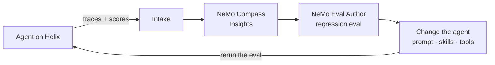

<!-- markdownlint-disable MD013 -->
<!-- SPDX-FileCopyrightText: Copyright (c) 2026 NVIDIA CORPORATION & AFFILIATES. All rights reserved. -->
<!-- SPDX-License-Identifier: Apache-2.0 -->
<!-- markdownlint-enable MD013 -->

# CAE FreeCAD Agent Harness Optimization

| Catalog field | Value |
| --- | --- |
| Description | Deploys a CAD agent on NeMo Helix against a live desktop application, scores its geometry, finds what it gets wrong with NeMo Compass, turns that into a proven Harbor eval with NeMo Eval Author, and improves the agent against the eval. |
| Industry | 🏭 Manufacturing |
| Requirements | macOS · Python 3.12+ · FreeCAD 1.1 with freecad-mcp · NeMo Helix 0.7.1 · Docker Desktop and Colima · Harbor 0.22.0 · a coding agent · inference credentials |
| NemoClaw | N/A |
| Harness | LangChain Deep Agents 0.7.25 |
| OpenShell | N/A |

A worked, end-to-end harness optimization loop for an agent that drives a real
application. Deploy it on [NeMo Helix](https://github.com/NVIDIA-NeMo/nemo-helix),
measure it against ground truth, find what it gets wrong with
[NeMo Compass](https://github.com/NVIDIA-NeMo/nemo-compass), turn that into a
regression eval with [NeMo Eval Author](https://github.com/NVIDIA-NeMo/eval-author),
then change the agent and keep only what the eval says is better.

The agent runs on **Nemotron 3.5 Lightning**, a small model, and must rebuild any part
it is given as a mesh. The eval holds two different parts. At the start the agent froze
FreeCAD in 5 of 6 runs and passed none. Thirteen **rounds** of the loop, each one
pass through Steps 2 to 6 below, took it to 8 of 12, 4 of 6 on each part.

## Screenshot


The task: rebuild each blue mesh as an editable FreeCAD model. Orange is the final
agent's reconstruction of each part: a native PartDesign body (IoU 0.940 for both)
whose named dimension rebuilds it. The same routine built both; nothing in it is
specific to either part. Lofting slices leaves a ragged rim on part 1 (see
[Known limitations](#known-limitations)).

## At A Glance

| Question | Answer |
| --- | --- |
| Category | Developer Tool |
| Contributor or provenance | NVIDIA |
| Use this when | You have a specialised agent that calls an external application through tools, and you want to find its failures in traces, turn them into a regression eval, and improve the agent against measurement. |
| You will get | A Helix deployment of a Deep Agents CAD agent with every run traced; Compass Insights in Studio; a proven Harbor eval of two parts with five checks each; and a measured, round-by-round journey with its final agent. |
| Runs on | macOS, with FreeCAD running on the same host. |
| Requires | See [Prerequisites](#prerequisites). |
| Verified on | macOS, FreeCAD 1.1.3, NeMo Helix 0.7.1, Deep Agents 0.7.25, NeMo Compass `462f09c`, NeMo Eval Author `20f95a0`, Harbor 0.22.0, Colima. |
| Evidence level | Live end to end with Nemotron 3.5 Lightning (see [Results](#results)); unit tests for the scorer and the Harbor agent. |
| Support and maturity | Compass and Eval Author are research previews. [Best-effort community support](../../../SUPPORT.md). Pin versions. |
| External access, data, and actions | Installation downloads packages. Live runs send prompts, geometry descriptions, traces and the Ethos to your inference endpoints, write telemetry to your Helix instance, execute agent-written Python inside FreeCAD, and change the FreeCAD documents on your screen. |
| Start here | [Prerequisites](#prerequisites) |
| Confirm success | [Verification](#verification) |

## Why this exists

General-purpose harnesses are strong at orchestration, but they do not carry your
domain. Turning a mesh into a **parametric CAD model** is a good example: the result
has to be a real feature tree of sketches and features with dimensions a designer
can change. A model that looks right but cannot be edited is worthless, and an agent
that reports success is not evidence that it succeeded.

Closing that gap is **harness engineering**: changing the system prompt, skills,
subagents and tool access until a general harness behaves like a specialist. This
example makes every change answer to measurement:



1. **Run** the agent on Helix, with every run traced to Intake.
2. **Score** each run and attach the score to its trace.
3. **Write an Ethos**: what the agent is for, and what it must never trade away.
4. **Find** recurring problems in the traces with Compass, which files them as Insights.
5. **Turn** the Insights into a proven eval with Eval Author, so any change can be graded.
6. **Change** the agent, rerun the eval, and keep only what measures better.

Nothing here is CAD-specific.

## Results

A run passes only when all five checks of the eval pass:

| Check | What it verifies |
| --- | --- |
| `single-valid-solid` | The document holds one PartDesign body with one clean solid: it passes FreeCAD's full shape check, including self-intersections. |
| `native-feature-tree` | The solid is built from sketches by native PartDesign features, not a scripted shape. |
| `named-dimension-drives-geometry` | Changing a named dimension by 10% changes the rebuilt solid, so the model is editable. |
| `mesh-fidelity` | The solid overlaps the reference mesh with IoU ≥ 0.9. |
| `single-visible-object` | Only the finished model is visible, as the task asks. |

The eval has two tasks, [part-1-reconstruction](evals/part-1-reconstruction/) and
[part-2-reconstruction](evals/part-2-reconstruction/): the same instruction and the
same five checks, with a different reference part each. The [Ethos](ETHOS.md) asks for
a method that works for any part, so a change that helps one part and breaks the other
does not count.

Each round ran the eval three times per part (six from round 12), with 10 minutes per
run:

| Round | What Compass and the traces showed | Change to the agent | Part 1 | Part 2 | Median tokens per run |
| --- | --- | --- | --- | --- | --- |
| 0. Base agent | | | 0/3 | 0/3 | 1.4 M |
| 1. Session rules | Host discovery on FreeCAD's GUI thread froze it; the mesh was converted to static shapes | Rules for the live session; a skill of tested FreeCAD recipes | 0/3 | 0/3 | 4.9 M |
| 2 to 8. A routine the agent can run | The geometry missed the mesh (IoU at most 0.35) and was never measured | A tested routine that builds and measures any part; then six fixes so the model runs it as written¹ | 0 of 9 runs | | 2 M to 7 M |
| 9. Code files and one call | The agent only saw part of the skill's code | The routine in three files of under 100 lines, run with one `step(...)` call | 2/3 | 1/3 | 1.2 M |
| 10. Self-checks and recovery | Copy errors; tinkering after `DONE` | Blocks that test themselves; `step` recovers, finishes in one call and checks editability | 3/3, then 1/3² | 2/3, then 1/3² | 0.3 M, then 1.3 M |
| 11. Stronger self-tests | A copy error the self-test missed | A self-test on a small box (rejected) | 1/3 | 2/3 | 2.6 M |
| 12. One skill file | The agent tried to load the code files from inside FreeCAD | The blocks back in one `SKILL.md`, read whole (stopped early) | 0/1 | 1/2 | 5.1 M |
| 13. **One skill file, box self-tests** | Round 12's copy errors passed the old self-test | Round 12 with round 11's self-tests | **4/6** | **4/6** | **0.8 M** |

¹ Each stopped after one or two runs, as soon as the trace showed the next failure:
code retyped wrongly, Deep Agents' `read_file` showing only 100 lines of the skill, the
agent rewriting the driver code or trying to load the skill's files from inside
FreeCAD. See [results/](results/README.md#round-by-round).
² Round 10 was measured twice; its first result overstated it, so rounds 12 and 13 ran
six attempts per part.

The final agent ([results/final-agent](results/final-agent/agent.yaml)) passed 8 of 12
runs, 4 of 6 on each part. When it follows the routine it scores IoU 0.94 on both parts
in about a minute; its failures are the model going off-plan (a mangled copy, a disk
search that froze FreeCAD, changes after `DONE`). The biggest gains came from removing
work: a tested routine the agent runs instead of writing CAD code, then one call
instead of several. One change that looked like an improvement measured worse, and one
round that looked good did not hold up when measured again. Per-check tables and what each round taught are in
[results/](results/README.md).

## Prerequisites

- **FreeCAD 1.1** with the [freecad-mcp](https://github.com/neka-nat/freecad-mcp) addon
  in your FreeCAD `Mod/` folder and its RPC server enabled. Launch the GUI normally.
- **[uv](https://docs.astral.sh/uv/) 0.10.10 or later**, Python 3.12+ and Node.js.
- **Docker Desktop**, running: Helix keeps Intake's database in a container.
- **[Colima](https://github.com/abiosoft/colima)** for the eval: Harbor runs the
  verifier with no network access, which Docker Desktop on macOS cannot enforce.
- **A coding agent** for Eval Author's skills and the experiment step. Eval Author
  supports [Claude Code, Codex, Cursor and others](https://github.com/NVIDIA-NeMo/eval-author/blob/main/docs/getting-started.md#install-eval-author-with-npx).
- **An inference provider** with a tool-calling model for the agent (this example uses
  Nemotron 3.5 Lightning) and one with structured output for Compass.

Install NeMo Helix with the Deep Agents harness, Harbor and Compass, then start Helix
and Colima:

```bash
uv tool install "nemo-helix[all,nemo-agents-plugin-deepagents]==0.7.1"
uv tool install harbor==0.22.0
uv tool install 'insight-agent @ git+https://github.com/NVIDIA-NeMo/nemo-compass.git@462f09c'
export NEMO_AGENTS_GATEWAY_READ_TIMEOUT=1800   # CAD runs take minutes
nemo setup
colima start
```

`nemo setup` starts the services, registers your inference provider and discovers its
models. Studio opens at `http://localhost:8080/studio/`. If port 8080 is taken, run
`nemo services run --port 9090` and `nemo config set --base-url http://localhost:9090`
before `nemo setup`, export `NHX_BASE_URL=http://localhost:9090`, set the same URL in
the `base_url` of `agent/agent.yaml` (the agent reaches its model through Helix), and
pass `--trace.intake.base-url $NHX_BASE_URL` to Compass in Step 3. See the
[Helix setup guide](https://docs.nvidia.com/nemo-helix/documentation/get-started/setup/)
for other options.

## Start Here

```bash
cd examples/tools/cae-freecad-agent-harness-optimization
```

### Step 1: Deploy the agent

[agent/agent.yaml](agent/agent.yaml) is the base agent: a Deep Agents harness with the
freecad-mcp tools, and a short prompt that covers how this environment works (read
skill files in full, the mesh path is only valid inside FreeCAD, keep FreeCAD calls
short, which tools are broken) but nothing about CAD modelling. The loop has to find
the rest. Edit two fields in it: set `model:` to your model entity, and the
freecad MCP server's `url:` to the absolute path of `uvx` (Helix runs the MCP command
from there):

```bash
nemo models list --all-pages    # e.g. nvidia-nvidia-nemotron-3-5-lightning
command -v uvx
```

Then deploy and smoke-test it:

```bash
nemo agents create --name cad-agent --agent-config "$PWD/agent/agent.yaml"
nemo agents deploy --agent cad-agent --name cad-agent-deployment --mode subprocess
nemo agents invoke --agent-deployment cad-agent-deployment \
  --input "List the FreeCAD documents currently open."
```

The agent's `telemetry` block declares every tool it can call, so each trace records
them and Compass can check tool use. To start from the measured final agent instead,
deploy `results/final-agent/agent.yaml` the same way.

### Step 2: Run the agent and score every run

[task/instruction.md](task/instruction.md) asks for a parametric reconstruction of a
mesh such as [reference_part.obj](meshes/reference_part.obj). [scorer/score.py](scorer/score.py)
scores the result by IoU against the mesh, and [ETHOS.md](ETHOS.md) says what the
score is for. The **Ethos** states what the agent is for, what it must not do, and what
success looks like: here, an IoU of 0.9 or more *from a native, editable feature
tree*, never one without the other. Compass checks every trace against it, and Eval
Author builds evals from it. See the
[Ethos guide](https://github.com/NVIDIA-NeMo/eval-author/blob/main/ethos/README.md).

Run both tasks three times each with the example's Harbor agent,
[harness/helix_cad_agent.py](harness/helix_cad_agent.py). It invokes the deployment,
scores the result, and attaches the score to the run's trace in Intake:

```bash
export DOCKER_HOST="unix://$HOME/.colima/default/docker.sock"
export CAD_AGENT_TIMEOUT=600 CAD_FREECAD_RESTART="$PWD/harness/restart_freecad.sh"
PYTHONPATH=harness harbor run -p evals \
  -a helix_cad_agent:HelixCadAgent --n-attempts 3 -n 1 --jobs-dir results/runs
```

This uses the eval that Step 4 explains; here it is simply a way to run and score the
agent. Runs go one at a time because there is one FreeCAD session.
`CAD_AGENT_TIMEOUT=600` gives each run the 10 minutes the results used, and the restart
script relaunches FreeCAD if a run freezes it. Before each run the Harbor agent also
installs a small guard ([harness/freecad_guard.py](harness/freecad_guard.py)) that turns
two FreeCAD 1.1 traps into ordinary errors: `Part.Shape()` given something other than a
shape aborts FreeCAD outright, and `newDocument()` with a name already open silently
creates `EvalPart1`, `EvalPart2`... that nobody grades. If FreeCAD still goes down mid-run, the run is
stopped within 30 s instead of waiting for the timeout. Each trial's `verifier/results` lists
the five checks.

### Step 3: Find the problems with NeMo Compass

[NeMo Compass](https://github.com/NVIDIA-NeMo/nemo-compass) reads a large set of traces
and reports recurring problems as **Insights**, each backed by at least two traces. It
finds them with five [Compass signals](https://github.com/NVIDIA-NeMo/nemo-compass/blob/main/docs/compass-signals.md),
each of which runs only when the traces carry what it needs:

| Signal | What it looks for | Needs |
| --- | --- | --- |
| Ethos divergence | Behavior that breaks the agent's purpose, rules or boundaries | `ETHOS.md` |
| Grader failures | What runs with poor recorded scores have in common | Scores on the traces, from Step 2 |
| Tool issues | Failing, invalid or misused tool calls | Recorded tool spans; tool schemas for argument checks |
| Anomalies and patterns | Unusual runs and recurring behavior across the set | Varied traces |
| User sentiment | Recurring user complaints | User messages and an embedding model (off here) |

Copy [.env.example](.env.example) to `.env` and fill in Compass's model. Then run
Compass over the window (UTC) that covers your Step 2 runs, and publish the Insights
to Studio:

```bash
cp .env.example .env
insight-agent --config analyst.yaml \
  --trace.intake.query.started-at-gte 2026-10-14T09:00:00Z \
  --trace.intake.query.started-at-lte 2026-10-14T10:00:00Z
uv run --with pyyaml python publish.py insights.yml
```

[analyst.yaml](analyst.yaml) points Compass at Helix Intake, gives it `ETHOS.md`, and
sets `code_base` to the agent folder so it can check each finding against the agent's
configuration. Read the `Ran:` line it prints to see which signals ran.


### Step 4: Turn the Insights into an eval with NeMo Eval Author

An Insight says what went wrong. To know whether a change fixes it, without breaking
something else, you need an **eval**: tasks with checks that grade any version of the
agent the same way. The more distinct behaviors the checks cover, the less room a
change has to pass while getting worse.

[NeMo Eval Author](https://github.com/NVIDIA-NeMo/eval-author) is a set of skills that
guides a coding agent to build those evals from your agent's code, its Ethos and its
traces. Install the skills for your coding agent (`claude-code`, `codex`, `cursor` and
[others](https://github.com/NVIDIA-NeMo/eval-author/blob/main/docs/getting-started.md#install-eval-author-with-npx)):

```bash
npx skills add NVIDIA-NeMo/eval-author --skill '*' --agent <your-coding-agent> --yes
```

Then ask your coding agent to run `eval-author-trace-environment` on a trace the
Insights cite. It turns that trace into a [Harbor](https://www.harborframework.com/)
task, records the ground truth (the reference mesh, plus a passing model as the
reference solution), and will not sign the task off until it is proven: empty
submissions score 0, the reference solution scores 1, and a realistic wrong answer
scores 0, with no network access. Here it produced
[evals/part-1-reconstruction](evals/part-1-reconstruction/), graded by
the five checks in [Results](#results). A second task,
[part-2-reconstruction](evals/part-2-reconstruction/), gives the same instruction and
checks a second part, so the eval tests that the agent's method is not tuned to one
shape. It was proven with the same controls (see [evals/](evals/README.md)).

Each time you rerun Compass, ask it to review the new Insights with
`eval-author-task-create` in proposal mode: does the eval already catch each failure,
or does it need a new check? That is how `single-visible-object` was added.

### Step 5: Change the agent and measure it

Neither Compass nor Eval Author changes the agent. This example does that step with a
skill written for this exercise only,
[cad-experimenter](skills/cad-experimenter/SKILL.md): read the Insights and their
traces, diagnose, propose up to two candidates, deploy each beside the agent under
study, run the eval as in Step 2, and report. A human decides what ships. Install it
for your coding agent and ask it to run a round:

```bash
npx skills add ./skills --skill cad-experimenter --agent <your-coding-agent> --yes
```

A candidate can change the system prompt, skills, subagents or tool gating in
`agent.yaml`; the skill's [levers table](skills/cad-experimenter/SKILL.md#levers) says
where each lives. Its working files go under `experiments/`, which is git-ignored.

### Step 6: Promote the winner and resolve the Insight

Redeploy the winning candidate as `cad-agent`, rerun Step 2's eval, and mark the
Insights it fixed as resolved:

```bash
nemo agents undeploy --agent cad-agent --yes && nemo agents delete cad-agent --yes
nemo agents create --name cad-agent --agent-config "$PWD/experiments/<round>/<candidate>/agent/agent.yaml"
nemo agents deploy --agent cad-agent --name cad-agent-deployment --mode subprocess
curl -X PATCH -H 'Content-Type: application/json' -d '{"status": "resolved"}' \
  "${NHX_BASE_URL:-http://localhost:8080}/apis/insights/v2/workspaces/default/insights/<insight-id>"
```

The next round starts with fresh runs of the promoted agent, back at Step 2.

## Environment variables

Compass reads its model from `.env` ([.env.example](.env.example)). Everything else is
read from your shell:

| Variable | Default | What it does |
| --- | --- | --- |
| `NHX_BASE_URL` | `http://localhost:8080` | The Helix URL, for `publish.py` and the Step 6 `curl`. |
| `NEMO_AGENTS_GATEWAY_READ_TIMEOUT` | `300` | Helix's gateway timeout; set it before `nemo setup`. |
| `CAD_AGENT`, `CAD_DEPLOYMENT` | `cad-agent`, `cad-agent-deployment` | The agent the Harbor agent runs. |
| `CAD_AGENT_TIMEOUT` | `1800` | Seconds for one run. The results used 600. |
| `CAD_FREECAD_RESTART` | none | Command that relaunches a frozen FreeCAD ([harness/restart_freecad.sh](harness/restart_freecad.sh) on macOS). |
| `FREECAD_RPC` | `http://127.0.0.1:9875` | The freecad-mcp addon's RPC endpoint. |

Keep credentials in Helix (`nemo setup`) or `.env`, never in `agent.yaml`.

## Troubleshooting

| Symptom | Cause | Fix |
| --- | --- | --- |
| `the 'deepagents' package is required for the Deep Agents adapter` | Helix was installed without the Deep Agents harness. | Install with the `nemo-agents-plugin-deepagents` extra, as in [Prerequisites](#prerequisites). |
| Compass reports `unknown_tool` for built-in tools | The tool is missing from the agent's `telemetry` tool definitions. | Declare every tool the agent can call, including the Deep Agents built-ins. |
| `execute_code() takes 2 positional arguments but 3 were given` | freecad-mcp 0.1.24 sends a `timeout` argument that an older FreeCAD addon does not accept. | Update the addon and restart FreeCAD, or tell the agent never to pass `timeout`. |
| A run outlives `nemo agents invoke --timeout` | The client timeout does not stop the run on the server. | Redeploy the agent. The Harbor agent does this after a failed run. |
| The verifier fails to start | Docker Desktop cannot enforce Harbor's no-network mode. | Use Colima, with the example under your home folder. |
| The agent runs a truncated copy of a long skill | Deep Agents' `read_file` returns 100 lines unless a larger `limit` is passed. | Keep each file the agent must read whole under 100 lines, as the final agent's skill does. |
| A skill never reaches the agent | Deep Agents' `skills.paths` does not load on this Helix version. | Ship `skills/<name>/SKILL.md` in the agent folder with `environment.workspace: .` and point to it from the prompt. |

## Known limitations

- **Two parts, few runs.** Three to six runs per part per round; a difference of one
  run is noise. The eval shows the method works for two different parts, not for
  every part. An agent
  you mean to ship needs a set of tasks covering the work it will see.
- **The reconstructions are close, not clean.** The routine lofts measured slices, so
  part 1 has a ragged rim where the lofts fold through themselves. The results above
  were graded before `single-valid-solid` became strict; under the strict check the
  final agent's part-1 models fail, and its sketches are free B-spline profiles with no
  Sketcher constraints: one named dimension (`Params.Height`) drives every section,
  which the eval accepts but a designer would want more of. Compass raised the second
  point in round 10.
- **The routine reaches the agent as code it must copy.** Each run, the model copies
  three blocks from its skill into FreeCAD. The blocks test themselves, but in a third
  of the final runs the model still went off-plan: it wrote its own code after a
  failed copy, searched the disk, or kept changing a finished model.
- **The fifth check was added after part 1's task was proven**, and re-proven with the
  same controls (see [evals/](evals/README.md)).
- **The agent executes Python inside FreeCAD on your machine.** Keep the RPC listener on
  loopback and use a FreeCAD session with nothing you need to keep.
- **macOS only, as verified.**

## Verification

**Evidence level:** local/static for the tests below; the results above are from live
runs.

```bash
uv run --python 3.13 --with-requirements requirements.txt python -m unittest discover -s tests
```

**Expected result:**

```text
Ran 42 tests

OK
```

**This verifies:** the scorer's IoU arithmetic and the Harbor agent's helpers, without
credentials, services or FreeCAD.

**This does not verify:** the live path. For that, complete Steps 1 to 3: an
invocation that returns, eval trials that each report the five checks, their traces in
Intake with the `iou` score, and Insights in Studio.

## Teardown

```bash
nemo agents undeploy --agent cad-agent --yes
nemo agents delete cad-agent --yes
colima stop
```

Close the `EvalPart` document in FreeCAD. `results/runs/` and `experiments/` are
git-ignored; delete them freely.

## Provenance and license

Contributed by NVIDIA under the repository's [Apache-2.0 license](../../../LICENSE).
An earlier version of this example ran the same CAD agent on NeMo Platform, which is now
NeMo Helix. The eval task was authored with NeMo Eval Author; the `cad-experimenter`
skill was written for this example. NeMo Helix, NeMo Compass, NeMo Eval Author, Harbor
and freecad-mcp are installed by the reader and not vendored here.
