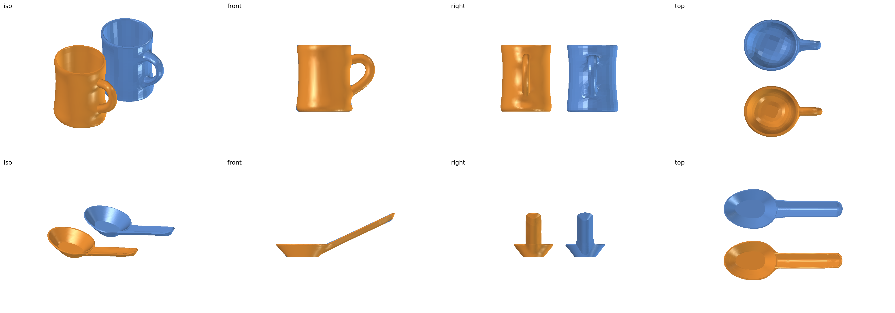
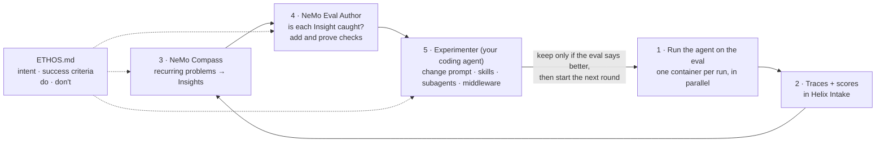
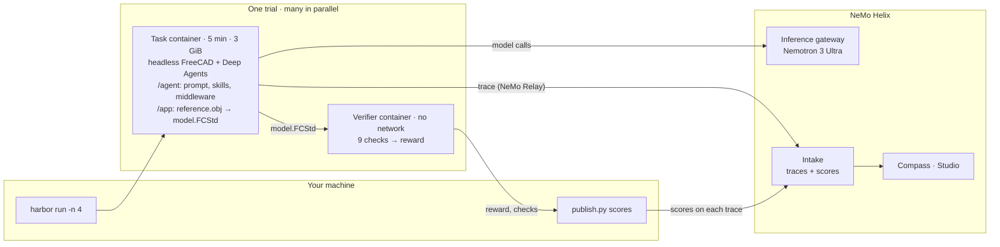

<!-- markdownlint-disable MD013 -->
<!-- SPDX-FileCopyrightText: Copyright (c) 2026 NVIDIA CORPORATION & AFFILIATES. All rights reserved. -->
<!-- SPDX-License-Identifier: Apache-2.0 -->
<!-- markdownlint-enable MD013 -->

# CAE FreeCAD Agent Harness Optimization

| Catalog field | Value |
| --- | --- |
| Description | Runs a CAD agent next to headless FreeCAD in one container per run, traces every run to NeMo Helix, finds what it gets wrong with NeMo Compass, turns that into a proven Harbor eval with NeMo Eval Author, and improves the agent against the eval. |
| Industry | 🏭 Manufacturing |
| Requirements | Python 3.12+ · NeMo Helix 0.7.1 · Docker (Colima on macOS) · Harbor 0.22.0 · a coding agent · inference credentials |
| NemoClaw | N/A |
| Harness | LangChain Deep Agents 0.7.25 |
| OpenShell | N/A |

A worked, end-to-end loop for improving an AI agent that drives an engineering tool.
The agent here turns a 3D scan-like mesh of a part into an editable CAD model in
[FreeCAD](https://www.freecad.org/). Each round, the agent runs on a small benchmark,
its runs are analysed for recurring problems, the benchmark gains checks for the
problems that matter, a coding agent changes the agent, and the change is kept only if
the benchmark says it is better.

The example's main lesson is about the **Ethos**, a short document that states what the
agent is for, what success looks like, and what it must and must not do. Every part of the
loop reads it, and the loop optimizes exactly what it says. Here the agent first reached a
perfect score while missing what the owner actually wanted; one revision of the Ethos,
and the checks that came from it, steered the next rounds to an agent that models the part
the way an engineer would. The final agent, on **Nemotron 3 Ultra**, passes all nine checks
on 10 of 10 runs ([Results](#results)).

## Screenshot


The task: rebuild each blue mesh as an editable FreeCAD model. Orange is the final
agent's reconstruction from a typical run: a smooth body lofted through measured
cross-sections, a cavity cut from the measured floor, and a branch (a tube swept along the
measured centre line on the left, an arm lofted from the rim on the right), driven by
named dimensions such as height, floor and branch length. The agent chose these features
and wrote the code itself. Its overlap with the mesh (IoU, see below) is 0.949 and 0.915,
with 18 and 39 faces. Rendered headless from the saved files with
[skills/cad-experimenter/render](skills/cad-experimenter/render/), which the experimenter
also uses from four directions to look for artefacts:



## At A Glance

| Question | Answer |
| --- | --- |
| Category | Developer Tool |
| Contributor or provenance | NVIDIA |
| Use this when | You have a specialised agent that drives an engineering tool, and you want to find its failures in traces, turn them into a regression eval, and improve the agent against measurement. |
| You will get | A containerized Deep Agents CAD agent with every run traced to Helix; Compass Insights in Studio; a proven Harbor eval of two parts with nine checks each; and a measured, round-by-round journey, including an Ethos revision, with its final agent. |
| Runs on | Any host with Docker and NeMo Helix; verified on macOS with Colima. |
| Requires | See [Prerequisites](#prerequisites). |
| Verified on | macOS, Colima (4 CPU, 16 GiB), FreeCAD 1.1.3 (conda-forge, in the images), NeMo Helix 0.7.1, Deep Agents 0.7.25, NeMo Relay 0.7.3, NeMo Compass `462f09c`, NeMo Eval Author `20f95a0`, Harbor 0.22.0. |
| Evidence level | Live end to end with Nemotron 3 Ultra (see [Results](#results)); unit tests for the IoU math and `publish.py`. |
| Support and maturity | Compass and Eval Author are research previews. [Best-effort community support](../../../SUPPORT.md). Pin versions. |
| External access, data, and actions | Installation downloads packages and images. Live runs send prompts, geometry descriptions, traces and the Ethos to your inference endpoints and write telemetry to your Helix instance. The agent runs Python it writes, inside its own container, which can reach only Helix. |
| Start here | [Prerequisites](#prerequisites) |
| Confirm success | [Verification](#verification) |

## Why this exists

General-purpose agent harnesses are strong at orchestration, but they do not carry your
domain. Turning a mesh into a **parametric CAD model** is a good example: the result has
to be a real feature tree of sketches and features, with dimensions a designer can
change. A model that looks right but cannot be edited is worthless, and an agent that
reports success is not evidence that it succeeded.

Closing that gap is **harness engineering**: changing the agent's system prompt, skills,
subagents and middleware until a general harness behaves like a specialist. Done by hand,
it is guesswork. This example makes every change answer to measurement, with these parts:

| Part | What it is |
| --- | --- |
| **Ethos** ([ETHOS.md](ETHOS.md)) | The agent's specification in plain language: its purpose, its success criteria, what to do and what never to do, and what may be changed. Written by the agent's owner. |
| **Eval** ([evals/](evals/README.md)) | The benchmark: two tasks (two different parts), each graded by a set of pass/fail **checks**. A run scores 1 only if every check passes. Run with [Harbor](https://www.harborframework.com/). |
| **IoU** | Intersection over union: how much the model's volume and the mesh's volume overlap, from 0 (none) to 1 (identical). One of the checks requires IoU ≥ 0.9. |
| **[NeMo Helix](https://github.com/NVIDIA-NeMo/nemo-helix)** | The platform the agent uses: it serves the model and stores every run's trace, with its score, in Intake. |
| **[NeMo Compass](https://github.com/NVIDIA-NeMo/nemo-compass)** | An analysis agent that reads many traces against the Ethos and reports recurring problems as **Insights**, each backed by the traces that show it. |
| **[NeMo Eval Author](https://github.com/NVIDIA-NeMo/eval-author)** | Skills for your coding agent that build and review the eval: for each Insight, does a check already catch it, or does the eval need a new one? Every check is **proven**: an empty answer scores 0, a known-good answer 1, and a realistic wrong answer 0. |
| **Experimenter** ([skills/cad-experimenter](skills/cad-experimenter/SKILL.md)) | Your coding agent following one skill: diagnose from the Insights and traces, build up to two candidate agents, test them. |

One round of the loop:



**Why the Ethos and the checks matter most.** The loop optimizes what it can measure, and
it measures what the Ethos asks for. A vague Ethos lets the agent pass while missing the
point; a precise one, with clear intent, success criteria and things not to do, gives
Compass something to judge traces against and gives Eval Author something to turn into
checks. Each check closes one way to pass while getting worse, so the more distinct
behaviours the checks cover, the more a passing score means. In this example Eval Author
grew the eval from five checks to nine, each from evidence in the traces, and each new
check changed which agent the loop kept.

**Why the eval is the hard part.** As the
[Eval Author team puts it](https://github.com/NVIDIA-NeMo/eval-author/blob/main/docs/dev-notes/posts/2026-10-08-introducing-eval-author.md),
building agentic evals splits into *measurement* (turn what the agent should do, here the
Ethos, into goals, and find where the eval falls short of them) and *generation* (for each
gap, a task: an input, an environment and a verifier, each checked for accuracy). Their
warning, that agents readily take shortcuts that pass a task while missing the behaviour it
was meant to test, is exactly what happened here: a one-command script passed every check.
In this loop Compass supplies the evidence for measurement, Eval Author generates and
proves the checks (an empty answer scores 0, the reference solution 1, a realistic wrong
answer 0), and each new check removed one shortcut.

**Not tied to any infrastructure.** Compass is an agent that reads traces, and Eval
Author is a set of skills for a coding agent; neither prescribes how your agent is built,
which framework it uses or where it is deployed. The experiment step is delegated to your
coding agent. So the same loop fits whatever framework and infrastructure your agent
already uses. Here the agent is LangChain Deep Agents in a container per run, and nothing
is CAD-specific: swap FreeCAD for your solver, mesher or CAD kernel.

## How it runs

Each eval run (a *trial*) gets its own container, built from the task's
[environment](evals/part-1-reconstruction/environment/Dockerfile): headless FreeCAD 1.1.3,
the Deep Agents runtime, NeMo Relay for tracing, and the part's mesh. A separate container
with no network grades the saved model.



| Piece | What it does |
| --- | --- |
| [agent/](agent/agent.yaml) | The agent: `agent.yaml` (name, model, a short system prompt), with `skills/` and an optional `middleware.py` beside it. This folder is all the loop changes. |
| [harness/run_agent.py](harness/run_agent.py) | Inside the container: builds the Deep Agents agent from the folder with a real shell rooted at `/app`, its skills, subagents and middleware; reaches the model through the Helix gateway; traces the run with NeMo Relay; stops it after 5 minutes. |
| [harness/cad_agent.py](harness/cad_agent.py) | The Harbor agent: uploads the agent folder and starts the runner in each trial's container. |
| [evals/](evals/README.md) | Two Harbor tasks with one instruction and one verifier. |
| [publish.py](publish.py) | After a job, attaches each run's grade to its trace; publishes Compass Insights to Studio. |
| [controls/](controls/) | Generates negative controls from the reference solutions, and grades a saved model, to prove each check fails what it should. |
| [skills/cad-experimenter](skills/cad-experimenter/SKILL.md) | The process one round of the loop follows, including rendering models to look at them. |

The agent sees real paths: the mesh at `/app/reference.obj`, its skills under
`/agent/skills/`, and any file it writes, so a skill can ship code the agent runs with
`freecadcmd`. The container's network reaches only Helix, so a run cannot see other runs,
the eval's solution, or the rest of your machine.

## Results

> These are the end results of the whole optimization: the final agent first, then the
> rounds that led to it. [Start Here](#start-here) walks through running each step
> yourself; [results/](results/README.md) has every round in detail.

**Final agent** ([results/final-agent](results/final-agent/agent.yaml)): a short prompt,
three knowledge skills (measure the mesh, build features, verify the model) with small
building blocks the agent composes in its own build script, and a clock middleware. On
Nemotron 3 Ultra it passed **10 of 10** confirmation runs, five per part, all nine checks
passing: IoU 0.949-0.952 with 18 faces on part 1, 0.910-0.924 with 38-39 faces on part 2,
about 3.5 minutes and 0.12 M tokens per run.

A run passes only when all nine checks pass:

| Check | What it verifies |
| --- | --- |
| `recomputes-after-reopen` | Every feature rebuilds from its inputs after the file is reopened. |
| `single-valid-solid` | One PartDesign body with one solid that passes FreeCAD's full shape check, including self-intersections. |
| `native-feature-tree` | The solid is built from sketches by native PartDesign features, not a scripted shape. |
| `named-dimension-drives-geometry` | Changing a named dimension by 10% rebuilds one clean solid whose size changes by at least 1%. |
| `independent-dimensions` | Two named dimensions each move the part in a different way: design intent, not one stretch. |
| `mesh-fidelity` | IoU with the reference mesh ≥ 0.9. |
| `no-missing-feature` | No whole feature is left out: the largest piece of the part the model misses is at most 1.2% of its volume. |
| `single-visible-object` | Only the finished model is visible when the file is opened. |
| `compact-model` | At most 10× the faces of the reference solution: a designer's model, not a stack of slices. |

### How it got there

The run had three chapters. **First**, from a two-sentence prompt, the loop reached 10 of
10 in four rounds, with an agent that ran one reconstruction script. **Then** the owner
saw that this met the Ethos as written but not the intent (a designer could only make
the part taller) and revised the Ethos: the agent writes its own model, dimensions carry
design intent, the method generalizes. Eval Author turned that into a new check and the
same agent fell to 0 of 10. **Last**, four more rounds produced an agent that models the
part itself; rendering the models showed artefacts no check measured, and fixing those
exposed one more gap in the eval, closed with one more check.


| Round | What changed | Runs passed | Checks | IoU (part 1 · part 2) |
| --- | --- | --- | --- | --- |
| 0 | Base agent: a two-sentence prompt | 0/4 | 0% | none |
| 1 | A skill with a one-command reconstruction script | 0/4 | 79% | 0.92 · 0.78 |
| 2 | Lofts instead of stacked slices (rejected) | 0/4 | 64% | none · 0.85 |
| 3 | Valid joints and a trustworthy overlap estimate | **4/4** | 100% | 0.97 · 0.94 |
| | *Ethos revised; `independent-dimensions` added* | | | |
| 4 | Round 3's agent, re-graded | 0/4 | 88% | 0.97 · 0.94 |
| 5 | The agent writes its own model from knowledge skills (rejected) | 0/4 | 9% | none |
| 6 | Feature-level building blocks; a planner subagent | 2/4 | 94% | 0.92 · 0.80 |
| 7 | A clock, and a save that says what is missing; subagent dropped | **4/4** | 100% | 0.93 · 0.95 |
| 8 | Smoother bodies and branches (smoke test only) | | | 0.95 · 0.63 |
| 9 | The branch starts on the rim's flat face | 4/4 | 100% | 0.95 · 0.93 |
| | *`no-missing-feature` added; round 9 re-graded to 3/4* | | | |
| 10 | A branch that is never dropped | **4/4** | 100% | 0.95 · 0.93 |

*Checks* is the share of the eval's checks passed over the round's four runs (the eval
grew from seven to nine checks). [results/](results/README.md) has what each round's traces
and Insights showed and why each change was made, and
[results/insights](results/insights/README.md) every Compass Insight, which check caught it
and which round fixed it.

## What the loop built

The loop only ever changed the agent folder: system prompt, skills, subagents and
middleware. From the [base agent](agent/agent.yaml) (two sentences, nothing else) to the
[final agent](results/final-agent/):

| Layer | Base agent | Final agent | Why (round) |
| --- | --- | --- | --- |
| System prompt | "You are a CAD Agent… work in /app." | Five steps: measure, plan the features with world numbers and 2-3 named dimensions, build and save, fix what the save reports, stop and report in time. | Runs spent their time learning FreeCAD or ended mid-build (0, 7) |
| Skill `measure-mesh` | none | One command that prints the mesh's sections along each axis, branch centre lines and a STRUCTURE summary. | The agent misread the part's structure: a body lofted too high, a cut through the floor (7) |
| Skill `build-features` | none | `cadkit.py`: sketches, lofts through the mesh's own sections, pipes, holes, named dimensions, all in world coordinates; the agent composes them in its own build script. | Raw FreeCAD API code failed in every run (5, 6) |
| Skill `verify-model` | none | Reopens the saved model: one clean solid, an overlap estimate, which regions are wrong, whether the named dimensions move the part independently. | Success was claimed without evidence (1, 3, 7) |
| Middleware | none | A clock on every tool result and a stop-and-report one minute before the limit. | Runs ended mid-build with no report (7) |
| Subagents | none | none | A measuring subagent (5) and a planner subagent (6) handed the main agent lossy summaries; dropped in round 7 |

The agent still decides which features describe the part and writes the code; the
skills take the FreeCAD API and the measuring away. One model, Nemotron 3 Ultra, does
all of it.

## Taking this further

Two parts are enough to show the loop working, not to show the agent generalizes. To
take an agent like this to production:

- **Many more tasks**, covering the parts and edge cases the agent will meet.
- **A train set and a test set.** Let the experimenter iterate against the train tasks
  only, and report the agent on test tasks it never saw, so a change that overfits the
  training parts shows up as a drop on the test set. Here the experimenters saw both
  parts, so the 10 of 10 is a training score.
- **More checks from the Ethos.** Every principle the eval cannot check (here: whether a
  missing small feature is caught, whether the model would work in any orientation) is a
  way to pass while getting worse; Eval Author can turn each into a proven check.
- **Your organisation's design knowledge.** The agent here learned from two meshes and a
  made-up example. In practice, give it what your engineers already have: design
  guidelines and modelling standards as skills (how features are ordered, which
  dimensions are named and how, tolerances and conventions), and reference models of
  previous designs as examples it can study for how a feature tree is structured. The
  same material belongs in the Ethos where it states intent, so Compass and Eval Author
  hold the agent to it.

## Prerequisites

- **[uv](https://docs.astral.sh/uv/) 0.10.10 or later** and Python 3.12+.
- **Docker** that can enforce per-container network rules. On macOS, Docker Desktop
  cannot; use [Colima](https://github.com/abiosoft/colima), and keep the example
  under your home folder (Colima mounts only that).
- **A coding agent** for Eval Author's skills and the experiment step. Eval Author
  supports [Claude Code, Codex, Cursor and others](https://github.com/NVIDIA-NeMo/eval-author/blob/main/docs/getting-started.md#install-eval-author-with-npx).
- **An inference provider** with a tool-calling model for the agent (this example uses
  Nemotron 3 Ultra) and one with structured output for Compass.

Install NeMo Helix, Harbor and Compass, then start Helix and Colima:

```bash
uv tool install "nemo-helix[all]==0.7.1"
uv tool install harbor==0.22.0
uv tool install 'insight-agent @ git+https://github.com/NVIDIA-NeMo/nemo-compass.git@462f09c'
nemo setup
colima start --cpu 4 --memory 16
export DOCKER_HOST="unix://$HOME/.colima/default/docker.sock"
```

`nemo setup` starts the services, registers your inference provider and discovers its
models; Studio opens at `http://localhost:8080/studio/`. See the
[Helix setup guide](https://docs.nvidia.com/nemo-helix/documentation/get-started/setup/).
Then tell the tools where Helix is:

```bash
export NHX_BASE_URL=http://localhost:8080                 # from this host
export CAD_HELIX_URL=http://host.docker.internal:8080     # from the containers
```

Each trial is capped at 3 GiB; 16 GiB fits four trials in parallel (`-n 4`).

## Start Here

```bash
cd examples/tools/cae-freecad-agent-harness-optimization
```

### Step 1: Run the agent and score every run

[agent/agent.yaml](agent/agent.yaml) is the base agent: a two-sentence prompt and no
skills. Pick a model from `nemo models list --all-pages` and run both tasks, two
attempts each, four at a time:

```bash
PYTHONPATH=harness harbor run -y -p evals -a cad_agent:CadAgent \
  -m nvidia-nvidia-nemotron-3-ultra --n-attempts 2 -n 4 --jobs-dir runs --job-name base
python publish.py scores runs/base
```

The first build of the task image takes a few minutes. Each trial's
`verifier/results` lists the nine checks; `agent/run.log` starts with the run's trace
ID, and `publish.py scores` attaches the reward, IoU, failed checks and complexity to
that trace, so Compass can see how each run was graded.

The [Ethos](ETHOS.md) is what those scores are for: what the agent is for, what it
must not do, and what success looks like (here, an IoU of 0.9 or more *from a native,
editable, compact feature tree*, never one without the other). See the
[Ethos guide](https://github.com/NVIDIA-NeMo/eval-author/blob/main/ethos/README.md).

### Step 2: Find the problems with NeMo Compass

[NeMo Compass](https://github.com/NVIDIA-NeMo/nemo-compass) reads a set of traces and
reports recurring problems as **Insights**, each backed by at least two traces. It
finds them with [Compass signals](https://github.com/NVIDIA-NeMo/nemo-compass/blob/main/docs/compass-signals.md),
each of which runs only when the traces carry what it needs:

| Signal | What it looks for | Needs |
| --- | --- | --- |
| Ethos divergence | Behavior that breaks the agent's purpose, rules or boundaries | `ETHOS.md` |
| Grader failures | What poorly scored runs have in common | Scores on the traces, from Step 1 |
| Tool issues | Failing, invalid or misused tool calls | Tool spans and schemas, which NeMo Relay records |
| Anomalies and patterns | Unusual runs and recurring behavior | Varied traces |
| User sentiment | Recurring user complaints | User messages and an embedding model (off here) |

Copy [.env.example](.env.example) to `.env`, fill in Compass's model, and run it over
the window (UTC) of your Step 1 runs:

```bash
cp .env.example .env
insight-agent --config analyst.yaml --trace.intake.base-url $NHX_BASE_URL \
  --trace.intake.query.started-at-gte <start> --trace.intake.query.started-at-lte <end>
uv run --with pyyaml python publish.py insights insights.yml
```

[analyst.yaml](analyst.yaml) points Compass at Intake and gives it `ETHOS.md` and the
agent folder, so it can check each finding against the agent's configuration. The Insights it
produced in each round of this run, and how each was resolved, are in
[results/insights](results/insights/README.md).


### Step 3: Turn the Insights into an eval with NeMo Eval Author

An Insight says what went wrong. To know whether a change fixes it without breaking
something else, you need an **eval**: tasks with checks that grade any version of the
agent the same way. [NeMo Eval Author](https://github.com/NVIDIA-NeMo/eval-author) is a
set of skills that guides a coding agent to build those evals from your agent's code,
its Ethos and its traces:

```bash
npx skills add NVIDIA-NeMo/eval-author --skill '*' --agent <your-coding-agent> --yes
```

Ask your coding agent to run `eval-author-trace-environment` on a trace the Insights
cite. It turns the trace into a [Harbor](https://www.harborframework.com/) task and
will not sign it off until it is proven: an empty submission scores 0, the reference
solution scores 1, and a realistic wrong answer scores 0, with no network access. Here
it produced [part-1-reconstruction](evals/part-1-reconstruction/); a second part,
[part-2-reconstruction](evals/part-2-reconstruction/), checks that the agent's method
is not tuned to one shape. Each time you rerun Compass, ask Eval Author
(`eval-author-task-create`, proposal mode) whether the eval already catches each new
Insight. That is how `recomputes-after-reopen` and `compact-model` were added
([evals/](evals/README.md) has the checks, the controls and how to rerun them).

### Step 4: Change the agent and measure it

Neither Compass nor Eval Author changes the agent. This example does that with a skill
written for it, [cad-experimenter](skills/cad-experimenter/SKILL.md): read the
Insights and their traces, diagnose, build up to two candidate agent folders, test
them in the agent's own image, and report. Install it for your coding agent and ask it
to run a round:

```bash
npx skills add ./skills --skill cad-experimenter --agent <your-coding-agent> --yes
```

A candidate is a copy of the agent folder: system prompt, skills (with helper
scripts), subagents or middleware; the Ethos's Change Scope says what may change.
Measure it exactly like Step 1, pointing Harbor at the candidate folder:

```bash
PYTHONPATH=harness harbor run -y -p evals -a cad_agent:CadAgent -m <model> \
  --ak agent_dir=$PWD/experiments/<round>/candidates/<name>/agent \
  --n-attempts 2 -n 4 --jobs-dir runs --job-name <name>
python publish.py scores runs/<name>
```

Keep a candidate only if it passes more runs than the agent under study (or as many
runs and more checks), with no part and no check worse. Copy the winner over `agent/`,
mark the Insights it fixed as resolved in Studio, and start the next round at Step 1.

## Environment variables

Compass reads its model from `.env` ([.env.example](.env.example)). Everything else is
read from your shell:

| Variable | Default | What it does |
| --- | --- | --- |
| `NHX_BASE_URL` | `http://localhost:8080` | Helix as this host reaches it, for `publish.py`. |
| `CAD_HELIX_URL` | `http://host.docker.internal:8080` | Helix as the containers reach it: the model gateway and Intake. |
| `NHX_WORKSPACE` | `default` | The Helix workspace, for both. |
| `DOCKER_HOST` | Docker's default | The Colima socket on macOS. |

The 5-minute run limit and 3 GiB memory cap live in each task's
[task.toml](evals/part-1-reconstruction/task.toml). Keep credentials in Helix
(`nemo setup`) or `.env`, never in `agent.yaml`.

## Troubleshooting

| Symptom | Cause | Fix |
| --- | --- | --- |
| `harbor run` stops at a prompt about environment variables | The tasks read `CAD_HELIX_URL` and `NHX_WORKSPACE` from your shell. | Pass `-y`. |
| The verifier or agent container fails to start | Docker Desktop on macOS cannot enforce Harbor's network rules. | Use Colima, with the example under your home folder. |
| Every run fails to reach the model | The container cannot resolve or reach `CAD_HELIX_URL`. | Check Helix's port; on native Linux, map `host.docker.internal` to the host gateway. For Helix on another host, also change `allowed_hosts` in each `task.toml`. |
| `publish.py scores` skips a trial | Its trace never reached Intake (the run was killed before NeMo Relay sent it). | Rerun the trial. |
| A trial is killed by memory | FreeCAD's full shape check on a model with thousands of faces needs several GB. | That is the 3 GiB cap working; such a model fails `compact-model` anyway. |

## Known limitations

- **Two parts, few runs.** Two runs per part per round, ten for the final agent; the eval
  shows the method works for two different parts, not for every part, and no rotated or
  held-out part was tested. An agent you mean to ship needs tasks covering the work it
  will see.
- **The measurement scripts suggest feature calls.** The agent decides the features and
  writes the model, and Compass found no Ethos divergence, but the hints sit close to the
  Ethos's "no reconstruction routine" line.
- **Thin missing features.** `no-missing-feature` sees a missing piece thicker than about 3%
  of the part's size; a thinner one, with IoU still above 0.9, would pass. The agent's own
  save also compares the measured structure with the model.
- **Remaining artefacts.** Mild waviness on part 1's body and a faint square on its cavity
  floor; a slight crease under part 2's arm at the rim and a shallow groove at its tip.
- **`independent-dimensions` can be met by two stretches along different axes.** It is a
  starting point for design intent; Compass reads the Ethos for the rest.
- **The agent's report can overstate.** The saved file is what is graded.
- **`single-visible-object` reads saved visibility.** A file whose Body is hidden but whose
  tip is visible passes; whether FreeCAD's GUI then shows the part is unconfirmed.
- **The eval's network rule is per host.** The agent's container can reach any port on
  the Helix host, not only Helix.
- **Span status is always "success".** Intake shows every span of these traces as
  successful, even a failed tool call; Compass reads the tool output instead. Platform
  feedback for Helix.
- **Helix deployments cannot run this agent.** Helix's Deep Agents adapter gives the agent
  a virtual file system and no shell, so the agent runs in the task container and Helix
  provides the model, traces and analysis. Platform feedback: a real-path workspace and a
  shell backend would let the same agent deploy on Helix.

## Verification

**Evidence level:** local/static for the tests below; the results above are from live
runs.

```bash
uv run --python 3.13 --with-requirements requirements.txt python -m unittest discover -s tests
```

**Expected result:**

```text
Ran 46 tests

OK
```

**This verifies:** the verifier's IoU arithmetic, how `publish.py` reads trace IDs and
grades, and that the two tasks' verifier copies, check lists and reference face counts
agree, without credentials, services or Docker.

**This does not verify:** the live path. For that, run the controls in
[evals/](evals/README.md#rerun) (NOP 0, Oracle 1, every negative 0), then Step 1: four
trials that each report nine checks, and their traces in Intake with `reward` and
`iou` attached.

## Teardown

```bash
colima stop
```

`runs/` and `experiments/` are git-ignored; delete them freely. Harbor removes each
trial's containers; `docker image prune` removes the task images.

## Provenance and license

Contributed by NVIDIA under the repository's [Apache-2.0 license](../../../LICENSE).
The eval tasks were authored with NeMo Eval Author; the `cad-experimenter` skill was
written for this example. NeMo Helix, NeMo Relay, NeMo Compass, NeMo Eval Author,
Harbor, Deep Agents and FreeCAD are installed by the reader (FreeCAD from conda-forge
inside the task images) and not vendored here.
