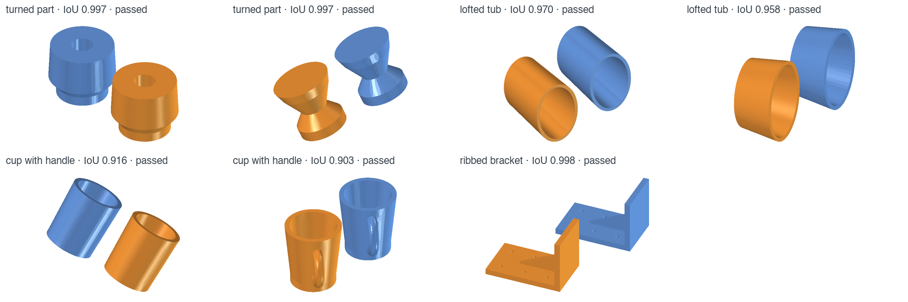
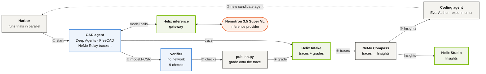
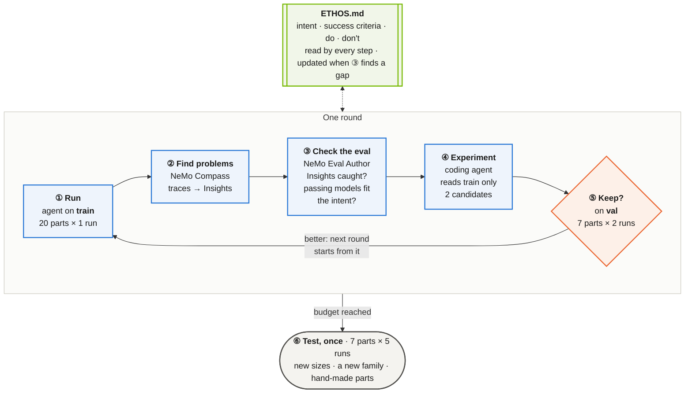
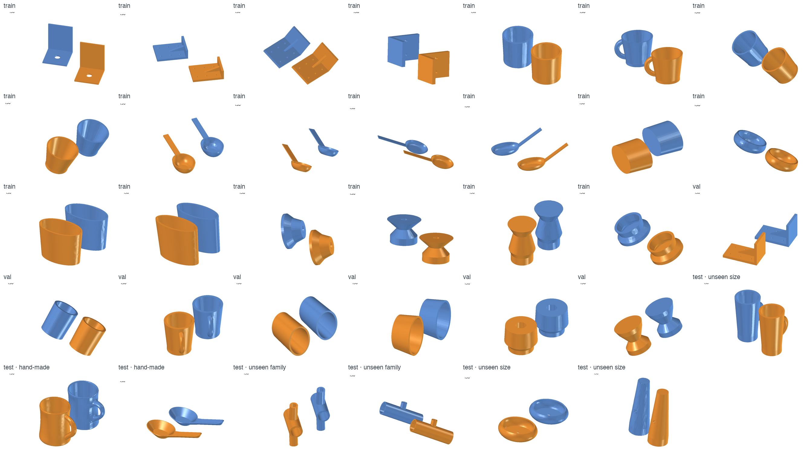
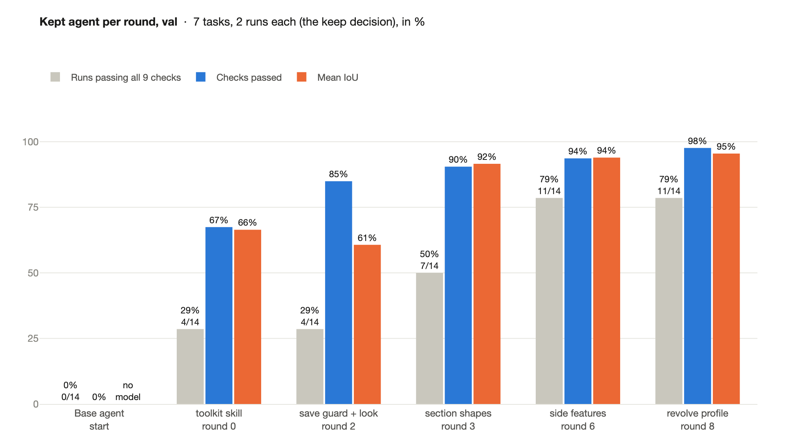
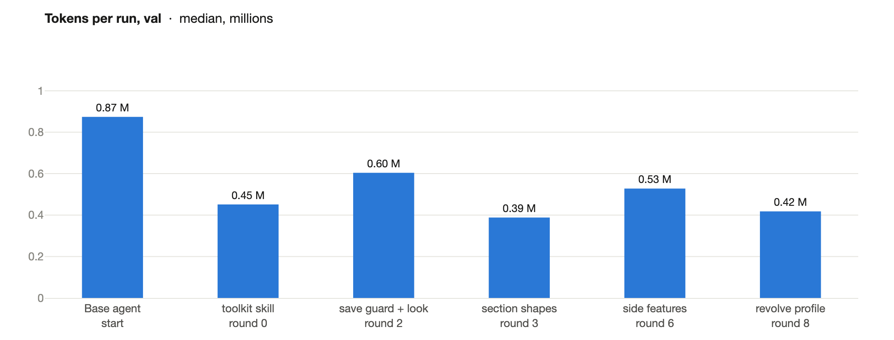
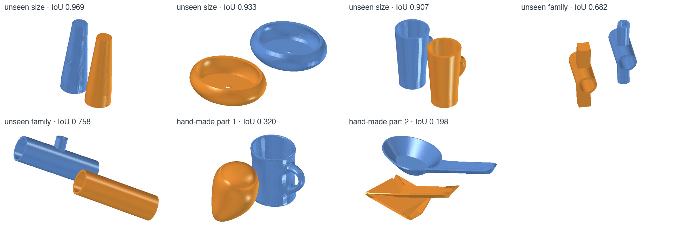
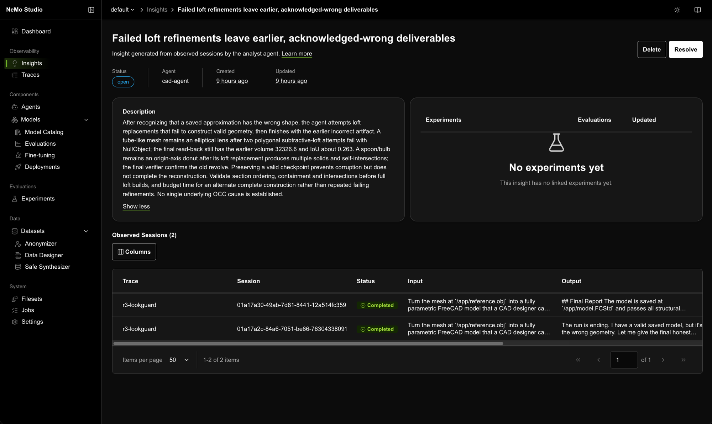
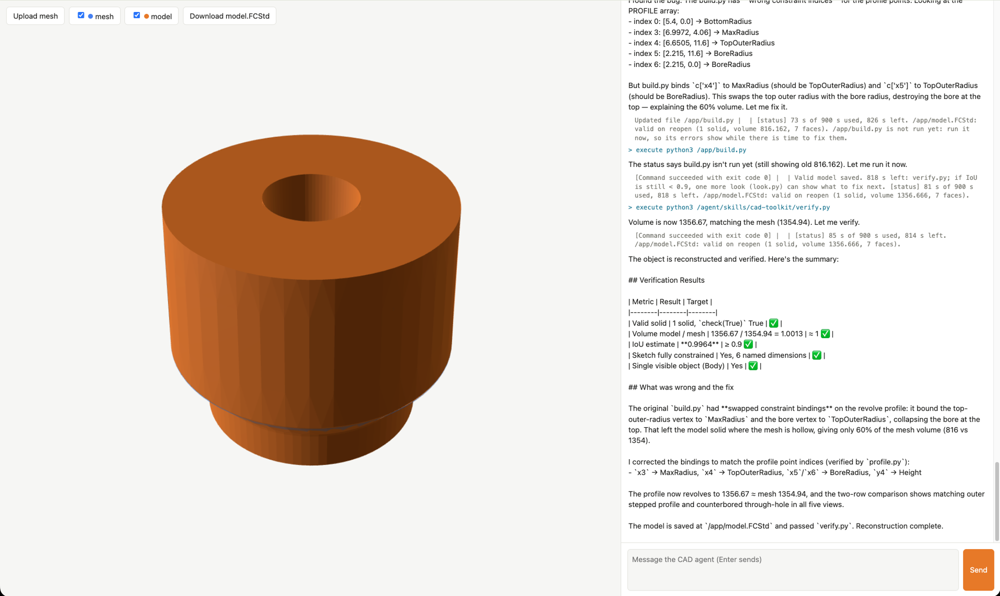

<!-- markdownlint-disable MD013 -->
<!-- SPDX-FileCopyrightText: Copyright (c) 2026 NVIDIA CORPORATION & AFFILIATES. All rights reserved. -->
<!-- SPDX-License-Identifier: Apache-2.0 -->
<!-- markdownlint-enable MD013 -->

# CAE FreeCAD Agent Harness Optimization

| Catalog field | Value |
| --- | --- |
| Description | Runs a CAD agent next to headless FreeCAD, traces every run to NeMo Helix, finds its failures with NeMo Compass, holds it to a proven Harbor eval built with NeMo Eval Author, and keeps only changes that improve it on parts it never saw. |
| Industry | 🏭 Manufacturing |
| Requirements | Python 3.12+ · NeMo Helix 0.8.1 · Docker (Colima on macOS) · Harbor 0.24.0 · a coding agent · inference credentials |
| NemoClaw | N/A |
| Harness | LangChain Deep Agents 0.7.32 |
| OpenShell | N/A |

A worked, end-to-end loop for improving an AI agent that drives an engineering tool.
The agent here turns a 3D scan-like mesh of a part into an editable CAD model in
[FreeCAD](https://www.freecad.org/). Each round, the agent runs on a set of training
parts, its runs are analysed for recurring problems, a coding agent changes the agent,
and the change is kept only if it does better on parts the coding agent never saw. At
the end, the final agent is measured once on a test set.

The agent runs on **Nemotron 3.5 Super VL**, a model that reads images, so it can render
its own model beside the mesh and look at the difference. From a two-sentence prompt
that saved no model on train or val, nine rounds built an agent that passes all nine checks on
**11 of 14** validation runs, and **7 of 35** test runs against 0 for the base agent
([Results](#results)). The test set also shows where it stops: it builds valid, editable
models of new sizes of the parts it was improved on, but not yet of a new family of
parts or of the two hand-made parts.

## Screenshot



The task: rebuild each blue mesh as an editable FreeCAD model. Orange is the final agent's
best run on each validation part, which no experimenter saw: turned parts, lofted tubs,
cups with handles and a ribbed bracket, each in a random pose, built from sketches and
PartDesign features driven by named dimensions. The agent measured the mesh, chose the features and wrote the code itself; every model here
passes all nine checks. Rendered headless with
[skills/cad-experimenter/render](skills/cad-experimenter/render/).

## At A Glance

| Question | Answer |
| --- | --- |
| Category | Developer Tool |
| Contributor or provenance | NVIDIA |
| Use this when | You have a specialised agent that drives an engineering tool, and you want to find its failures in traces, hold it to a proven eval, and improve it against measurement on tasks it was not tuned on. |
| You will get | A containerized Deep Agents CAD agent with every run traced to Helix; Compass Insights in Studio; a proven Harbor eval of 34 parts with nine checks each, split into train, val and test; and a measured, round-by-round run with its final agent. |
| Runs on | Any host with Docker and NeMo Helix; verified on macOS with Colima. |
| Requires | See [Prerequisites](#prerequisites). |
| Verified on | macOS, Colima (4 CPU, 16 GiB), FreeCAD 1.1.3 (conda-forge, in the images), NeMo Helix 0.8.1, Deep Agents 0.7.32, NeMo Relay 0.10.4, NeMo Compass 0.1.0, NeMo Eval Author `48c2b3b`, Harbor 0.24.0. |
| Evidence level | Live end to end with Nemotron 3.5 Super VL (see [Results](#results)); unit tests for the IoU math, `publish.py` and the eval's consistency. |
| Support and maturity | Compass and Eval Author are research previews. [Best-effort community support](../../../SUPPORT.md). Pin versions. |
| External access, data, and actions | Installation downloads packages and images. Live runs send prompts, geometry descriptions, renders, traces and the Ethos to your inference endpoints and write telemetry to your Helix instance. The agent runs Python it writes, inside its own container, which can reach only Helix. |
| Start here | [Prerequisites](#prerequisites) |
| Confirm success | [Verification](#verification) |

## Included artefacts

What each step of the loop does, and what it left in this folder. Run folders, traces and
renders of every run stay in the git-ignored `experiments/`.

| Step | What you do | Checked-in artefacts | Made by |
| --- | --- | --- | --- |
| Specify | Write what the agent is for and must not do | [ETHOS.md](ETHOS.md) | you |
| Eval | Tasks and checks, proven before use | [34 tasks in train, val and test](evals/), [splits](evals/splits.json), [proof](evals/README.md#proof), [manifest](evals/manifest.json) | NeMo Eval Author |
| 1 · Run and score | The agent under study on train (and val), one container per run | [every agent's grades and tokens](results/rounds.json) | [loop/eval.sh](loop/eval.sh) |
| 2 · Find problems | NeMo Compass on the round's train traces | [each round's Insights](results/insights/) | [loop/compass.sh](loop/compass.sh) |
| 3 · Check the eval | Is each Insight caught? Do passing models fit the Ethos? | [Insight-to-check trail](results/insights/README.md) | [loop/EVAL-AUTHOR.md](loop/EVAL-AUTHOR.md) |
| 4 · Experiment and keep | Candidates from train; the keep rule on val | [every candidate](results/README.md#every-candidate), [round charts](assets/rounds-val.png) | [cad-experimenter](skills/cad-experimenter/SKILL.md), [loop/summary.py](loop/summary.py) |
| Test | The final agent and the base agent, once | [test results](results/README.md#the-final-agent-on-every-split), [renders](assets/final-test.png) | [loop/eval.sh](loop/eval.sh) |
| Result | The agent the loop built | [final agent](results/final-agent/), [browser chat](chat/README.md) | the loop |

## Why this exists

General-purpose agent harnesses are strong at orchestration, but they do not carry your
domain. Turning a mesh into a **parametric CAD model** is a good example: the result has
to be a real feature tree of sketches and features, with dimensions a designer can
change. A model that looks right but cannot be edited is worthless, and an agent that
reports success is not evidence that it succeeded.

Closing that gap is **harness engineering**: changing the agent's system prompt, skills,
subagents and middleware until a general harness behaves like a specialist. Done by hand,
it is guesswork. This example makes every change answer to measurement, and measures it
on parts the change was not made for.

### The pieces

| Piece | What it does in this example |
| --- | --- |
| **Ethos** ([ETHOS.md](ETHOS.md)) | The agent's specification in plain language: purpose, success criteria, what to do and never do, what may change. Compass, Eval Author and the experimenter all read it, and the loop optimizes what it says. |
| **Eval** ([evals/](evals/README.md)), run with **[Harbor](https://github.com/harbor-framework/harbor)** | 34 tasks (34 parts) split into **train**, **val** and **test**, each graded by nine pass/fail **checks** in a separate container with no network. A run scores 1 only if every check passes. Harbor runs each trial in its own container, many in parallel. |
| **Inference provider** | Serves the models: a tool-calling model for the agent (here **Nemotron 3.5 Super VL**, which also reads images) and a model with structured output for Compass. |
| **[NeMo Helix](https://github.com/NVIDIA-NeMo/nemo-helix)** | The platform around the agent: an **inference gateway** in front of your provider (the agent calls one URL, without a key), **Intake**, which stores every run's trace with its score, and **Studio**, where Compass's Insights are shown. |
| **[NeMo Relay](https://github.com/NVIDIA/NeMo-Relay)** | Records each run as a trace in the open ATIF format (every model call and tool call, with the tool schemas) and sends it to Intake. |
| **[LangChain Deep Agents](https://github.com/langchain-ai/deepagents)** | The agent runtime: the model loop, a shell, skills, subagents and middleware. The agent is a folder of these ([agent/](agent/agent.yaml)). |
| **FreeCAD 1.1.3**, headless | The engineering tool the agent drives, inside the trial's container, with a virtual display for renders. |
| **[NeMo Compass](https://github.com/NVIDIA-NeMo/nemo-compass)** | NeMo Compass analyzes stored agent traces and evaluation evidence to find recurring failures, expose evaluation gaps, and prioritize what teams should improve next. Here it reads from Intake; it also reads local ATIF files and other trace stores (Braintrust, LangSmith, Langfuse, MLflow). |
| **[NeMo Eval Author](https://github.com/NVIDIA-NeMo/eval-author)** | NeMo Eval Author measures evaluation coverage and generates candidate agent-specific tasks, environments, and verifiers to address identified coverage gaps. Here its skills help a coding agent build and review the eval, and every check is proven against empty, known-good, and realistic wrong answers. |
| **Coding agent** and the **experimenter** ([skills/cad-experimenter](skills/cad-experimenter/SKILL.md)) | Your coding agent (Claude Code, Codex, Cursor and others) runs Eval Author's skills and the experimenter skill, which diagnoses from the Insights and train traces and builds candidate agents. |
| **Docker** ([Colima](https://github.com/abiosoft/colima) on macOS) | Runs every trial in its own container, its network limited to Helix. |

**IoU** (intersection over union), used throughout, is how much the model's volume and the
mesh's volume overlap: 0 is none, 1 is identical. One check requires IoU ≥ 0.9.

How the pieces connect, for one trial and the analysis after it (grey runs on your machine,
blue in the trial's containers, green in NeMo Helix):



One round of the loop:



**The experimenter is yours to design.** Steps 1 to 4 and the keep rule are general; the
experiment step is not. Here it is [cad-experimenter](skills/cad-experimenter/SKILL.md), a
skill written for this task: how to read CAD traces, render a model beside its mesh, and
test a candidate in the agent's image. For your agent, write the equivalent: what an
experimenter reads, may change, must test, and hands over.

**Why train, val and test.** An optimization loop finds whatever passes the tasks it is
measured on. If the experimenter can see the tasks a change is judged on, a change that
only fits those parts looks like progress. So the experimenters see only the **train**
parts and their traces; a change is kept on **val**, parts they never see; and **test**,
which includes a family of parts never trained on and the two hand-made parts, is read
once, at the end, to say how far the agent generalizes.

**Why the Ethos and the checks matter most.** The loop optimizes what it can measure, and
it measures what the Ethos asks for. A vague Ethos lets the agent pass while missing the
point; a precise one, with clear intent, success criteria and things not to do, gives
Compass something to judge traces against and gives Eval Author something to turn into
checks. Each check closes one way to pass while getting worse
([How the eval was built](#how-the-eval-was-built)).

**Not tied to any infrastructure.** Compass is an agent that reads traces, and Eval
Author is a set of skills for a coding agent; neither prescribes how your agent is built,
which framework it uses or where it is deployed. The experiment step is delegated to your
coding agent. So the same loop fits whatever framework and infrastructure your agent
already uses. Here the agent is LangChain Deep Agents in a container per run, and nothing
is CAD-specific: swap FreeCAD for your solver, mesher or CAD kernel.

## How it runs

Each eval run (a *trial*) gets its own container, built from the task's
[environment](evals/test/part-1-reconstruction/environment/Dockerfile) (the same for every
task): headless FreeCAD 1.1.3 with a virtual display, the Deep Agents runtime, NeMo Relay
for tracing, and the part's mesh. A separate container with no network grades the saved
model.

| Piece | What it does |
| --- | --- |
| [agent/](agent/agent.yaml) | The agent: `agent.yaml` (name, model, a short system prompt), with `skills/` and an optional `middleware.py` beside it. This folder is all the loop changes. |
| [harness/agent.py](harness/agent.py) | Builds the Deep Agents agent from the folder: a real shell rooted at `/app`, its skills, subagents and middleware, and retries of model-gateway errors. |
| [harness/run_agent.py](harness/run_agent.py) | Inside the container: runs that agent through the Helix gateway; traces the run with NeMo Relay; records a run lost to the gateway; stops it, and every process it started, at the run limit (5 minutes). |
| [harness/cad_agent.py](harness/cad_agent.py) | The Harbor agent: uploads the agent folder and the runner and starts it in each trial's container. |
| [evals/](evals/README.md) | 34 Harbor tasks with one instruction, in `train/`, `val/` and `test/`, and the verifier they share in `verifier/`. |
| [loop/](loop/) | `eval.sh` runs an agent on one split and grades it; `summary.py` applies the keep rule; `compass.sh` runs Compass on a round; [EVAL-AUTHOR.md](loop/EVAL-AUTHOR.md) is the Step 3 prompt; [START.md](loop/START.md) runs the whole loop. |
| [publish.py](publish.py) | After a job, attaches each run's grade to its trace; publishes Compass Insights to Studio. |
| [controls/](controls/) | Generates negative controls from the reference solutions, and grades a saved model, to prove each check fails what it should. |
| [skills/cad-experimenter](skills/cad-experimenter/SKILL.md) | The experiment step, written for this task: how one round diagnoses and builds candidates, including rendering models to look at them. Design your own for your agent. |
| [chat/](chat/README.md) | A browser chat with any agent folder: upload a mesh, watch the agent work, compare and download its model. |

**Bring your own tool.** To run the loop on your agent and tool, replace the CAD-specific
pieces and keep the loop:

| Replace | Keep |
| --- | --- |
| `agent/` (your agent: prompt, skills, middleware) | `loop/` (run, Compass, keep rule, the prompts) |
| `ETHOS.md` (what your agent is for) | `harness/` (Deep Agents in a container, retries, tracing) |
| Each task's `environment/Dockerfile` (your tool in place of FreeCAD) and its input | `publish.py` (grades onto traces, Insights to Studio) |
| `evals/verifier/` (your checks, proven with Eval Author) and each task's `tests/` | `analyst.yaml` (Compass on Intake) |
| `skills/cad-experimenter` (how an experimenter reads your traces and tests a change) | `results/charts.py` (round charts from a results file) |

The agent sees real paths: the mesh at `/app/reference.obj`, its skills under
`/agent/skills/`, and any file it writes, so a skill can ship code the agent runs with
`freecadcmd`, and `read_file` on an image it renders returns the image to the model. The
container's network reaches only Helix, so a run cannot see other runs, other tasks, the
eval's solution, or the rest of your machine.

## Results

> These are the end results of the whole optimization: the final agent first, then the
> rounds that led to it. [Start Here](#start-here) walks through running each step
> yourself; [results/](results/README.md) has every agent the loop measured.

**Final agent** ([results/final-agent](results/final-agent/agent.yaml)): a seven-line prompt,
one skill (`cad-toolkit`: tools to find the part's frame, fit its sections, measure its
profile and side features, build, verify and render) and a middleware that checks every
save. On Nemotron 3.5 Super VL:

| | Base agent | Final agent |
| --- | --- | --- |
| **Val** (7 parts, 2 runs each): runs passing all nine checks | 0/14 | **11/14 (79%)** |
| Val: checks passed | 0/126 | **123/126 (98%)** |
| Val: mean IoU | no model saved | **0.95** |
| Val: tokens per run (median) | 0.87 M | **0.42 M** |
| **Test** (7 parts, 5 runs each): runs passing all nine checks | 0/35 | **7/35** |
| Test: checks passed | 1/315 | **256/315 (81%)** |

A run passes only when all nine checks pass:

| Check | What it verifies |
| --- | --- |
| `recomputes-after-reopen` | Every feature rebuilds from its inputs after the file is reopened. |
| `single-valid-solid` | One PartDesign body with one solid that passes FreeCAD's full shape check, including self-intersections. |
| `native-feature-tree` | The solid is built from sketches by native PartDesign features, not a scripted shape. |
| `named-dimension-drives-geometry` | Changing a named dimension by 10% rebuilds one clean solid whose size changes by at least 1%. |
| `independent-dimensions` | Two named dimensions each move the part in a different way: design intent, not one stretch. |
| `mesh-fidelity` | IoU with the reference mesh ≥ 0.9. |
| `no-missing-feature` | No whole feature is left out: the largest piece of the part the model misses is at most 1.2% of its volume. |
| `single-visible-object` | Only the finished model is visible when the file is opened. |
| `compact-model` | At most 10× the faces of the reference solution: a designer's model, not a stack of slices. |

### The tasks

Parametric FreeCAD parts from six families (turned parts, lofted tubs, cups with handles,
scoops, ribbed brackets, tee fittings), each in a random pose and mesh resolution, each
proved like the hand-made tasks ([evals/](evals/README.md#proof)).

- **Train**, 20 parts, 4 per family except tees: everything the experimenters see.
- **Val**, 7 parts from the same families, two runs each: the keep decision.
- **Test**, read once at the end: 3 parts at sizes outside the training range, 2 tee
  fittings (a family never trained on), and the two hand-made parts.



### Val, round by round

The base agent and the agent each round kept, on val:



Tokens per run fell to about half of the base agent's: the tools print the numbers
the model used to work out in its own reasoning. They do not fall round by round, as
richer toolkits add some back.



### Test: what transfers and what does not

Test is how far the agent generalizes, so it was read once, after the last round, on the
final agent and the base agent, five runs per task:

| Test slice | Base agent | Final agent |
| --- | --- | --- |
| Sizes outside the training range (3 tasks, trained families) | 0/15 | **7/15** (a turned part 5/5 at IoU 0.96; a tub and a cup 1/5 each, the cup's four failing runs at IoU 0.85-0.89, just under the bar) |
| A family never trained on (2 tee fittings) | 0/10 | 0/10 (IoU 0.30-0.76: the main tube, a misplaced branch) |
| The two hand-made parts | 0/10 | 0/10 (IoU 0.01-0.32: a solid egg for the cup, a flat sheet for the scoop) |



Every test run of the final agent delivers a native feature tree that recomputes after
reopening; what fails is fidelity and missing features. Its knowledge transfers to new
sizes and poses of the families it was improved on, but a new arrangement of features, or
a hand-made shape whose surfaces are not the generator's, defeats its reading of the part.

### How the agent got there

The base agent and every change the loop kept, with the Compass Insights it targeted
(in parentheses, the round whose Insights it answers) and where in the agent folder it
changed: the system prompt, the middleware, or a skill and its files. Every candidate, kept or
dropped, is in [results/](results/README.md#every-candidate).

| Round | Compass Insight targeted | Change kept | Where it changed | Val passed | Val checks |
| --- | --- | --- | --- | --- | --- |
| start | | Base agent: a two-sentence prompt, no skills | `agent.yaml` | 0/14 | 0/126 |
| 0 | FreeCAD API mistakes (loft profiles, radius constraints); runs that end with measurements and no saved model (0) | Skill `cad-toolkit`: a frame finder for posed meshes, a section lister, sketch and feature building blocks, a verify | prompt; new skill `cad-toolkit` (`SKILL.md`, `measure.py`, `sections.py`, `sketchkit.py`, `verify.py`) | 4/14 | 85/126 |
| 2 | Failed lofts saved anyway; runs that never run a build; build errors not recovered (1) | A save guard that reopens each save and rolls back a failing one, a status line with the time, and a look at a render after the first valid save (at most two) | prompt; new middleware (`middleware.py`); skill: `SKILL.md`, new `look.py` | 4/14 | 107/126 |
| 3 | Valid solids that miss fidelity and features (1) | Section shapes: each section fitted as circle, ellipse, rectangle or polygon, and a survey of holes, walls and side loops | skill: `SKILL.md`, `sections.py`, `sketchkit.py` | 7/14 | 114/126 |
| 6 | Models that leave out features; self-intersecting lofts that reach the grader (3, 4) | Side-feature tools, a verify 10× faster, and a guard that names missing side features at the first save | middleware; skill: `SKILL.md`, new `sides.py` and `SIDES.md`, `sketchkit.py`, `verify.py` | 11/14 (9/14 measured again) | 118/126 |
| 8 | The revolve axis ignores off-axis sections (3); low-fidelity models (7) | `profile.py`: the revolve axis found ignoring arms, and the exact half-section to revolve | skill: `SKILL.md`, new `profile.py` | **11/14** | **123/126** |

**The keep rule.** A candidate is kept when, on val, it passes more runs than the agent
under study, or as many runs and more checks, with no check passing fewer times. One
exception: in round 6 a candidate lost only because one of its 14 runs saved no valid model;
measured again, it still passed more runs (9 against 7) and was kept by judgement.

Each round's Insights, whether the eval caught each, and what resolved it are in
[results/insights](results/insights/README.md).

### How the eval was built

The nine checks were built with Eval Author from Compass Insights in earlier runs of this
loop on the two hand-made parts, and each closes a way to pass while missing what the Ethos
asks for. Each is proven: it fails an empty model (NOP), passes the reference solution
(Oracle), and fails a realistic model that games the gap ([evals/](evals/README.md#proof)).

- **Slice stacks.** Stacks of thin flat slices, about 1,700 faces, passed IoU. Eval Author
  added `compact-model`.
- **One stretch instead of design intent.** One traced shape whose only real dimension
  made the part taller met the Ethos as first written. The owner revised the Ethos (the
  agent writes its own model; dimensions carry design intent; the method generalizes), and
  Eval Author added `independent-dimensions`.
- **A missing feature.** Models that left out a branch still passed. Eval Author added
  `no-missing-feature`.
- **Holes in the verifier itself.** Its review found that a tree broken on reopen passed
  `single-valid-solid`, and that a scripted base shape passed `native-feature-tree`. Both
  holes were closed in the verifier.

Each of these was found by looking at what passed, not at what failed: a model met every
check, and the Ethos as written, while missing what the designer wanted. That is the loop's
main risk. An optimization finds the cheapest way to pass, so the eval and the Ethos have
to be watched as closely as the agent:

- **Run Eval Author every round**, on the new Insights and on samples of passing models: is
  each problem caught by a check, and could a model pass every check and still be wrong?
- **Look at the passing solutions** against the designer's intent (renders, the feature
  tree, the named dimensions), not only at the failing ones.
- **Update the Ethos when it is missing something**, then have Eval Author turn the change
  into a proven check, and regrade the stored runs.

## What the loop built

The loop only ever changed the agent folder: system prompt, skills, subagents and
middleware. From the [base agent](agent/agent.yaml) (two sentences, nothing else) to the
[final agent](results/final-agent/):

| Layer | Final agent | Why (round) |
| --- | --- | --- |
| System prompt | Seven lines: read the toolkit, follow the `[status]` line, save a valid body first, then look once and fix the first difference. | The base agent measured until the clock ran out (0) |
| `measure.py` | Finds the part's own frame in a posed mesh. | Measuring in world axes wasted every run (0) |
| `sections.py all` | One call: each section fitted as circle, ellipse, rectangle or polygon; holes, walls, side loops, where each starts and stops. | Raw section points led to rectangles where the part was oval (2, 3) |
| `profile.py` | The revolve axis found ignoring arms; the exact half-section to revolve. | A handle tilted the frame, so round bodies were revolved about the wrong axis (8) |
| `sides.py` and `SIDES.md` | Each feature off the body: its plane, thickness, and arc and section, or outline; the recipe read only when needed. | Ribs and handles were left out or guessed (4 to 6) |
| `sketchkit.py`, `verify.py` | Building blocks with named dimensions; a verify that takes seconds. | API mistakes, and a verify that took minutes on lofts (0, 5) |
| `look.py` | The mesh and the model rendered in the part's frame, read back as an image. | Saved models were grossly wrong in ways no number named (1, 2) |
| Middleware | Reopens every save and rolls back a failing one; a status line with the time; a look after the first valid save (at most two); at that save, runs `sides.py` and names the missing features. | Runs ended with no model, an invalid one, or a skipped feature (1, 2, 6) |
| Subagents | none | No experimenter proposed one; middleware and tools covered what the traces showed |

The agent still decides which features describe the part and writes the code; the tools
take the measuring and the FreeCAD plumbing away.

## Taking this further

The test set says what to do next. To take an agent like this to production:

- **A broader train set.** More families, and hand-made parts in train
  ([Test](#test-what-transfers-and-what-does-not)).
- **A balanced, larger val set**, with every family in it and enough runs that one bad run
  does not decide a keep.
- **More checks from the Ethos.** Every principle the eval cannot check (here: whether a
  missing small feature is caught, whether the model's surfaces are clean) is a way to pass
  while getting worse; Eval Author can turn each into a proven check.
- **Your organisation's design knowledge.** The agent here learned from generated parts.
  In practice, give it what your engineers already have: design guidelines and modelling
  standards as skills (how features are ordered, which dimensions are named and how,
  tolerances and conventions), and reference models of previous designs as examples it can
  study for how a feature tree is structured. The same material belongs in the Ethos where
  it states intent, so Compass and Eval Author hold the agent to it.
- **Post-train the model.** Harness engineering changes what surrounds the model: tools,
  knowledge and checks. It cannot make the model reason better over what it sees: the tools
  measure the part, but the model still has to turn numbers and renders into the right
  FreeCAD features, which is where the failed test runs went wrong. Post-training puts that
  skill in the weights, and the loop leaves what it needs: a proven eval, the harness, and
  traces graded check by check (for fine-tuning on passing runs, and as a reward for RL).

## Adapt it to your own task

Start from your tool and what your agent is for. Write your `ETHOS.md`, then have a frontier
model solve a few of your tasks (Step 0). Build a small eval with Eval Author: tasks from your
tool's real inputs, split into train, val and test, each check proven. Replace the
CAD-specific pieces ([Bring your own tool](#how-it-runs)) and keep `loop/`. Measure the base
agent (Step 1), then run the loop with [loop/START.md](loop/START.md), one round at a time.

## Prerequisites

- **[uv](https://docs.astral.sh/uv/) 0.10.10 or later** and Python 3.12+.
- **Docker** that can enforce per-container network rules. On macOS, Docker Desktop
  cannot; use [Colima](https://github.com/abiosoft/colima), and keep the example
  under your home folder (Colima mounts only that).
- **A coding agent** for Eval Author's skills and the experiment step. Eval Author
  supports [Claude Code, Codex, Cursor and others](https://github.com/NVIDIA-NeMo/eval-author/blob/main/docs/getting-started.md#install-eval-author-with-npx).
- **An inference provider** with a tool-calling model for the agent (this example uses
  Nemotron 3.5 Super VL; a model that reads images lets the agent look at its renders) and
  one with structured output for Compass.

Install NeMo Helix, Harbor and Compass, then start Helix and Colima:

```bash
uv tool install "nemo-helix[all]==0.8.1"
uv tool install harbor==0.24.0
uv tool install --with mcp 'nemo-compass @ git+https://github.com/NVIDIA-NeMo/nemo-compass.git@v0.1.0'  # mcp: missing from its dependencies
nemo setup
colima start --cpu 4 --memory 16
export DOCKER_HOST="unix://$HOME/.colima/default/docker.sock"
```

`nemo setup` starts the services, registers your inference provider and discovers its
models; Studio opens at `http://localhost:8080/studio/`. See the
[Helix setup guide](https://docs.nvidia.com/nemo-helix/documentation/get-started/setup/).
Then tell the tools where Helix is:

```bash
export NHX_BASE_URL=http://localhost:8080                 # from this host
export CAD_HELIX_URL=http://host.docker.internal:8080     # from the containers
```

## Start Here

```bash
cd examples/tools/cae-freecad-agent-harness-optimization
cp .env.example .env          # fill in Compass's model
```

### Step 0: Show the task can be done

Before optimizing a small model for a task, have a frontier model do it. Ask your coding
agent (Claude Code, Codex or another) to solve a few train parts itself in the agent's
container, from the [Ethos](ETHOS.md), the instruction and the mesh alone, with no checks
yet. Have it verify the result with its own measurements and renders. This tells you three
things before you spend any time on the loop:

- **The task is possible.** If a frontier model cannot meet the Ethos, no harness will
  make a smaller one meet it.
- **The eval has examples.** Its final models are positives every check must pass, and its
  failed attempts are realistic negatives (Step 3).
- **The experimenter has a teacher.** A summary of how it worked, with no numbers
  specific to these parts, shows what knowledge and tools the small model lacks (Step 4).

### Step 1: Run the agent and score every run

[agent/agent.yaml](agent/agent.yaml) is the base agent: a two-sentence prompt and no
skills. Run it on train, one run per task, for the evidence, and on val, two runs per
task, as the baseline every candidate is compared with ([loop/eval.sh](loop/eval.sh) runs
Harbor four trials at a time, attaches each run's grade to its trace and prints a summary;
`MODEL` picks another model from `nemo models list --all-pages`):

```bash
loop/eval.sh agent experiments/<run>/round-0/runs train 1
loop/eval.sh agent experiments/<run>/round-0/runs val 2
```

The first build of the task image takes a few minutes. Each trial's
`verifier/results` lists the nine checks; `agent/run.log` starts with the run's trace
ID, and `publish.py scores` has attached the reward, IoU, failed checks and complexity to
that trace, so Compass can see how each run was graded.

The scores measure what the [Ethos](ETHOS.md) asks for: an IoU of 0.9 or more *from a
native, editable, compact feature tree*, never one without the other
([Ethos guide](https://github.com/NVIDIA/skills/blob/main/skills/ethos-orchestrate/README.md#how-to-use)).

### Step 2: Find the problems with NeMo Compass

[NeMo Compass](https://github.com/NVIDIA-NeMo/nemo-compass) reads a set of traces and
reports recurring problems as **Insights**, each backed by at least two traces. It
finds them with [Compass signals](https://github.com/NVIDIA-NeMo/nemo-compass/blob/main/docs/compass-signals.md),
each of which runs only when the traces carry what it needs:

| Signal | What it looks for | Needs |
| --- | --- | --- |
| Ethos divergence | Behavior that breaks the agent's purpose, rules or boundaries | `ETHOS.md` |
| Grader failures | What poorly scored runs have in common | Scores on the traces, from Step 1 |
| Tool issues | Failing, invalid or misused tool calls | Tool spans and schemas, which NeMo Relay records |
| Anomalies and patterns | Unusual runs and recurring behavior | Varied traces |
| User sentiment | Recurring user complaints | User messages and an embedding model (off here) |

Run it over the round's train runs, then publish its Insights to Studio:

```bash
cp -R agent experiments/<run>/round-0/agent   # the agent under study, for Compass to read
loop/compass.sh experiments/<run>/round-0
```

Under the hood, `compass.sh` fills in [analyst.yaml](analyst.yaml) with the round's time
window and agent name (Compass reads Intake, `ETHOS.md` and the agent folder), runs
Compass's analyst agent (`compass --config <round>/analyst.yaml --output-path
<round>/insights.yml`), and publishes the Insights to Studio (`publish.py insights`).



### Step 3: Check the Insights against the eval with NeMo Eval Author

An Insight says what went wrong. To know whether a change fixes it without breaking
something else, you need an **eval**: tasks with checks that grade any version of the
agent the same way. [NeMo Eval Author](https://github.com/NVIDIA-NeMo/eval-author) is a
set of skills that guides a coding agent to build those evals from your agent's code,
its Ethos and its traces:

```bash
npx skills add NVIDIA-NeMo/eval-author --skill '*' --agent <your-coding-agent> --yes
```

The eval here is already built ([How the eval was built](#how-the-eval-was-built)). Each
round, paste [loop/EVAL-AUTHOR.md](loop/EVAL-AUTHOR.md) into your coding agent: Eval Author
(`eval-author-task-create`, proposal mode) decides whether a check catches each new Insight
and reviews a few passing models against the Ethos, since a model that passes every check
can still miss the intent. It writes its decisions to the round's folder and stops for you. If a gap shows, update the Ethos and have
Eval Author propose and prove a new check ([evals/](evals/README.md) has the checks, the
controls and how to rerun them).

### Step 4: Change the agent and measure it

Neither Compass nor Eval Author changes the agent. This example does that with a skill
written for it, [cad-experimenter](skills/cad-experimenter/SKILL.md): read the
Insights and their train traces, diagnose, build a candidate agent folder, test it in the
agent's own image, and report. Install it for your coding agent and ask it to run a
round:

```bash
npx skills add ./skills --skill cad-experimenter --agent <your-coding-agent> --yes
```

A candidate is a copy of the agent folder: system prompt, skills (with helper scripts),
subagents or middleware; the Ethos's Change Scope says what may change. Measure it on val,
two runs per task, and compare it with the agent under study on val:

```bash
loop/eval.sh experiments/<run>/round-0/candidates/<name>/agent experiments/<run>/round-0/candidates/<name>/runs val 2
python3 loop/summary.py experiments/<run>/round-0/candidates/<name>/runs/val experiments/<run>/round-0/runs/val
```

`summary.py` prints KEEP or DROP by the [keep rule](#how-the-agent-got-there), or no decision
while VOID runs leave the two jobs with different runs (re-run them first). Copy the winner over
the round's agent, mark the Insights it fixed as resolved in Studio, and start the next
round at Step 1.

### Run the loop yourself

Steps 1 to 4 are one round. To run the loop, have your coding agent repeat them, one
round at a time:

1. **Fix the rules before the first round:** the Ethos, the number of rounds, the runs per
   task on train and val, the run limit and the keep rule. Changed mid-run, they make
   rounds impossible to compare.
2. **Each round:** run the agent under study on train (Step 1), wait for Compass (Step 2)
   before building candidates, have Eval Author check every Insight against the eval
   (Step 3), then build the candidates from train alone and measure them on val (Step 4).
3. **When Eval Author adds or fixes a check,** prove it as above and regrade the stored
   runs instead of running them again, then decide on the new grades:
   `PYTHONPATH=harness harbor jobs regrade <round>/runs/<split> -p evals/<split> --jobs-dir <round>/runs --job-name <split>-regraded`,
   then compare and diagnose from `<split>-regraded`.
4. **Stop** at the round budget, or after two rounds in a row with no kept candidate.
   Then read test once: the final agent and the base agent, five runs per task.

To have your coding agent run all of it, from Step 0 to the test and a report, paste
[loop/START.md](loop/START.md) into a fresh session in this folder. It stops for your "go"
once, before the first round.

### Try the final agent

[chat/](chat/README.md) runs any agent folder in the browser, built exactly as the eval
builds it: upload a mesh, ask the agent to rebuild it, watch its steps and the renders it
reads, compare its model with the mesh in 3D, and download `model.FCStd`.

```bash
docker build -t cad-env "$(ls -d evals/train/*/environment | head -1)"   # once: the agent's image
chat/chat.sh          # the final agent; open http://localhost:8765
```



## Environment variables

Compass reads its model from `.env` ([.env.example](.env.example)). Everything else is
read from your shell:

| Variable | Default | What it does |
| --- | --- | --- |
| `NHX_BASE_URL` | `http://localhost:8080` | Helix as this host reaches it, for `publish.py` and Compass. |
| `CAD_HELIX_URL` | `http://host.docker.internal:8080` | Helix as the containers reach it: the model gateway and Intake. |
| `NHX_WORKSPACE` | `default` | The Helix workspace, for both. |
| `DOCKER_HOST` | Docker's default | The Colima socket on macOS. |
| `CAD_AGENT_TIMEOUT` | `300` | The run limit in seconds, read when Harbor starts a trial; up to 1800 fits the tasks' hard stop. |
| `MODEL` | `nvidia-nvidia-nemotron-3-5-super-vl` | The agent's model, for `loop/eval.sh`. |
| `CAD_SLOTS` | `4` | Trials `loop/eval.sh` runs at once (3 GiB each). |

The default run limit and the memory cap live in each task's
[task.toml](evals/test/part-1-reconstruction/task.toml). Keep credentials in Helix
(`nemo setup`) or `.env`, never in `agent.yaml`.

## Troubleshooting

| Symptom | Cause | Fix |
| --- | --- | --- |
| `harbor run` stops at a prompt about environment variables | The tasks read `CAD_HELIX_URL` and `NHX_WORKSPACE` from your shell. | Pass `-y` (`loop/eval.sh` does). |
| The verifier or agent container fails to start | Docker Desktop on macOS cannot enforce Harbor's network rules. | Use Colima, with the example under your home folder. |
| Every run fails to reach the model | The container cannot resolve or reach `CAD_HELIX_URL`. | Check Helix's port; on native Linux, map `host.docker.internal` to the host gateway. For Helix on another host, also change `allowed_hosts` in each `task.toml`. |
| `publish.py scores` skips a trial | Its trace never reached Intake (the run was killed before NeMo Relay sent it). | Rerun the trial. |
| `publish.py scores` prints `skipped: void` | The run was lost to the model gateway or the infrastructure, not to the agent; it is not graded on its trace. | Rerun the trial (`--max-retries` already retries a lost gateway once or twice). |
| Compass finds no traces | Its query filters on the agent's name, which comes from `agent.yaml`. | Run it with `loop/compass.sh`, which sets the name and time window from the round. |
| A trial is killed by memory | FreeCAD's full shape check on a model with thousands of faces needs several GB. | That is the 3 GiB cap working; such a model fails `compact-model` anyway. |

## Known limitations

- **It generalizes within its training families, not beyond**
  ([Test](#test-what-transfers-and-what-does-not)).
- **Val overstates the agent.** The split was drawn at random without balancing families:
  val has no scoop, the family the agent always fails, and more turned parts, which it
  always passes. With 14 runs per decision, keeping the best candidate also flatters it
  (the one re-measured agent went from 11 to 9 of 14). Test, read once, is the number to
  quote.
- **The tools were shaped on the training families.** `cad-toolkit` grew round by round on
  turned parts, tubs, cups, scoops and brackets, and most of each model comes from what it
  measures. A different kind of part may need new tools.
- **The measurement tools suggest feature calls.** The agent decides the features and
  writes the model, and Compass found no Ethos divergence, but the hints sit close to the
  Ethos's "no reconstruction routine" line.
- **`independent-dimensions` can be met by two stretches along different axes.** It is a
  starting point for design intent; Compass reads the Ethos for the rest.
- **The agent's report can overstate.** The saved file is what is graded.
- **`single-visible-object` reads saved visibility.** A file whose Body is hidden but whose
  tip is visible passes; whether FreeCAD's GUI then shows the part is unconfirmed.
- **The eval's network rule is per host.** The agent's container can reach any port on
  the Helix host, not only Helix.
- **Span status is always "success".** Intake shows every span of these traces as
  successful, even a failed tool call; Compass reads the tool output instead. Fixed in
  [NeMo-Relay#1416](https://github.com/NVIDIA/NeMo-Relay/pull/1416) (in the 0.11.0
  pre-releases, not in 0.10.4); Intake also needs
  [nemo-helix#1265](https://github.com/NVIDIA-NeMo/nemo-helix/pull/1265).
- **Helix deployments cannot run this agent.** Helix's Deep Agents adapter gives the agent
  a virtual file system and no shell, so the agent runs in the task container and Helix
  provides the model, traces and analysis. Platform feedback: a real-path workspace and a
  shell backend would let the same agent deploy on Helix.

## Verification

**Evidence level:** local/static for the tests below; the results above are from live
runs.

```bash
uv run --python 3.13 --with-requirements requirements.txt python -m unittest discover -s tests
```

**Expected result:**

```text
Ran 52 tests

OK
```

**This verifies:** the verifier's IoU arithmetic, how `publish.py` reads trace IDs and
grades, that the verifier's check list is complete, and that each task's
reference face count matches the one recorded from its reference solution in
`evals/manifest.json`, without credentials, services or Docker.

**This does not verify:** the live path. For that, run the controls in
[evals/](evals/README.md#rerun) (NOP 0 and Oracle 1 on every task, every negative 0), then
Step 1: trials that each report nine checks, and their traces in Intake with `reward` and
`iou` attached.

## Teardown

```bash
colima stop
```

`runs/` and `experiments/` are git-ignored; delete them freely. Harbor removes each
trial's containers; `docker image prune` removes the task images.

## Provenance and license

Contributed by NVIDIA under the repository's [Apache-2.0 license](../../../LICENSE).
The eval's checks and hand-made tasks were authored with NeMo Eval Author; the generated
tasks were made from parametric FreeCAD models and proved with the same controls; the
`cad-experimenter` skill was written for this example. NeMo Helix, NeMo Relay, NeMo
Compass, NeMo Eval Author, Harbor, Deep Agents and FreeCAD are installed by the reader
(FreeCAD from conda-forge inside the task images) and not vendored here.
