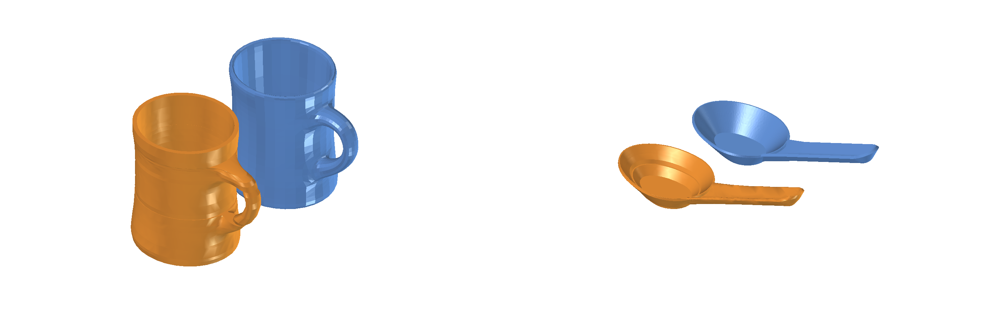
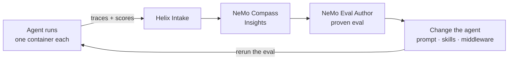
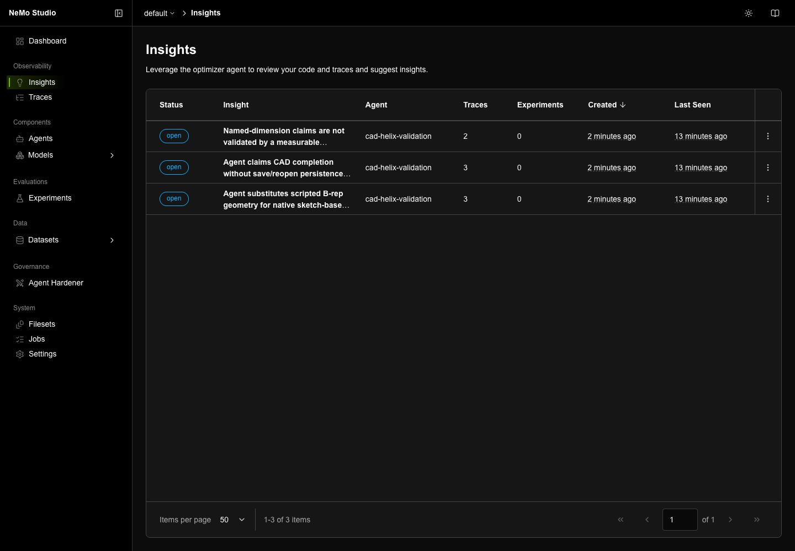

<!-- markdownlint-disable MD013 -->
<!-- SPDX-FileCopyrightText: Copyright (c) 2026 NVIDIA CORPORATION & AFFILIATES. All rights reserved. -->
<!-- SPDX-License-Identifier: Apache-2.0 -->
<!-- markdownlint-enable MD013 -->

# CAE FreeCAD Agent Harness Optimization

| Catalog field | Value |
| --- | --- |
| Description | Runs a CAD agent next to headless FreeCAD in one container per run, traces every run to NeMo Helix, finds what it gets wrong with NeMo Compass, turns that into a proven Harbor eval with NeMo Eval Author, and improves the agent against the eval. |
| Industry | 🏭 Manufacturing |
| Requirements | Python 3.12+ · NeMo Helix 0.7.1 · Docker (Colima on macOS) · Harbor 0.22.0 · a coding agent · inference credentials |
| NemoClaw | N/A |
| Harness | LangChain Deep Agents 0.7.25 |
| OpenShell | N/A |

A worked, end-to-end harness optimization loop for an agent that drives an engineering
tool. The agent runs where the tool runs: each run gets its own container with
headless [FreeCAD](https://www.freecad.org/) and a shell, so runs are isolated and go
in parallel. [NeMo Helix](https://github.com/NVIDIA-NeMo/nemo-helix) serves the model
and keeps every run's trace; [NeMo Compass](https://github.com/NVIDIA-NeMo/nemo-compass)
finds recurring problems in those traces;
[NeMo Eval Author](https://github.com/NVIDIA-NeMo/eval-author) turns them into a
proven eval; and each change to the agent is kept only if the eval says it is better.

The agent runs on **Nemotron 3 Ultra** and must rebuild any part it is given as a
mesh, as an editable FreeCAD model. The eval holds two different parts. The base agent
saved no model in 5 minutes. Four rounds of the loop, each one pass through Steps 1 to 4
below, took it to **4 of 4**, and a confirmation run to **10 of 10**, with all seven
checks passing, in about 20 seconds of agent time per run.

## Screenshot



The task: rebuild each blue mesh as an editable FreeCAD model. Orange is the final
agent's reconstruction: a native PartDesign body of four ruled lofts through sketched
sections, driven by one named dimension (IoU 0.970 and 0.943, 50 and 62 faces). The
same skill built both; nothing in it is specific to either part. Rendered headless from
the saved files.

## At A Glance

| Question | Answer |
| --- | --- |
| Category | Developer Tool |
| Contributor or provenance | NVIDIA |
| Use this when | You have a specialised agent that drives an engineering tool, and you want to find its failures in traces, turn them into a regression eval, and improve the agent against measurement. |
| You will get | A containerized Deep Agents CAD agent with every run traced to Helix; Compass Insights in Studio; a proven Harbor eval of two parts with seven checks each; and a measured, round-by-round journey with its final agent. |
| Runs on | Any host with Docker and NeMo Helix; verified on macOS with Colima. |
| Requires | See [Prerequisites](#prerequisites). |
| Verified on | macOS, Colima (4 CPU, 16 GiB), FreeCAD 1.1.3 (conda-forge, in the images), NeMo Helix 0.7.1, Deep Agents 0.7.25, NeMo Relay 0.7.3, NeMo Compass `462f09c`, NeMo Eval Author `20f95a0`, Harbor 0.22.0. |
| Evidence level | Live end to end with Nemotron 3 Ultra (see [Results](#results)); unit tests for the IoU math and `publish.py`. |
| Support and maturity | Compass and Eval Author are research previews. [Best-effort community support](../../../SUPPORT.md). Pin versions. |
| External access, data, and actions | Installation downloads packages and images. Live runs send prompts, geometry descriptions, traces and the Ethos to your inference endpoints and write telemetry to your Helix instance. The agent runs Python it writes, inside its own container, which can reach only Helix. |
| Start here | [Prerequisites](#prerequisites) |
| Confirm success | [Verification](#verification) |

## Why this exists

General-purpose harnesses are strong at orchestration, but they do not carry your
domain. Turning a mesh into a **parametric CAD model** is a good example: the result
has to be a real feature tree of sketches and features with dimensions a designer
can change. A model that looks right but cannot be edited is worthless, and an agent
that reports success is not evidence that it succeeded.

Closing that gap is **harness engineering**: changing the system prompt, skills,
subagents and middleware until a general harness behaves like a specialist. This
example makes every change answer to measurement:



Nothing here is CAD-specific: swap FreeCAD for your solver, mesher or CAD kernel.

## How it runs

Each eval trial is one container, built from the task's
[environment](evals/part-1-reconstruction/environment/Dockerfile): FreeCAD 1.1.3
(headless `freecadcmd`), the Deep Agents runtime, NeMo Relay, and the part's mesh.

```text
harbor run -n 4 (host)                                 NeMo Helix (host)
 │                                                     ┌──────────────────────────┐
 ├─ trial ─▶ task container ───── model calls ────────▶│ inference gateway → model │
 │           /agent  agent.yaml, skills/ (uploaded)    │ Intake: traces + scores   │
 │           /app    reference.obj → model.FCStd       │ Compass · Studio          │
 │           shell + freecadcmd, 5 min, 3 GiB ─ trace ▶└──────────────────────────┘
 │                    │ model.FCStd
 │                    ▼
 │           verifier container (no network): 7 checks → reward
 ├─ trial ─▶ … (in parallel, one container each)
 └─ publish.py scores: reward, IoU, failed checks, complexity → each trace
```

| Piece | What it does |
| --- | --- |
| [agent/agent.yaml](agent/agent.yaml) | The agent: name, model, a short system prompt. `skills/` and an optional `middleware.py` sit beside it. This folder is all the loop changes. |
| [harness/run_agent.py](harness/run_agent.py) | Inside the container: builds the Deep Agents agent from the folder with a real shell rooted at `/app` (`LocalShellBackend`), its skills and middleware; reaches the model through the Helix gateway; traces the run with NeMo Relay to Intake; stops it after 5 minutes. |
| [harness/cad_agent.py](harness/cad_agent.py) | The Harbor agent: uploads the agent folder and starts the runner in each trial's container. |
| [evals/](evals/README.md) | Two Harbor tasks with one instruction and one verifier: the agent saves `/app/model.FCStd`, and a separate, network-less container grades it. |
| [publish.py](publish.py) | After a job, attaches each run's grade to its Intake trace; publishes Compass Insights to Studio. |
| [controls/](controls/) | Negative controls that prove each check fails what it should. |
| [ETHOS.md](ETHOS.md) | What the agent is for, how and where it runs, and what may be changed. Compass, Eval Author and the experimenter all read it. |
| [skills/cad-experimenter](skills/cad-experimenter/SKILL.md) | The process one round of the loop follows. |

The agent sees real paths: the mesh at `/app/reference.obj`, its skills under
`/agent/skills/`, and any file it writes. A skill can ship helper scripts that the
agent runs with `freecadcmd`, with no code copied through the prompt. The container's
network reaches only Helix, so a run cannot see other runs, the eval's solution, or
the rest of your machine.

## Results

A run passes only when all seven checks of the eval pass:

| Check | What it verifies |
| --- | --- |
| `recomputes-after-reopen` | Every feature rebuilds from its inputs after the file is reopened. |
| `single-valid-solid` | One PartDesign body with one solid that passes FreeCAD's full shape check, including self-intersections. |
| `native-feature-tree` | The solid is built from sketches by native PartDesign features, not a scripted shape. |
| `named-dimension-drives-geometry` | Changing a named dimension by 10% rebuilds one clean solid whose size changes by at least 1%. |
| `mesh-fidelity` | The solid overlaps the reference mesh with IoU ≥ 0.9. |
| `single-visible-object` | Only the finished model is visible when the file is opened. |
| `compact-model` | At most 10× the faces of the reference solution: a designer's model, not a stack of slices. |

Each round ran both parts twice, all four runs in parallel (eight when two candidates
were measured at once), 5 minutes per run:

| Round | Change to the agent | Runs passed | Checks (of 28) | Part 1 IoU | Part 2 IoU | Tokens per run |
| --- | --- | --- | --- | --- | --- | --- |
| 0. Base agent | | 0/4 | 0 | | | 1.9 M |
| 1. A skill with a helper script | Time budget in the prompt; a skill whose script builds, saves and checks the model in one command (stacked slices) | 0/4 | 22 | 0.91, 0.92 | 0.78 | 0.04 M |
| 2. Ruled lofts (rejected) | One loft per segment instead of slices | 0/4 | 18 | invalid solid | 0.85 | 0.08 M |
| 3. **Valid joints, a sound IoU estimate** | Joints as flat steps with shared sections; a ray-cast IoU estimate the agent can trust | **4/4** | **28** | **0.97** | **0.94** | **0.02 M** |

After round 1, Compass found that the model was "a dense stack of slice sketches and
pads" that passed every check; Eval Author added `compact-model` and proved it, and
rounds 0 and 1 are shown re-graded with it. The final agent
([results/final-agent](results/final-agent/agent.yaml)) then passed **10 of 10** runs,
five per part. What each round found and taught is in [results/](results/README.md).

## Prerequisites

- **[uv](https://docs.astral.sh/uv/) 0.10.10 or later** and Python 3.12+.
- **Docker** that can enforce per-container network rules. On macOS, Docker Desktop
  cannot; use [Colima](https://github.com/abiosoft/colima), and keep the example
  under your home folder (Colima mounts only that).
- **A coding agent** for Eval Author's skills and the experiment step. Eval Author
  supports [Claude Code, Codex, Cursor and others](https://github.com/NVIDIA-NeMo/eval-author/blob/main/docs/getting-started.md#install-eval-author-with-npx).
- **An inference provider** with a tool-calling model for the agent (this example uses
  Nemotron 3 Ultra) and one with structured output for Compass.

Install NeMo Helix, Harbor and Compass, then start Helix and Colima:

```bash
uv tool install "nemo-helix[all]==0.7.1"
uv tool install harbor==0.22.0
uv tool install 'insight-agent @ git+https://github.com/NVIDIA-NeMo/nemo-compass.git@462f09c'
nemo setup
colima start --cpu 4 --memory 16
export DOCKER_HOST="unix://$HOME/.colima/default/docker.sock"
```

`nemo setup` starts the services, registers your inference provider and discovers its
models; Studio opens at `http://localhost:8080/studio/`. See the
[Helix setup guide](https://docs.nvidia.com/nemo-helix/documentation/get-started/setup/).
Then tell the tools where Helix is:

```bash
export NHX_BASE_URL=http://localhost:8080                 # from this host
export CAD_HELIX_URL=http://host.docker.internal:8080     # from the containers
```

Each trial is capped at 3 GiB; 16 GiB fits four trials in parallel (`-n 4`).

## Start Here

```bash
cd examples/tools/cae-freecad-agent-harness-optimization
```

### Step 1: Run the agent and score every run

[agent/agent.yaml](agent/agent.yaml) is the base agent: three lines of prompt and no
skills. Pick a model from `nemo models list --all-pages` and run both tasks, two
attempts each, four at a time:

```bash
PYTHONPATH=harness harbor run -y -p evals -a cad_agent:CadAgent \
  -m nvidia-nvidia-nemotron-3-ultra --n-attempts 2 -n 4 --jobs-dir runs --job-name base
python publish.py scores runs/base
```

The first build of the task image takes a few minutes. Each trial's
`verifier/results` lists the seven checks; `agent/run.log` starts with the run's trace
ID, and `publish.py scores` attaches the reward, IoU, failed checks and complexity to
that trace, so Compass can see how each run was graded.

The [Ethos](ETHOS.md) is what those scores are for: what the agent is for, what it
must not do, and what success looks like (here, an IoU of 0.9 or more *from a native,
editable, compact feature tree*, never one without the other). See the
[Ethos guide](https://github.com/NVIDIA-NeMo/eval-author/blob/main/ethos/README.md).

### Step 2: Find the problems with NeMo Compass

[NeMo Compass](https://github.com/NVIDIA-NeMo/nemo-compass) reads a set of traces and
reports recurring problems as **Insights**, each backed by at least two traces. It
finds them with [Compass signals](https://github.com/NVIDIA-NeMo/nemo-compass/blob/main/docs/compass-signals.md),
each of which runs only when the traces carry what it needs:

| Signal | What it looks for | Needs |
| --- | --- | --- |
| Ethos divergence | Behavior that breaks the agent's purpose, rules or boundaries | `ETHOS.md` |
| Grader failures | What poorly scored runs have in common | Scores on the traces, from Step 1 |
| Tool issues | Failing, invalid or misused tool calls | Tool spans and schemas, which NeMo Relay records |
| Anomalies and patterns | Unusual runs and recurring behavior | Varied traces |
| User sentiment | Recurring user complaints | User messages and an embedding model (off here) |

Copy [.env.example](.env.example) to `.env`, fill in Compass's model, and run it over
the window (UTC) of your Step 1 runs:

```bash
cp .env.example .env
insight-agent --config analyst.yaml --trace.intake.base-url $NHX_BASE_URL \
  --trace.intake.query.started-at-gte <start> --trace.intake.query.started-at-lte <end>
uv run --with pyyaml python publish.py insights insights.yml
```

[analyst.yaml](analyst.yaml) points Compass at Intake and gives it `ETHOS.md` and the
agent folder, so it can check each finding against the agent's configuration.



### Step 3: Turn the Insights into an eval with NeMo Eval Author

An Insight says what went wrong. To know whether a change fixes it without breaking
something else, you need an **eval**: tasks with checks that grade any version of the
agent the same way. [NeMo Eval Author](https://github.com/NVIDIA-NeMo/eval-author) is a
set of skills that guides a coding agent to build those evals from your agent's code,
its Ethos and its traces:

```bash
npx skills add NVIDIA-NeMo/eval-author --skill '*' --agent <your-coding-agent> --yes
```

Ask your coding agent to run `eval-author-trace-environment` on a trace the Insights
cite. It turns the trace into a [Harbor](https://www.harborframework.com/) task and
will not sign it off until it is proven: an empty submission scores 0, the reference
solution scores 1, and a realistic wrong answer scores 0, with no network access. Here
it produced [part-1-reconstruction](evals/part-1-reconstruction/); a second part,
[part-2-reconstruction](evals/part-2-reconstruction/), checks that the agent's method
is not tuned to one shape. Each time you rerun Compass, ask Eval Author
(`eval-author-task-create`, proposal mode) whether the eval already catches each new
Insight. That is how `recomputes-after-reopen` and `compact-model` were added
([evals/](evals/README.md) has the checks, the controls and how to rerun them).

### Step 4: Change the agent and measure it

Neither Compass nor Eval Author changes the agent. This example does that with a skill
written for it, [cad-experimenter](skills/cad-experimenter/SKILL.md): read the
Insights and their traces, diagnose, build up to two candidate agent folders, test
them in the agent's own image, and report. Install it for your coding agent and ask it
to run a round:

```bash
npx skills add ./skills --skill cad-experimenter --agent <your-coding-agent> --yes
```

A candidate is a copy of the agent folder: system prompt, skills (with helper
scripts), subagents or middleware; the Ethos's Change Scope says what may change.
Measure it exactly like Step 1, pointing Harbor at the candidate folder:

```bash
PYTHONPATH=harness harbor run -y -p evals -a cad_agent:CadAgent -m <model> \
  --ak agent_dir=$PWD/experiments/<round>/candidates/<name>/agent \
  --n-attempts 2 -n 4 --jobs-dir runs --job-name <name>
python publish.py scores runs/<name>
```

Keep a candidate only if it passes more runs than the agent under study (or as many
runs and more checks), with no part and no check worse. Copy the winner over `agent/`,
mark the Insights it fixed as resolved in Studio, and start the next round at Step 1.

## Environment variables

Compass reads its model from `.env` ([.env.example](.env.example)). Everything else is
read from your shell:

| Variable | Default | What it does |
| --- | --- | --- |
| `NHX_BASE_URL` | `http://localhost:8080` | Helix as this host reaches it, for `publish.py`. |
| `CAD_HELIX_URL` | `http://host.docker.internal:8080` | Helix as the containers reach it: the model gateway and Intake. |
| `NHX_WORKSPACE` | `default` | The Helix workspace, for both. |
| `DOCKER_HOST` | Docker's default | The Colima socket on macOS. |

The 5-minute run limit and 3 GiB memory cap live in each task's
[task.toml](evals/part-1-reconstruction/task.toml). Keep credentials in Helix
(`nemo setup`) or `.env`, never in `agent.yaml`.

## Troubleshooting

| Symptom | Cause | Fix |
| --- | --- | --- |
| `harbor run` stops at a prompt about environment variables | The tasks read `CAD_HELIX_URL` and `NHX_WORKSPACE` from your shell. | Pass `-y`. |
| The verifier or agent container fails to start | Docker Desktop on macOS cannot enforce Harbor's network rules. | Use Colima, with the example under your home folder. |
| Every run fails to reach the model | The container cannot resolve or reach `CAD_HELIX_URL`. | Check Helix's port; on native Linux, map `host.docker.internal` to the host gateway. For Helix on another host, also change `allowed_hosts` in each `task.toml`. |
| `publish.py scores` skips a trial | Its trace never reached Intake (the run was killed before NeMo Relay sent it). | Rerun the trial. |
| A trial is killed by memory | FreeCAD's full shape check on a model with thousands of faces needs several GB. | That is the 3 GiB cap working; such a model fails `compact-model` anyway. |

## Known limitations

- **Two parts, few runs.** Two runs per part per round, ten for the final agent; the eval
  shows the method works for two different parts, not for every part. An agent you mean
  to ship needs tasks covering the work it will see.
- **Compact, not yet a designer's tree.** The final models are four ruled lofts through
  24-27 sections driven by one named dimension. They pass `compact-model`, but a designer
  would revolve what is round and name more dimensions. Compass raised this; Eval Author
  found no geometry-agnostic check for it yet ([results/](results/README.md#insights-that-stayed-open)).
- **The agent's report overstates.** It reported "only the Body visible" when origin
  datums and a spreadsheet were too; the saved file is what is graded.
- **`single-visible-object` reads saved visibility.** A file whose Body is hidden but whose
  tip is visible passes; whether FreeCAD's GUI then shows the part is unconfirmed.
- **The eval's network rule is per host.** The agent's container can reach any port on
  the Helix host, not only Helix.
- **Span status is always "success".** Intake shows every span of these traces as
  successful, even a failed tool call; Compass reads the tool output instead. Platform
  feedback for Helix.
- **Helix deployments cannot run this agent.** Helix's Deep Agents adapter gives the agent
  a virtual file system and no shell, so the agent runs in the task container and Helix
  provides the model, traces and analysis. Platform feedback: a real-path workspace and a
  shell backend would let the same agent deploy on Helix.

## Verification

**Evidence level:** local/static for the tests below; the results above are from live
runs.

```bash
uv run --python 3.13 --with-requirements requirements.txt python -m unittest discover -s tests
```

**Expected result:**

```text
Ran 39 tests

OK
```

**This verifies:** the verifier's IoU arithmetic and how `publish.py` reads trace IDs
and grades, without credentials, services or Docker.

**This does not verify:** the live path. For that, run the controls in
[evals/](evals/README.md#rerun) (NOP 0, Oracle 1, every negative 0), then Step 1: four
trials that each report seven checks, and their traces in Intake with `reward` and
`iou` attached.

## Teardown

```bash
colima stop
```

`runs/` and `experiments/` are git-ignored; delete them freely. Harbor removes each
trial's containers; `docker image prune` removes the task images.

## Provenance and license

Contributed by NVIDIA under the repository's [Apache-2.0 license](../../../LICENSE).
The eval tasks were authored with NeMo Eval Author; the `cad-experimenter` skill was
written for this example. NeMo Helix, NeMo Relay, NeMo Compass, NeMo Eval Author,
Harbor, Deep Agents and FreeCAD are installed by the reader (FreeCAD from conda-forge
inside the task images) and not vendored here.
