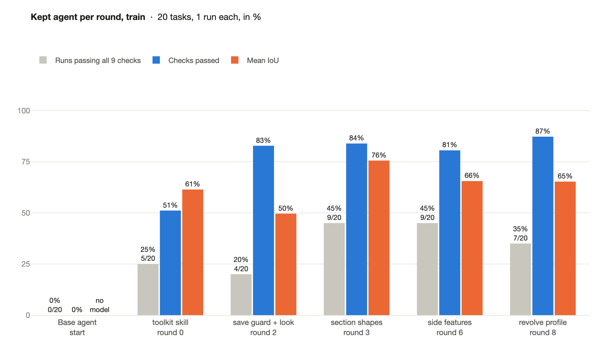
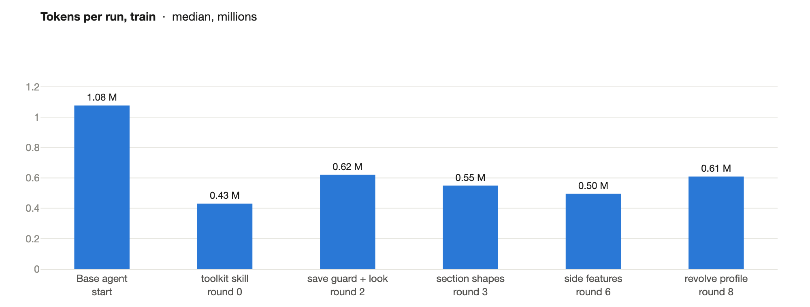
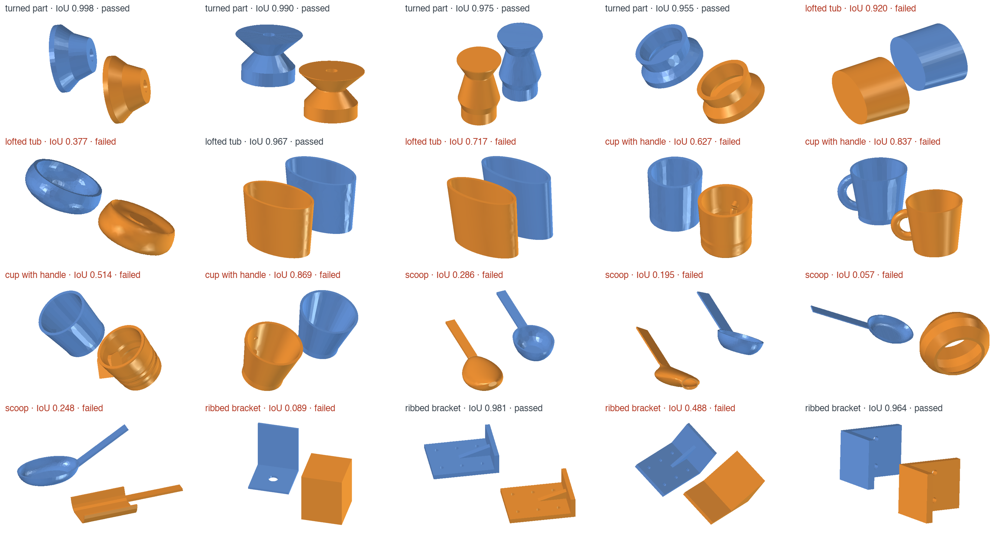

<!-- SPDX-FileCopyrightText: Copyright (c) 2026 NVIDIA CORPORATION & AFFILIATES. All rights reserved. -->
<!-- SPDX-License-Identifier: Apache-2.0 -->

# Results: Nemotron 3.5 Super VL, round by round

The agent runs on **Nemotron 3.5 Super VL**, one container per run with headless FreeCAD
1.1.3, a shell and a virtual display, 5 minutes and 3 GiB per run. Each round with a new
kept agent measured it on **train** (20 tasks, one run each); NeMo Compass read those traces
(rounds 0, 1, 3, 4 and 7; the others reused the last Insights, see
[insights/](insights/README.md)), the
orchestrator checked whether the eval caught each Insight, and two fresh experimenters
([cad-experimenter](../skills/cad-experimenter/SKILL.md)) built one candidate each from
train alone. Each candidate was measured on **val** (7 tasks, two runs each) and kept only
if it passed more runs than the agent under study, or as many runs and more checks, with
no check passing fewer times. **Test** was read once, at the end.

- [final-agent/](final-agent/): the final agent, described in the
  [README](../README.md#what-the-loop-built).
- [insights/](insights/README.md): every Compass Insight, whether the eval caught it, and what
  resolved it.
- [rounds.json](rounds.json): every agent's results on train, val and test, from which
  [charts.py](charts.py) draws the charts below.

## The kept agent of each round

## Every candidate

Every candidate, by the round that measured it. Each round, two experimenters each built
one candidate from the kept agent; *Where it changed* is the layer and files of the agent
folder it edited (no candidate used a subagent). *Train* is one run per task, *val* two.

| Round | Candidate (change to the kept agent) | Where it changed | Train passed | Val passed | Val checks | Decision |
| --- | --- | --- | --- | --- | --- | --- |
| start | base agent: a two-sentence prompt, no skills | the base agent: `agent.yaml` | 0/20 | 0/14 | 0/126 | no run saved a model |
| 0 | skill `cad-toolkit`: frame finder for posed meshes, section lister, sketch and feature building blocks, verify | prompt; new skill `cad-toolkit` (`SKILL.md`, `measure.py`, `sections.py`, `sketchkit.py`, `verify.py`) | 5/20 | 4/14 | 85/126 | **kept** |
| 0 | clock, build gate after 90 s, no silent end (middleware) | prompt; new middleware (`middleware.py`) | 0/20 | 0/14 | 25/126 | dropped |
| 1 | save guard: reopens each save, rolls back a failing one; status line; no silent end | prompt; new middleware (`middleware.py`) | 4/20 | 3/14 | 97/126 | dropped: more valid saves, one pass fewer |
| 1 | `look.py`: the agent renders mesh and model in the part's frame and reads the image | prompt; skill: `SKILL.md`, new `look.py` | 4/20 | 4/14 | 74/126 | dropped: it caught gross errors, but each look cost a turn |
| 2 | section shapes: each loop fitted as circle, ellipse, rectangle or polygon; a survey of holes, walls and side loops | skill: `SKILL.md`, `sections.py`, `sketchkit.py` | 5/20 | 6/14 | 91/126 | dropped by one run with no model (mean IoU 0.94 against 0.66) |
| 2 | save guard and look combined: no look before a valid save, one after it, none under 90 s left | prompt; new middleware (`middleware.py`); skill: `SKILL.md`, new `look.py` | 4/20 | 4/14 | 107/126 | **kept** |
| 3 | section shapes and survey on the guarded-look agent, one 7-step workflow | skill: `SKILL.md`, `sections.py`, `sketchkit.py` | 9/20 | 7/14 | 114/126 | **kept** (tubs pass) |
| 3 | named dimensions: polygon edges move whole, a probe after each save | prompt; skill: `SKILL.md`, `sketchkit.py`, `verify.py` | 5/20 | 4/14 | 100/126 | dropped: the probe costs time |
| 4 | side features: `sides.py` measures each feature off the body (arc and section, or outline) | skill: `SKILL.md`, new `sides.py`, `sketchkit.py` | 10/20 | 8/14 | 110/126 | dropped by one run with no model (cups with handles and brackets pass for the first time) |
| 4 | the cheap half of the dimension fix | skill: `SKILL.md`, new `dims.py`, `sketchkit.py`, `verify.py` | 6/20 | 5/14 | 114/126 | dropped |
| 5 | side-feature recipe in a file read on demand, after the first save | skill: `SKILL.md`, new `sides.py` and `SIDES.md`, `sketchkit.py` | 8/20 | 7/14 | 113/126 | dropped by one check |
| 5 | the agent's own verify 10× faster (it had stalled loft runs for 47-167 s) | skill: `verify.py` | 4/20 | 5/14 | 112/126 | dropped |
| 6 | a `build.py` skeleton: write once, then edit | middleware; skill: `SKILL.md`, new `build_skeleton.py` | 5/20 | 6/14 | 114/126 | dropped |
| 6 | side-feature tools, fast verify, and the guard runs `sides.py` at the first save and names what is missing | middleware; skill: `SKILL.md`, new `sides.py` and `SIDES.md`, `sketchkit.py`, `verify.py` | 9/20 | 11/14, re-measured 9/14 | 118/126 | **kept by judgement** (below) |
| 7 | a save-first gate: after 120 s with no valid model, only code that saves the model runs | middleware | 6/20 | 7/14 | 117/126 | dropped: an early forced save costs passes |
| 7 | arms measured through 11 cross-sections (their radius had been 17-27% short), built in one call | skill: `SKILL.md`, `SIDES.md`, `sides.py`, `sketchkit.py` | 9/20 | 10/14 | 120/126 | dropped: the kept agent's pass rate over its two val measurements, but `no-missing-feature` 71% against 79% |
| 8 | `profile.py`: the revolve axis found ignoring arms, the half-section printed exactly | skill: `SKILL.md`, new `profile.py` | 7/20 | **11/14** | **123/126** | **kept: the final agent** (every val run a valid model, mean IoU 0.95) |
| 8 | the arm fit again, with flat-section arms and false arm reports fixed | skill: `SKILL.md`, `SIDES.md`, `sides.py`, `sketchkit.py` | 7/20 | 11/14 | 114/126 | dropped |

## Every agent the loop measured

*Round* is the round that measured the candidate. Train: one run per task; val: two.
*Val IoU* is the mean over val runs that saved a model; *tokens* the median per val run,
from the traces.

| Round | Agent | Decision | Train passed | Train checks | Val passed | Val checks | Val IoU | Val tokens / run |
| --- | --- | --- | --- | --- | --- | --- | --- | --- |
| start | `base` | base agent | 0/20 | 0/180 | 0/14 | 0/126 | – | 0.87 M |
| 0 | `r1-skills` | **kept** | 5/20 | 92/180 | 4/14 | 85/126 | 0.66 | 0.45 M |
| 0 | `r1-process` | dropped | 0/20 | 37/180 | 0/14 | 25/126 | 0.00 | 2.60 M |
| 1 | `r2-process` | dropped | 4/20 | 127/180 | 3/14 | 97/126 | 0.53 | 0.52 M |
| 1 | `r2-vision` | dropped | 4/20 | 98/180 | 4/14 | 74/126 | 0.61 | 0.35 M |
| 2 | `r3-shapes` | dropped | 5/20 | 96/180 | 6/14 | 91/126 | 0.94 | 0.38 M |
| 2 | `r3-lookguard` | **kept** | 4/20 | 149/180 | 4/14 | 107/126 | 0.61 | 0.60 M |
| 3 | `r4-shapes` | **kept** | 9/20 | 151/180 | 7/14 | 114/126 | 0.92 | 0.39 M |
| 3 | `r4-dims` | dropped | 5/20 | 152/180 | 4/14 | 100/126 | 0.61 | 0.46 M |
| 4 | `r5-sides` | dropped | 10/20 | 150/180 | 8/14 | 110/126 | 0.86 | 0.37 M |
| 4 | `r5-dims` | dropped | 6/20 | 156/180 | 5/14 | 114/126 | 0.91 | 0.39 M |
| 5 | `r6-sides` | dropped | 8/20 | 156/180 | 7/14 | 113/126 | 0.88 | 0.38 M |
| 5 | `r6-fast` | dropped | 4/20 | 149/180 | 5/14 | 112/126 | 0.83 | 0.66 M |
| 6 | `r7-edit` | dropped | 5/20 | 153/180 | 6/14 | 114/126 | 0.93 | 0.58 M |
| 6 | `r7-sides` | **kept by judgement** | 9/20 | 145/180 | 11/14 | 118/126 | 0.94 | 0.53 M |
| 7 | `r8-safe` | dropped | 6/20 | 136/180 | 7/14 | 117/126 | 0.85 | 0.41 M |
| 7 | `r8-arms` | dropped | 9/20 | 162/180 | 10/14 | 120/126 | 0.89 | 0.36 M |
| 8 | `r9-body` | **kept: the final agent** | 7/20 | 157/180 | 11/14 | 123/126 | 0.95 | 0.42 M |
| 8 | `r9-arms` | dropped | 7/20 | 134/180 | 11/14 | 114/126 | 0.95 | 0.43 M |

Agents are named as in the run's logs, in the order of [Every candidate](#every-candidate)
(the base agent first). **The keep rule and one judgement.** `r7-sides` (round 6) failed the rule only
because one of its 14 val runs saved no valid model (a self-intersecting solid), which
costs every structural check at once. Measured again, it passed 9 of 14 against the kept
agent's 7, and was kept by that judgement; rounds 7 and 8 compared candidates with both of
its measurements. Every other decision is the rule's. The charts show its first
measurement.

## The final agent on every split

Each sheet shows the final agent's best run per task: its model (orange) beside the mesh
(blue).

**Train** (one run per task; 7 of 20 passed). Every turned part passes, and two of the
four brackets and one tub; no cup reaches the IoU bar (0.51-0.87), and no scoop does
(0.06-0.29: its bowl and handle defeat the agent's reading of the part).

**Val** (two runs per task; 11 of 14 passed, and every task at least once).

**Test** (five runs per task, read once):

| Test slice | Base agent | Final agent |
| --- | --- | --- |
| Sizes outside the training range (3 tasks) | 0/15 | **7/15** (turned part 5/5, tub 1/5, cup 1/5) |
| A family never trained on (2 tee fittings) | 0/10 | 0/10 |
| The two hand-made parts | 0/10 | 0/10 |
| **Runs passing all nine checks** | **0/35** | **7/35** |
| **Checks passed** | **1/315** | **256/315 (81%)** |

Every test run of the final agent saves a native feature tree that recomputes after
reopening (35/35), and all but one a single valid solid; what fails is fidelity
(`mesh-fidelity` 7/35) and missing features (`no-missing-feature` 17/35).

## Why val reads higher than train

The final agent passes 79% of val runs but 35% of train runs. No val task, mesh or trace
is named in any agent or experimenter file, and the agent's container holds only its own
task; the gap has two sources:

- **The split was drawn without balancing families.** Val has no scoop, the family the
  agent fails on train every time, and proportionally more turned parts, which it passes
  every time. At its train pass rate per family, val would score about 6 of 14.
- **Selection on 14 runs.** Each round kept the candidate that scored best on val, which
  flatters the winner: `r7-sides` passed 11 of 14 and then 9 of 14 on the same agent.

Test agrees with the lower number: 7 of 15 on new sizes of the trained families. A next
run should draw val with every family in it, and use more tasks and runs per task.

## What we learned

- **Vision helps when it is gated.** The model reads its renders and catches errors no
  number names (a solid where the part is hollow, a square body for a round one). Looking
  before a valid model is saved costs the run; one look after it pays.
- **Time is the binding constraint.** With 5-minute runs and model turns that can take a
  minute, several dropped candidates lost a run to the clock. Knowledge that is printed by a
  tool, ready to copy, costs less time than knowledge the model has to read and apply.
- **The experimenters found real bugs by measuring.** An IoU estimate that tested 20,000
  points one at a time; an arm radius 17-27% short because the arc was fitted only to the
  surface outside the body; a polygon helper that turned rectangles into trapezoids.
- **Small val sets need care.** Fourteen runs make one bad run decisive, and an
  unbalanced split makes val easier than train. Re-measuring before a judgement, and
  reading test once at the end, kept the report honest.
- **Generated tasks generalize within their families.** The agent learned the generator's
  parts, not yet parts in general.

## Open points

- **The method transfers within the families it was improved on**, not yet to a new
  family (tee fittings, 0/10) or to the two hand-made parts (0/10).
- **Tokens do not fall round by round.** Richer toolkits add some back; the final agent
  uses about half the base agent's tokens (val 0.87 M to 0.42 M per run).
- **Dimensions that move the part independently** pass every val run but fail 7 of 35
  test runs.

Run folders, traces and experimenter notes stay in the git-ignored `experiments/` folder.
