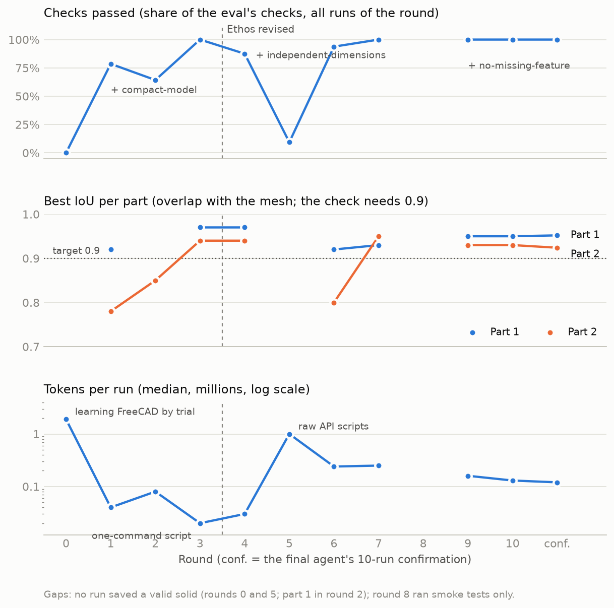

<!-- SPDX-FileCopyrightText: Copyright (c) 2026 NVIDIA CORPORATION & AFFILIATES. All rights reserved. -->
<!-- SPDX-License-Identifier: Apache-2.0 -->

# Results: Nemotron 3 Ultra, round by round

The agent runs on **Nemotron 3 Ultra**, one container per run with headless FreeCAD 1.1.3
and a shell, 5 minutes and 3 GiB per run. Each round ran both eval tasks twice, all runs in
parallel; then NeMo Compass read the round's traces, NeMo Eval Author checked whether the
eval caught each Insight, and a fresh experimenter
([cad-experimenter](../skills/cad-experimenter/SKILL.md)) built up to two candidates. A
candidate was kept only if it passed more runs than the agent under study (or as many runs
and more checks), with no part and no check worse.

Every Compass Insight, the check that caught it and the round that fixed it:
[insights/](insights/README.md). The final agent: [final-agent/](final-agent/), described
in the [README](../README.md#what-the-loop-built). The chart is drawn by
[rounds_chart.py](rounds_chart.py).

## Chapter 1: the original Ethos

Checks are out of 28 (four runs, seven checks).

| Round | What Compass, Eval Author and the traces showed | Change | Runs | Checks | Part 1 IoU | Part 2 IoU | Tokens / run |
| --- | --- | --- | --- | --- | --- | --- | --- |
| 0. Base agent | Every run spent its 5 minutes studying the mesh or learning FreeCAD by trial and error; none saved a model. | | 0/4 | 0 | | | 1.9 M |
| 1. A skill with a script (kept) | No plan and no sense of time. | Three prompt lines (a time budget; save a checked model early) and a skill whose script builds the model in one command: a stack of flat slices, one named size, save, reopen, self-check. | 0/4 | 22 | 0.91, 0.92 | 0.78 | 0.04 M |
| | **Compass:** "every model is a dense stack of slices", and on part 1 the stacks passed every check. | **Eval Author added `compact-model`** (at most 10 times the faces of a designer's model); the slice stack became its proof that the check fails what it should. | | | | | |
| 2. Smooth lofts (rejected) | The 1,700-face stacks fail the new check, and flat slices turn sloped walls into stairs. | One smooth shape through the cross-sections of each stretch of the part. The pieces did not join into one valid solid. | 0/4 | 18 | invalid solid | 0.85 | 0.08 M |
| 3. Clean joints and a trustworthy estimate (kept) | Where the branch meets the body two walls almost touched; the script's own overlap estimate ranked the attempts wrongly. | Joints as small flat steps; a better overlap estimate; "a model that fails FreeCAD's shape check is invalid". | **4/4** | **28** | 0.97 | 0.94 | 0.02 M |

A confirmation passed **10 of 10**: the agent read one skill and ran one command, and all
ten models were identical.

## The Ethos revision

The models matched the meshes and passed every check, but a designer could only make the
part taller: one parameter stretched every section, and the agent's only modelling step was
running the script. This is the shortcut the
[Eval Author team warns about](https://github.com/NVIDIA-NeMo/eval-author/blob/main/docs/dev-notes/posts/2026-10-08-introducing-eval-author.md):
a task passed while the behaviour it was meant to test was missing. The owner added to
[ETHOS.md](../ETHOS.md): the agent writes its own model (skills carry knowledge, never a
complete routine); dimensions express design intent; the method generalizes. Eval Author
turned the second into **`independent-dimensions`**, two named dimensions that move the
part in different ways. Re-graded, the chapter-1 agent fell from 10/10 to **0/10**, and
Compass reported that "the agent delegates the modelling to a fixed script".

## Chapter 2: the revised Ethos

Checks are out of 32 (four runs, eight checks).

| Round | What Compass, Eval Author and the traces showed | Change | Runs | Checks | Part 1 IoU | Part 2 IoU | Tokens / run |
| --- | --- | --- | --- | --- | --- | --- | --- |
| 4. Chapter-1 agent | Fails only `independent-dimensions`. **Compass:** "the agent delegates the modelling to a fixed script". | | 0/4 | 28 | 0.97 | 0.94 | 0.03 M |
| 5. The agent models (rejected) | | Knowledge skills (how to measure, build and check) with small helpers; the agent plans and writes its own build script. A measuring subagent in the second candidate. | 0/4 | 3 | | | 1.0 M |
| | 21 rewrites of 200-line scripts calling FreeCAD directly in 9 minutes: errors, mixed-up coordinates, sizes that drive nothing, nothing saved. 10-minute runs did not help. | | | | | | |
| 6. Building blocks per feature (kept) | | `cadkit.py`: a body through measured cross-sections, holes, tubes and more, in world coordinates, every size a named dimension; build the body first and save, then one feature at a time. A planner subagent. | 2/4 | 30 | 0.90, 0.92 | 0.27, 0.80 | 0.24 M |
| 7. A clock and "what is wrong where" (kept) | **Compass:** models below the overlap target; runs that end with no reply. One wrong decision per run that the agent never saw (the body built to the top of the bounding box, a hole through the floor, a branch never built); no sense of time. | Middleware: a clock on every tool result and a request to report at 240 s. A save that lists the missing and extra regions; a structure summary of the part. Planner dropped. | **4/4** | **32** | 0.93, 0.93 | 0.95, 0.92 | 0.25 M |

This agent passed a 10-run confirmation with every check.

## Chapter 3: looking at the models

Rendered from four directions, the chapter-2 models had creases where the branch meets the
body, seams between sections and a pinched arm, none of which a check measured. Checks
are out of 32, then 36 (nine checks).

| Round | What Compass, Eval Author and the traces showed | Change | Runs | Checks | Part 1 IoU | Part 2 IoU | Tokens / run |
| --- | --- | --- | --- | --- | --- | --- | --- |
| 8. Smoother bodies (rejected) | Every blemish came from a building block, the same in all ten runs. | A smooth body, no seams where the branch joins, smoothed outlines, branches built along their own direction. Part 1's blemishes went; part 2's arm would no longer join the smoothed rim. | smoke only | | 0.95 | 0.63 | |
| 9. The arm on the rim (4/4, then 3/4) | The arm met the body at such a shallow angle that FreeCAD could not join them cleanly. | The arm starts on the rim's flat top, so the two meet on one flat surface; a rounded tip measured from the mesh. | **4/4** | **32** | 0.92, 0.95 | 0.92, 0.93 | 0.16 M |
| | Two part-1 runs saved the model without its branch and still passed every check (IoU 0.918). | **Eval Author added `no-missing-feature`**: the largest piece of the part the model leaves out must be at most 1.2% of its volume. Round 9 re-graded: 3/4. | | | | | |
| 10. A branch that is never dropped (kept) | The agent edited the branch path's ends by hand and got one wrong; the branch failed, was left out, and nothing told the agent. | The measurement prints the whole path with its ends inside the wall; the tube repairs a bad path or falls back to the measured one; the save reports COMPLETE or INCOMPLETE. | **4/4** | **36** | 0.95, 0.95 | 0.92, 0.93 | 0.13 M |

**Confirmation** of the final agent: **10 of 10**, five per part, all nine checks passing:
part 1 IoU 0.949-0.952 with 18 faces, part 2 0.910-0.924 with 38-39 faces, about 3.5
minutes and 0.12 M tokens per run.

## What the rounds taught

- **The Ethos decides what "good" means.** The loop delivered what the first Ethos asked
  for, and it was not what the owner wanted. One revision and one new check redirected it.
- **Eval Author makes the Ethos bite.** Only a check changes the score: `compact-model`,
  `independent-dimensions` and `no-missing-feature` each turned a passing agent into a
  failing one and pointed the loop at the gap.
- **Compass finds what to fix.** Its Insights named the slice stacks, the delegated
  script, the low fidelity and the silent runs, each with the traces that show it
  ([insights/](insights/README.md)).
- **Give the model decisions, not plumbing.** Raw FreeCAD API code failed; feature-level
  blocks that leave the choice of features to the agent succeeded.
- **Subagents were tried and dropped.** A measuring subagent and a planner subagent handed
  the main agent lossy summaries; one agent with good measurement output did better.
- **Let the agent see what it cannot measure.** A clock, a save that names what is missing
  and a structure summary removed the single wrong decisions that failed runs.
- **Look at the models.** Renders showed artefacts no check measured, and fixing them
  exposed the last gap in the eval.
- **More time is not more skill.** 10-minute runs bought more failed rewrites, not
  convergence.

## Open points

- **Two parts, no held-out or rotated part.** Both scores are training scores.
- **The measurement scripts suggest feature calls.** The agent still decides and writes the
  model, and Compass found no Ethos divergence, but it sits close to the Ethos's line.
- **Thin missing features.** `no-missing-feature` sees a missing piece thicker than about
  3% of the part's size; part 2's fidelity margin is moderate (IoU 0.91-0.92).

Run folders, traces and experimenter notes stay in the git-ignored `experiments/` folder;
Compass's Insights per round are in [insights/](insights/).
